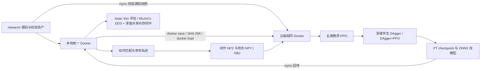

# PHP Parkour：统一 Docker 配置与运行

本分支将动作匹配、Isaac Sim 教师训练/学生蒸馏、Isaac Sim checkpoint 评估、ONNX 导出以及 MuJoCo 深度策略闭环放进同一个镜像 `php-parkour:research`。本地和云端复制同一镜像与校验过的源码、资产，宿主机不安装 Conda 或项目 Python 包。[usage.md](usage.md) 保存逐项验收与图像/视频；官方功能范围见 [README](README.md)、[训练指南](wbt_training/README.md)、[原生部署指南](wbt_training/DEPLOY.md)。

算法、状态/动作/奖励/loss、数据格式与标签来源，以及 real2sim2real 的实现和验证边界见独立的 [technical_pipeline.md](technical_pipeline.md)。

项目机器人是半球手的 Unitree G1，29 个关节。动作匹配有 17 种内置场景、29 个技能注册项；公开训练流程提供五类教师数据。动作数据库中的更多翻越技能并不自动成为公开深度策略掌握的技能。

## 1. 机器、目录与环境

| 位置 | 用途 | 持久路径 |
| --- | --- | --- |
| 本地 RTX 4070 Ti SUPER，16 GiB | 动作生成、可视化、MuJoCo、Isaac Sim 小规模评估 | 当前仓库 `outputs/research/`、`logs/` |
| `tencent-231`，8 × RTX PRO 5000，72 GB | 显存较大的官方训练 | `/diff/dzp_is_sb/php-parkour-research/` |
| 两端统一镜像 | Isaac Sim 5.1.0 / Isaac Lab 2.3.0 / Torch 2.7 CUDA 12.8 | Docker 镜像层，构建依赖均在容器中安装 |



镜像里的 `train-python` 使用 NVIDIA 的 Python 3.11.13；`motion-python` 与 `inference-python` 使用各自隔离的 Python 3.12.3 环境。动作生成/Pinocchio 的 NumPy 2 依赖与训练的 NumPy 1.26.4 分开安装。它们都属于同一镜像，绝不要求宿主安装对应环境。Isaac Lab 的产品 release 为 2.3.0，而上游 `isaaclab` Python distribution 显示 0.47.1；doctor 会同时保留实际版本。最终依赖以镜像内 `/opt/php-build/*.freeze.txt`、[版本约束](docker/) 和 doctor 报告为准。

仓库映射为 `/workspace/php_parkour`，研究产物为 `/outputs`，资产为 `/data/assets`，缓存为 `/data/cache`。镜像封存构建时的源码，可独立断网运行；日常启动挂载当前仓库，云端挂载按内容校验的源码快照。构建提交与实际挂载源码可能不同，复现时以部署记录的 `source_tree_sha256`、逐文件 manifest 和镜像 Config/RootFS 指纹共同确定版本，不能只看镜像标签。同一容器内仿真进程与推理进程共享私有 `/dev/shm`；不要给此容器启用宿主 IPC。大数据、checkpoint 和缓存不进 Git。

当前本地默认`php-parkour:research`和`php-parkour-research`容器已实际采用SDK0.1.8新统一镜像`2be18521…`，doctor与恢复后的TensorBoard6006检查通过；原0.1.6镜像保留为`php-parkour:research-sdk016-retained`。云端完整新镜像也已加载为独立candidate tag，正在运行的官方训练仍保留原冻结镜像/源码直至结束。[本地接入回执](usage_assets/reports/sdk018-local-adoption/summary.md)、[远端完整包校验](usage_assets/reports/sdk018-canonical-upload/summary.md)。

## 2. 首次克隆与构建

宿主只使用已有 NVIDIA 驱动、Docker/NVIDIA Container Toolkit、Git、SSH、rsync、gzip 和标准库 Python。以下命令均从仓库根目录执行，除非另有说明：

```bash
git clone --branch research --recurse-submodules https://github.com/superboySB/php_parkour.git
cd php_parkour
# 已有 checkout 则从这里开始
git switch research
git submodule update --init --recursive
bash scripts/research/docker.sh build
```

[Dockerfile](docker/Dockerfile) 固定 NVIDIA 官方基础镜像 digest；Holosoma 固定为 Git 子模块 commit。构建会安装容器系统库及三个运行环境，首次下载需留出足够磁盘空间。根目录及 Dockerfile 专用 `.dockerignore` 排除 Git 元数据、凭据、日志、checkpoint 和下载缓存。

无头启动本地统一容器：

```bash
bash scripts/research/docker.sh up
bash scripts/research/docker.sh doctor --require-gpu
bash scripts/research/docker.sh shell
```

`shell`进入容器交互终端；执行`exit`返回宿主后再运行本手册后续的`docker.sh`、`docker exec`和`cloud.py`命令。

需要 Tk 键盘交互或 MuJoCo 窗口时，先确认本地 X11 的变量，**在启动训练/评估前**选择 GUI 模式：

GUI compose现在令`MUJOCO_GL=egl`用于离屏depth/video渲染；可见MuJoCo passive viewer本身仍使用GLFW。真实平地验收已走通窗口8/9、终端策略/录制/速度/停止/保持按键及两份NPZ保存，双方正常退出。此前glfw离屏配置的一次析构abort原样保留；单次EGL对照通过不表示所有内存竞态均已排除。[完整交互、四次失败与最终通过证据](usage_assets/reports/native-keyboard-gui/summary.md)。

```bash
test -n "$DISPLAY" && test -f "$XAUTHORITY"
bash scripts/research/docker.sh gui
```

切换 `gui` 会重建当前容器，应先结束其中的作业。它复用同一镜像与数据目录。退出 shell 不会停止容器；`bash scripts/research/docker.sh down` 停止本项目容器，数据和缓存保留。

## 3. 下载与验证全部公开资产

以下脚本只用 Python 标准库下载文件，**不在宿主安装任何包**。它校验每个压缩包及其中每个文件，已有正确文件不会重复下载。

```bash
python3 scripts/research/verify_assets.py
python3 scripts/research/verify_assets.py --verify-only
```

| 组件 | 内容 |
| --- | --- |
| `databases` | 19 个数据库、32 个 OBJ 与 32 个地形描述 JSON |
| `student` | `depth_backbone.onnx` 与 `student.onnx` |
| `motions-locomotion` | 100 组动作/地形 |
| `motions-low-step` / `motions-high-step` | 56 / 60 组动作/地形 |
| `motions-low-climb-76` / `motions-high-climb-76` | 各 40 组动作/地形 |

默认落在 `outputs/research/assets/`，容器对应 `/data/assets/`。公开发布没有教师 `.pt` 或学生原生 `.pt`；ONNX 不能直接当训练教师，也不能替代 Isaac Sim 的 checkpoint 评估输入。

## 4. 动作匹配、可视化与自定义数据

完整场景及技能验收在容器中执行，输出目录应为空：

```bash
bash scripts/research/docker.sh motion scripts/research/motion_matching_matrix.py \
  --skills --seed 42 --jobs 4 --output-dir /outputs/motion-matching
bash scripts/research/docker.sh motion scripts/research/render_motion_evidence.py \
  --matrix /outputs/motion-matching/matrix.json --output-dir /outputs/motion-videos
```

这会生成参考动作与配对地形，并逐项校验字段、有限值、四元数、50 FPS 与 15 维方向指令。参考录像脚本默认使用 CPU OSMesa，不需要 DISPLAY；`PHP_REFERENCE_GL` 可显式指定其他后端。录像是参考轨迹的运动学回放，不能用来证明学习策略完成了障碍。

只运行官方某个场景：

```bash
docker exec php-parkour-research mkdir -p /outputs/custom-motion
docker exec -w /outputs/custom-motion php-parkour-research \
  motion-python -m motion_matching.run --mode generate --scenario high_speed_climb_76 --jobs 1
docker exec php-parkour-research motion-python -m motion_matching.motion_visualizer \
  --motion-file /outputs/custom-motion/motion_matching_results/high_speed_climb_76
```

浏览器打开终端显示的 Viser URL（通常 `http://localhost:8080`）。结束当前服务按 Ctrl+C，再执行交互或数据库回放：

```bash
bash scripts/research/docker.sh motion -m motion_matching.run --mode interactive
# 结束交互服务后再执行：
bash scripts/research/docker.sh motion -m motion_matching.play_database \
  --database /data/assets/databases/database_g1_locomotion.bin
```

交互动作匹配需要 GUI 容器与 Tk；交互和数据库浏览器均使用 `http://localhost:8081`，不能同时占用该端口。运动文件浏览器使用8080。Tk窗口使用 I/K/J/L 前后左右、Tab切换速度、界面列出的技能键触发参考动作，Quit同时停止动作匹配循环。

数据库播放器用`--database`选择一个DB，没有motion/variant下拉菜单。Auto Play、Frame、Min/Max Frame、Speed、contact marker及相机follow/XYZ/smoothness已经真实浏览器验收；播放在Max Frame停止，不自动循环。[原生读回与截图](usage_assets/reports/database-gui/summary.md)。已有Chrome的机器可在不运行其它8081服务时复跑控件检查：

```bash
python3 scripts/research/verify_database_gui.py \
  --output outputs/research/database-gui-new
```

Viser调整速度后点Save，会保存新tracking NPZ及匹配命名的terrain NPY/OBJ，保留源文件全部地形变体；已有方向指令随动作速度/FPS重采样。主交互界面的Start/End Recording默认保存到`motion_matching_results/interactive/mmYYYYMMDD/`，输出`recording_时间戳_motion.npz`、配对`_terrain.npy/.obj`和`.recording.json`；空场景也有合法空地形。交互录制只保存qpos，没有`vel_cmd`，需提供真实逐帧方向标签后才能用于方向条件学生训练。两条实际控件、保存和转换/加载流程见 [GUI验收](usage_assets/reports/gui-workflows/summary.md)。

自定义动作的格式、数据库生成、技能注册方式见 [motion_matching/README.md](motion_matching/README.md)。原生示例中的 `python` 替换为容器的 `motion-python`，所有输入均应放在已挂载目录中。生成数据库的源 qpos 顺序是 `[root_quat_wxyz, root_pos_xyz, dof29]`，需要显式指定源 FPS。

新生成的动作是29关节/30 body的tracking格式，训练需要转换为36维位置/35维速度/32 body的Holosoma native格式；公开的296组训练数据已转换。转换上面的自定义场景，并保留同名地形配对：

```bash
bash scripts/research/docker.sh train -m wbt_training.training_runs.motion_convert \
  /outputs/custom-motion/motion_matching_results/high_speed_climb_76 \
  /outputs/custom-native/high-speed-climb-76
docker exec php-parkour-research bash -c \
  'cp /outputs/custom-motion/motion_matching_results/high_speed_climb_76/*_terrain.npy /outputs/custom-native/high-speed-climb-76/'
```

转换器的目录模式只转换NPZ，不自动复制地形。训练时将该完整bundle指定为`file:///outputs/custom-native/high-speed-climb-76`，不能把任意qpos NPZ直接传给训练。

训练数据使用`file:///data/assets/motions-...`或自己生成的本地native bundle。离线工作流将数据物化到本地目录、逐文件复核SHA-256，再通过实际`file://` registry解析；服务器无需访问外部注册表。训练曲线由TensorBoard记录和查看。

从上面的完整矩阵产生的 BeyondMimic 动作转为原生训练格式，可运行真实转换及逐数组验收：

```bash
bash scripts/research/docker.sh train scripts/research/verify_conversion.py \
  --source /outputs/motion-matching/scenarios/low_speed_step/forward_walk0.5s_step0s_motion.npz \
  --terrain /outputs/motion-matching/scenarios/low_speed_step/forward_walk0.5s_step0s_terrain.npy \
  --output /outputs/conversion/low-step
```

单文件与目录转换均调用官方 `wbt_training.training_runs.motion_convert`，随后诊断并校验原生 registry。输出目录需要为空。

## 5. 服务器免密登录与完整镜像同步

本机已有 `~/.ssh/id_ed25519.pub` 已授权给 `tencent-231`，配置检查：

```bash
ssh -p 22 -o BatchMode=yes -o PasswordAuthentication=no tencent-231 'id -un'
python3 scripts/research/cloud.py status
```

新机器使用自己的密钥，先运行 `ssh-copy-id -i ~/.ssh/id_ed25519.pub -p 22 tencent-231` 并交互输入一次登录凭据。密码、私钥不写进仓库或镜像。

```bash
python3 scripts/research/cloud.py deploy
python3 scripts/research/cloud.py exec train-python scripts/research/verify_runtime.py \
  --require-gpu --output /outputs/docker/cloud-runtime.json
```

`deploy` 先同步按内容 SHA-256 命名的源码快照及全部资产，再 `docker save` 完整镜像、压缩、rsync 传输、核对包 SHA-256、`docker load`，最后核对镜像配置及层内容。镜像归档分别保存在本地 `outputs/research/cloud/images/` 和远端 `images/`，可断点续传。远端没有任何 Conda/pip/apt 安装步骤。

真正启动时重新检查 GPU，选择**没有计算/图形进程、显存不超过 64 MiB 且利用率为零的最小 nvidia-smi 编号**。记录对应 UUID 并以 UUID 映射进容器，容器内仅使用 `cuda:0`。服务器的 Linux minor number 与 nvidia-smi 编号不同，不能用 `/dev/nvidiaN` 推断该编号。无空闲卡时脚本退出，不挤占其他作业。`--gpu 1` 可要求指定卡，但仍必须通过空闲检查。

远端统一容器名为 `php-parkour-cloud-research`。已有同名容器时 `deploy` 拒绝替换，避免结束正在训练的进程。`cloud.py sync` 仅上传新的独立源码快照和资产，不更换运行中容器的源码。这样每次训练使用的源码保持明确；再次部署应先检查并停止自己的旧作业。

## 6. 教师训练、两种蒸馏与恢复

先以显式 smoke 配置检查完整路径；这是运行验收，产物没有收敛质量保证：

可以一次顺序执行五类教师、六个教师 preset、两种学生及各自评估/导出：

```bash
python3 scripts/research/cloud.py --detach exec bash -c \
  'bash scripts/research/run_training_acceptance.sh > /outputs/training-acceptance.log 2>&1'
```

或分阶段执行以下命令；不要与上面的一键验收同时启动：

```bash
python3 scripts/research/cloud.py exec bash scripts/research/train_pipeline.sh \
  teachers --profile smoke
python3 scripts/research/cloud.py exec bash scripts/research/train_pipeline.sh \
  eval-teachers --profile smoke --eval-steps 250
python3 scripts/research/cloud.py exec bash scripts/research/train_pipeline.sh \
  distill-pure --profile smoke
python3 scripts/research/cloud.py exec bash scripts/research/train_pipeline.sh \
  distill-finetune --profile smoke
python3 scripts/research/cloud.py exec bash scripts/research/train_pipeline.sh \
  eval-student --profile smoke --student-kind pure --eval-steps 250
python3 scripts/research/cloud.py exec bash scripts/research/train_pipeline.sh \
  export --profile smoke --student-kind pure
python3 scripts/research/cloud.py exec bash scripts/research/train_pipeline.sh \
  eval-student --profile smoke --student-kind finetune --eval-steps 250
python3 scripts/research/cloud.py exec bash scripts/research/train_pipeline.sh \
  export --profile smoke --student-kind finetune
```

正式复现使用 `official`，默认五个教师按顺序在选中的一张卡训练，随后学生使用相同顺序的五个教师与五组注册表：

```bash
python3 scripts/research/cloud.py exec bash scripts/research/train_pipeline.sh \
  teachers --profile official
python3 scripts/research/cloud.py exec bash scripts/research/train_pipeline.sh \
  distill-pure --profile official
python3 scripts/research/cloud.py exec bash scripts/research/train_pipeline.sh \
  distill-finetune --profile official
```

| 阶段 | 默认并行环境 | 默认总迭代 |
| --- | ---: | ---: |
| 每类 height-scan 教师 | 4096 | 20000 |
| 纯 DAgger 学生，`FINETUNE=0` | 2048 | 10000 |
| DAgger + PPO 学生，`FINETUNE=1` | 2048 | 30000 |

脚本记录每次命令、环境变量、checkpoint、日志与状态；`--skills locomotion` 可先只跑一种技能，`--plan` 只显示计划。`--num-envs` 与 `--iterations` 是显式改动，报告必须保留实际值。恢复训练使用相同 profile、output、skills 和 `--resume`。底层 Holosoma 的恢复迭代数是额外迭代，研究脚本按 checkpoint 中的迭代计算剩余量，以维持目标总迭代数。

原生 checkpoint 保存的是最后一次迭代的零起始编号，恢复时会重做这个编号对应的一步；脚本遵循原生语义，不声称恢复前后逐位等价。已达到目标的 checkpoint 不再多训练一步。恢复前仍比较实际环境数、当前注册表、FINETUNE 和按顺序排列的教师 SHA；允许延长总迭代数，但输入不符或旧记录不足以验证时直接拒绝，需要另建输出目录。评估/导出的跳过判断包含输入 checkpoint 的 SHA-256，评估还检查本次新录像，导出再运行双 ONNX 模型的真实推理检查。

关闭 SSH 后仍需运行的任务，可用下面的方式启动，并检查 `/outputs/training/official/manifests/` 中的状态和对应日志：

```bash
python3 scripts/research/cloud.py --detach exec bash -c \
  'bash scripts/research/train_pipeline.sh teachers --profile official > /outputs/official-teachers.log 2>&1'
```

先用前台小规模检查确认环境正确，再启动长训练。不要与上述前台命令同时运行同一阶段，或启动多个作业竞争同一张卡。训练命令成功结束只证明执行完成；是否学会技能需要无辅助 rollout 和明确评估指标。

默认入口设置 `LOGGER=tensorboard`、`WANDB_MODE=disabled`，使用 Holosoma 本地 SummaryWriter。数据注册表与 checkpoint 全部来自本地路径，不需要服务器访问外网或登录实验平台。在云端容器启动曲线服务：

```bash
python3 scripts/research/cloud.py --detach exec train-python -m tensorboard.main \
  --logdir /outputs/training --host 127.0.0.1 --port 6006 --load_fast false
ssh -p 22 -N -L 6007:127.0.0.1:6006 tencent-231
```

保持 SSH 转发运行，在本地浏览器打开 `http://127.0.0.1:6007/`。若训练指定了其他 `--output`，同步调整 `--logdir`。查看本仓库已验收的原始曲线则用本地 Docker 的 `--logdir /workspace/php_parkour/usage_assets/tensorboard`，打开本地 6006 端口；同一端口只启动一个服务。

评估入口 `eval-teachers` / `eval-student` 会生成 `quality.json`：checkpoint SHA、实际仿真时间、失败/超时 reset、跟踪误差、观察到的 motion IDs、录像 SHA 和本地 TensorBoard `Evaluation/*`。`--eval-steps` 控制本次有界 rollout 的步数。当前 MotionLoader 把源动作合并为一个 NPZ，顶层 ID 0 和 `available_clip_count=1` 不能直接统计原始片段覆盖；需要结合 `motion_ends` 和参考时间索引。不能从步数或录像数量推断遍历了整套动作。

学生还支持 `--show-depth True`，显示策略实际读取的延迟深度拼图。先按第2节启动能访问 X11 的 GUI Docker，再使用容器内有效的学生 PT；Isaac 主视窗仍可 headless：

```bash
: "${PHP_STUDENT_CHECKPOINT:?请先设为容器内实际学生PT的绝对路径}"
docker exec -e CHECKPOINT="$PHP_STUDENT_CHECKPOINT" \
  -e REGISTRY=file:///data/assets/motions-locomotion \
  -e NUM_ENVS=4 -e MAX_EVAL_STEPS=100 php-parkour-research \
  bash wbt_training/training_runs/eval_student.sh --show-depth True \
  --training.headless True --training.export-onnx False \
  --logger.base-dir /outputs/depth-window-new
```

上述例子只评估 locomotion 输入；完整多技能评估应传入训练顺序一致的 registry 列表。离线 logger 使用 `--logger.base-dir`，不接受 W&B 专属的 `--logger.project` / `--logger.name`。实际窗口已验证4环境、100帧与两张窗口截图；精确观察命令和原始日志见 [深度窗口验收](usage_assets/reports/depth-gui/summary.md)。

逐原始片段检查使用独立工具 [eval_source_coverage.py](scripts/research/eval_source_coverage.py)。它先校验全部 296 对公开数据，再为每个选中的源文件复制独立 `file://` bundle；不改运行中的训练。下面以纯学生和第一个 low-step 片段为例：先把 `PHP_STUDENT_CHECKPOINT` 设为容器内已经存在的学生 `.pt` 绝对路径，使用未占用的输出目录。

```bash
: "${PHP_STUDENT_CHECKPOINT:?请先设为容器内实际学生PT的绝对路径}"
docker exec -e CUDA_VISIBLE_DEVICES= -w /workspace/php_parkour \
  php-parkour-research /opt/php/bin/train-python \
  scripts/research/eval_source_coverage.py plan --policy pure \
  --checkpoint "$PHP_STUDENT_CHECKPOINT" --output /outputs/source-coverage-pure-new \
  --source-clip-id motions-low-step/forward_walk0.5s_step0.5s_motion.npz
docker exec -e CUDA_VISIBLE_DEVICES= -w /workspace/php_parkour \
  php-parkour-research /opt/php/bin/train-python \
  scripts/research/eval_source_coverage.py preflight \
  --plan /outputs/source-coverage-pure-new/plan.json
bash scripts/research/docker.sh train scripts/research/eval_source_coverage.py run \
  --plan /outputs/source-coverage-pure-new/plan.json
```

`plan` 和 `preflight` 只做 CPU 检查；`run` 才启动 Isaac，使用空闲 GPU，逐片段独立进程、1 环境、1 个地形变体、seed 42。去掉 `--source-clip-id` 可选择全部 296 个源；混合学生用 `--policy finetune` 和自己的 PT。教师用 `--policy teacher`，按五类技能分别提供 `--teacher-checkpoint locomotion=实际PT路径` 等五个参数，工具核对保存配置所属注册表。三个策略范围合计 888 次尝试，不等于已经完成这些测试，也不覆盖训练中的全部 64/3 个地形变体。

原始训练 expert 编号保留在外部来源记录，独立 bundle 预处理后的 native expert 为 0。原生评估会执行两次 `reset_all` 的零动作步：第一次初始化单列，第二次属于首次尝试；之后策略参考帧为 `1..T-2`，最后一帧是结束标记。工具在首次失败、超时、片段边界或步数上限停止，保留逐步 JSONL、真实预处理文件/配置、视频和离线 TensorBoard；失败与边界同一步时按失败记录。命令执行成功与片段完成、技能质量分别统计，`quality_verified` 不自动置真。实际验证范围见 [usage.md](usage.md)。

此独立工具还修复了原生 warmup 缓存问题：`reset_all` 清零身体目标，而下一步先检测终止、后刷新目标。工具只在两次 warmup 前提取并执行当前固定版原生对齐公式，刷新两个缓存，记录公式 SHA、参考时间和 RNG 不变的证据；没有改变终止条件或运行中的云训练。修复前后三个真实 Isaac 片段与全部结果文件见 [验收报告](usage_assets/reports/source-coverage-pilot/summary.md)。

六种教师 preset（含默认 noscale、no-heightscan、pelvis）及两种学生 preset 见 [验收定义](scripts/research/acceptance_matrix.json)。用 `teacher-presets --profile smoke --skills locomotion` 检查六个教师配置；直接 CLI 用 `train-python -m wbt_training.train_agent exp:... simulator:isaacsim ...`。其中 no-heightscan 教师默认 60000 迭代，不能把标准教师的 20000 误当该配置的默认训练量。`--skip-completed` 仅在成功记录、配置与经校验的 checkpoint 都满足目标时跳过阶段。

保存六份smoke模型后，可在同一Docker用CPU核验各自的PT/ONNX配置、参考查询与动作均值。`--root`是该次输出的`smoke`目录，`--output`须新建；height-scan输入449维，no-heightscan输入160维，不能共用一个固定449维检查。

```bash
docker exec -e CUDA_VISIBLE_DEVICES= -e OMP_NUM_THREADS=1 php-parkour-research \
  /opt/php/bin/train-python scripts/research/validate_teacher_presets.py \
  --root /outputs/final-cloud-acceptance/results/smoke \
  --output /outputs/teacher-presets-cpu-new
```

本次六份实际模型的72个参考用例与60个均值对照已通过。[CPU结果与边界](usage_assets/reports/teacher-presets-cpu/summary.md)。五个非默认配置随后也各自完成实际Isaac重载：16环境×100控制步、四项tracking指标各1600个有限样本，保持其原160/449维输入、anchor与动作缩放。累计251次failed episode resets，quality_verified=false；最长录像仅0.62–0.96秒，不能当作完整长片或收敛。[真实质量、YAML、短录像与独立验证](usage_assets/reports/teacher-preset-reload-sdk018-v3/summary.md)。只读源码运行须另设可写robot资产缓存目录，见后文。

完整日程也可交给单个可续跑 driver：

```bash
python3 scripts/research/cloud.py --detach exec bash -c \
  'bash scripts/research/run_official_acceptance.sh /outputs/official-full > /outputs/official-full-driver.log 2>&1'
```

它依次完成五教师、最终教师 ONNX 检查、五教师质量评估、两种学生训练/质量评估/独立导出。同一输出目录有文件锁；重启会恢复有效 checkpoint，重新生成丢失或被改动的验收产物。训练保留 4096/2048 环境、官方迭代数和每 500 轮保存设置，质量评估单独使用 64 环境 × 3000 步。预计需多天；状态以各阶段 manifest 和原始日志为准。

完成后的逐源验收由 [posttrain_coverage.py](scripts/research/posttrain_coverage.py) 衔接。先用`cloud.py sync`将最新代码同步为独立快照，保留正在训练的旧挂载；下列命令在服务器已有shell中执行，`PHP_COVERAGE_SOURCE_TREE`须填同步输出的64位SHA：

```bash
: "${PHP_COVERAGE_SOURCE_TREE:?请设为新的源码快照SHA}"
PHP_COVERAGE_ROOT=/diff/dzp_is_sb/php-parkour-research
python3 "$PHP_COVERAGE_ROOT/source/$PHP_COVERAGE_SOURCE_TREE/scripts/research/posttrain_coverage.py" \
  dry-run --source-tree "$PHP_COVERAGE_SOURCE_TREE" \
  --coverage-output "$PHP_COVERAGE_ROOT/outputs/coverage-official-final-ro-assets-v2"
# 核对dry-run，再以前台watch或已有进程管理方式持续运行：
python3 "$PHP_COVERAGE_ROOT/source/$PHP_COVERAGE_SOURCE_TREE/scripts/research/posttrain_coverage.py" \
  watch --source-tree "$PHP_COVERAGE_SOURCE_TREE" \
  --coverage-output "$PHP_COVERAGE_ROOT/outputs/coverage-official-final-ro-assets-v2" --poll-seconds 60
```

`dry-run`只读状态。`watch`等待全部16阶段manifest、driver最终标记、所有训练/评估子进程退出和官方锁释放；随后用相同镜像启动无GPU、无网络的Docker，核对七个最终PT的真实配置、有限权重及学生内嵌五专家与教师逐tensor一致，再执行三套296源CPU预检。只有固定物理GPU 1的UUID确实空闲时，才启动无网络GPU Docker执行888个首次尝试；不改原训练容器或源码。每个失败、未完成和已完成记录均保留；中断后只有显式`--resume-interrupted`才续跑未尝试项，不重试已失败的技能。状态保存在服务器`outputs/coverage-official-final-ro-assets-v2/monitor-status.json`，逐源输出与官方训练目录分开；启动watch不等于完成这些测试。

本次watch于北京时间2026-10-10 18:09升级到独立的`02bc1100…`源码快照，PID4074213，使用新的RO资产合同；原14:39部署的`8d9ee8a4…`watch与日志已按原字节归档。只向身份核验过的旧waiting进程发出一次pidfd SIGTERM，再启动新watch；正式训练的`0093aa40…`挂载、镜像和进程身份均未改变。当前只需读状态，勿重复启动；同服务器全局锁会拒绝第二个watch。

```bash
ssh -p 22 -o BatchMode=yes -o PasswordAuthentication=no tencent-231 \
  cat /diff/dzp_is_sb/php-parkour-research/outputs/coverage-official-final-ro-assets-v2/monitor-status.json
```

新源码/镜像校验、只读dry-run、旧进程出生身份、实际pidfd退出与新watch轮询回执见[本次升级证据](usage_assets/reports/posttrain-monitor-ro-assets-v2/summary.md)；[最初部署证据](usage_assets/reports/posttrain-monitor-deployment/summary.md)保留历史范围。当前等待正式训练完成，watch没有启动额外GPU作业。

本次正式 driver 已于北京时间 2026-10-10 12:20 用上述 `/outputs/official-full` 目录启动，当前无需重复启动。云端 TensorBoard 已以该目录为 `--logdir` 运行，本机 6007 转发也已实测 HTTP 200；打开 `http://127.0.0.1:6007/` 查看实时训练。上述 `/outputs/training` 示例适用于默认输出目录；已有服务时复用同一端口。可随时只读检查进度：

```bash
python3 scripts/research/cloud.py exec tail -n 50 /outputs/official-full-driver.log
python3 scripts/research/cloud.py exec cat /outputs/official-full/official/manifests/teacher-locomotion.json
```

SSH 转发退出后，在本机重新运行 `ssh -p 22 -N -L 127.0.0.1:6007:127.0.0.1:6006 tencent-231` 即可。训练持续使用已核验的冻结源码；`cloud.py sync` 会创建新快照，不会替换运行中容器的源码挂载。最新启动证据见 [usage](usage.md#5-训练isaac-sim-评估与导出)。

研究分支让障碍预处理在未提供 `obstacle_seed` 时使用 `training.seed`，并写回保存配置。单 GPU 训练原入口已提前设种子；本修复主要保证独立评估、导出和直接调用 hook 时生成相同地形。显式障碍种子优先。回归实际比较了不同全局 RNG 状态下的地形/动作数组，以及原单 GPU 隐式 seed 42 与显式 seed 42 的几何一致性；这不保证完整训练或 checkpoint 恢复逐位相同，也不声称多 GPU 地形行为等价。

## 7. 导出、回传与仿真闭环

云端 checkpoint/ONNX 与评估结果回传：

```bash
python3 scripts/research/cloud.py pull
```

远端 `/outputs` 回传至本地 `outputs/research/cloud/results/`，`logs/` 单独回传。本地重新评估 `.pt` 时需使用本地实际路径并指定本地注册表，不能照搬只存在于远端的绝对路径。原生手工导出命令及 `.pt` 与 ONNX 的区别见 [训练导出说明](wbt_training/README.md#export-to-onnx)。

只需要正式学生部署模型时，使用[选择性回传工具](scripts/research/pull_final_students.py)，无须拉取整个训练输出。它只读检查16个官方阶段、七个最终PT来源、已成功的独立CPU检查容器及专家顺序；ready后只传两组配套ONNX和28份来源JSON。主机只使用标准库、现有SSH/rsync，不安装模型依赖。

```bash
python3 -B scripts/research/pull_final_students.py status
# status为ready后执行；waiting时不会创建模型目录：
python3 -B scripts/research/pull_final_students.py fetch
```

目标为`outputs/research/final-student-transfer/<cohort>/initial/`，其中`models/pure/`与`models/finetune/`各有`student.onnx`和`depth_backbone.onnx`。工具校验远端前后身份、本地原文件集合及SHA，保留失败的partial目录；审阅失败后用新的`--attempt`，不会覆盖历史。它不运行ORT或仿真。初版15:26真实status为waiting，57项CPU检查通过；该记录保留为历史。更新后的77项检查与10:19真实状态见本文末段；最终两组模型尚未回传，更不能拿发布模型的629扫描代替自训模型验收。[初版检查证据](usage_assets/reports/final-student-transfer/summary.md)。

先验证公开 ONNX 双图的结构、元数据和真实 CPU 推理：

```bash
bash scripts/research/docker.sh inference scripts/research/validate_onnx.py \
  --models /data/assets/student --output /outputs/onnx/released.json
```

有界 MuJoCo 闭环通过原生 DDS 桥和 D435i 深度共享内存传输状态与动作；自动输入只替代键盘操作：

```bash
bash scripts/research/docker.sh train scripts/research/sim2sim.py \
  --models /data/assets/student --terrain plane --commands 1 --gl egl \
  --seconds-per-command 8 --output /outputs/sim2sim/plane-forward
bash scripts/research/docker.sh train scripts/research/sim2sim.py \
  --models /data/assets/student --terrain step --commands 6 --gl egl \
  --seconds-per-command 20 --output /outputs/sim2sim/step-forward
```

`--terrain custom --mesh /absolute/path/course.obj` 选择自己的网格；`--commands all` 顺序发送 12 种已部署指令，用于输入通路检查，增加 `--isolate-commands` 则逐指令启动新进程与场景，防止前一指令跌倒影响后续结果。12、13、14 三个保留方向槽位仅在 ONNX 合约测试中检查，不宣称它们具有独立行为。时长按仿真时间计，报告另外保存实际墙钟时间和步数。

手动 GUI 使用两个终端，均进入同一容器：

```bash
# 终端 1；等待 DepthShmPlugin created 提示
docker exec -it php-parkour-research bash ./run_php_sim.sh
# 终端 2
docker exec -it -e BACKBONE=/data/assets/student/depth_backbone.onnx \
  -e STUDENT=/data/assets/student/student.onnx php-parkour-research bash ./run_php_inference.sh
```

MuJoCo 窗口中 `8` 放下吊架、`9` 移除吊架、Backspace 重置。推理终端 `]` 启动策略、`o` 阻尼停止、`i` 恢复初始站姿；`w/s` 前后，`a/d` 左右 45°，`q/e` 左右 90°，`z` 站立，`=` 切换速度，`c` 开始/结束录制。方向键释放检测需要可用显示会话。启动新仿真前结束旧仿真/推理，避免覆盖仍在使用的深度共享内存。

有界闭环增加 `--record-policy` 可验证原生录制、STOP 自动保存和阻尼模式。原生 SDK 的 qpos 录制布局是 `[wxyz, 零 xyz 占位, dof29]`，不是世界坐标轨迹或 BeyondMimic 文件；不能直接送入训练转换器。位移和真实根位置使用闭环输出的 `trajectory.csv`。任意 OBJ 可加载不代表公开策略能通过任意障碍，实际成功与失败片段见 usage。

全部生成配置的物理扫描用同一容器运行下列入口。先结束已有MuJoCo/DDS推理；该脚本持有容器全局锁，并检查存活的原生子进程，防止覆盖深度共享内存。输出保留逐例日志、世界轨迹、视频及输入SHA；相同计划可重启续跑，已完成项须通过产物SHA复核后才跳过。默认不加`--all-configs`只选17个代表配置。

```bash
docker exec -e OMP_NUM_THREADS=4 php-parkour-research \
  /opt/php/bin/train-python scripts/research/sim2sim_scene_matrix.py \
  --all-configs --matrix /outputs/motion-matching/matrix.json \
  --models /data/assets/student --output /outputs/sim2sim/all-configs-final \
  --image-id "$(docker inspect --format '{{.Image}}' php-parkour-research)" \
  --seconds 10 --gl egl
```

这是17场景全部629个配置各自几何上的有界测试，每例500次策略控制。配置数不是独立几何数：固定计划有580个不同OBJ文件SHA，50个平地配置共享同一OBJ；没有做几何等价性判定。[计数核验](usage_assets/reports/sim2sim-configuration-vs-mesh.json)。各例使用恒定forward command，不按参考轨迹回放，也不把存活10秒视为完成课程。旧后台批次已在北京时间15:48有序停止，原目录保持不动；其SDK0.1.6退出段错误与监督漏查需要修复，**不能继续resume该批次作为最终验收**。[实际停止、279 reported completed/5失败/1中断/344未运行及原源码](usage_assets/reports/sim2sim-cohort-halt/summary.md)。具体旧启动时间和两段预检视频见[扫描记录](usage_assets/reports/sim2sim-all-configs-start/summary.md)。

旧[完整发布工具](scripts/research/publish_full_scene_matrix.py)绑定旧driver路径和收据格式，不能直接发布当前隔离的fresh629批次；独立审查已定位命名空间、driver合同、冻结源码及完整后验绑定的缺口。[兼容性审查及固定依赖](usage_assets/reports/fresh629-publisher-compatibility-review/index.md)。初版24项CPU检查和两例浏览器预览通过，新版另有34项CPU回归，这些历史结果不代表新629完成。[首次失败原字节与时间线](usage_assets/reports/sim2sim-worker-failure/report.md)保留父进程exit1，不能只凭worker JSON补造成功。旧工具仍须显式指定独立冻结的`--expected-plan-sha256`与`--expected-harness-sha256`，schema3检查两worker退出与三份进程收据，schema2只允许历史预览。[旧工具命令与初版检查](usage_assets/reports/full-scene-publisher/summary.md)、[新版回归](usage_assets/reports/publisher-schema3-review/review.md)。

主Dockerfile与train/inference约束现已使用SDK0.1.8；Holosoma的unitree extra硬钉0.1.6，因此安装采用booster extra加显式SDK0.1.8，其他版本保持约束。新统一镜像`2be18521…`由干净提交`6cb2ae2`完整构建，实际断网、无宿主源码挂载的265版本核验、Isaac16环境两轮训练/权重更新、12组教师ONNX推理及TensorBoard均通过。[新统一镜像原始证据](usage_assets/reports/sdk018-canonical-offline/summary.md)。原0.1.6镜像及云端官方训练容器不替换；新镜像另行完整上传并核验，旧训练不因升级中断。

先行候选SDK0.1.8已对原5个显式失败配置完成实际MuJoCo/DDS/深度共享内存闭环：每例500ticks，10个worker全部正常退出，进程组最终为空，原视频全部完整解码。一个高速攀爬配置仍跌倒；正常退出不等于技能通过，也不证明竞态的唯一原因。[五例输入、收据、真实截图与视频](usage_assets/reports/sdk018-native-pilot/summary.md)、[上游Wait修复及归因边界](usage_assets/reports/unitree-lifecycle-independent/report.md)。fresh629必须独立执行，不能把这五例拼入旧结果。

## 8. 验收与定位问题

```bash
python3 scripts/research/cpu_tests.py --output-dir outputs/research/cpu-tests
```

测试、矩阵与录像输出目录都应使用新的空目录，避免把旧产物记作新结果。查看子进程退出状态和对应 JSON，不能仅根据日志里出现一次 `ready` 判断通过。镜像依赖问题修改 Dockerfile/约束后重建；数据问题先运行 `verify_assets.py --verify-only`；checkpoint 问题确认 teacher/student 类型、注册表次序与文件路径；仿真问题保留完整日志再重跑。修复记录及最终验证范围见 [usage.md](usage.md)。

motion/inference 的 `pip check` 已通过。NVIDIA 基础训练环境仍有三条上游元数据冲突：两个 SRL/URDF 包声明缺少 `usd-core` distribution（运行时 `pxr` 已随 Isaac 提供），以及 SRL 的 `lxml<5` 与 Dex retargeting 的 `lxml>=5.2` 不兼容。当前遵循 SRL 的 4.9.4；实际 Isaac 训练、加载和录像另外验证，不能把这些运行成功写成训练环境 `pip check` 全通过，也不要在宿主安装 `usd-core` 来绕过。

原生推理入口的键盘监听修复：`run_php_inference.sh`经根目录引导器调用原生`run_policy.py`，核对固定Holosoma与sshkeyboard源码SHA后，仅修正同步`listen_keyboard()`返回后错误调用`.start()/.join()`。两订阅队列真实PTY收键与Esc退出已验证，应用后23项CPU回归通过；真实MuJoCo窗口/策略按键仍须单独验收。[原始异常、修复及范围](usage_assets/reports/native-keyboard-bootstrap/summary.md)。

本地退出验收修复已应用：父监督现在检查最终两worker退出码，按独立PGID/SID和PID出生时间追踪已知成员；身份未知时拒绝发送信号，清理等待后仍有成员则失败。新schema3计划强制fatal-signal诊断，封存必须绑定双方入口和最终退出三份收据，不能只读body JSON的completed。应用后监督37项加19子用例、矩阵76项、发布34项CPU回归通过；这些检查及真实普通CPU进程组测试尚不代表SDK/DDS物理运行已通过。[监督修复原始证据](usage_assets/reports/worker-exit-supervisor/review.json)、[独立封存审查](usage_assets/reports/worker-exit-sealing-review/review.md)。

发布器对schema3使用与矩阵相同的三收据校验，并保留seal原始SHA到复制阶段，拒绝“校验后、复制前”发生变化的历史文件。34项CPU回归与独立注入复审通过；旧schema2只可生成明确标注未证明正常退出的历史预览，不能发布完整629通过页。[发布复制校验与原失败反例](usage_assets/reports/publisher-schema3-review/review.md)。

候选隔离运行的前两次启动失败均保留：首次只读数据挂载点缺失，第二次冻结源码遗漏动态Unitree入口；这两次本身没有SDK退出验证。旧340项仅为原计划的依赖集合，不是完整导入闭包。376项补入全部bridge Python及父包初始化文件，矩阵78项CPU回归通过；随后同镜像/同只读快照的实际CPU预检导入train150/inference49个仓库模块、所选Unitree metadata入口和五份CLI配置，再执行了上述五例原生闭环。[原始启动错误与修复](usage_assets/reports/sdk018-native-setup/summary.md)、[实际预检与五例终态](usage_assets/reports/sdk018-native-pilot/summary.md)。

Isaac评估将URDF转换缓存写在`robot.asset.asset_root`下。源码只读时须把原始G1 URDF/mesh按SHA复制至独立可写数据目录，并传`--robot.asset.asset-root /outputs/<独立资产目录>/robots`；不要把Python源码改为可写来容纳缓存。本轮五非默认教师首次重载因该缓存路径失败、虽然父进程返回0却没有quality.json，原失败保留。[原始失败](usage_assets/reports/teacher-presets-reload-ro-failure/summary.md)。评估入口现拒绝复用旧报告，并在没有新有效报告时非零退出；14项CPU检查通过。[退出门卫源码与测试](usage_assets/reports/eval-quality-exit-guard/summary.md)。

当前四模块联合CPU回归172项测试加19个子用例全部通过，精确源码和原始JUnit见[本轮联合记录](usage_assets/reports/worker-exit-integrated/review.json)。

新的SDK0.1.8完整629批次已单独冻结3297份源码及1887份场景输入，合计5206文件SHA通过独立核验；同镜像runc/noGPU/network-none容器的all-configs计划、17场景CLI与两角色实际imports都通过，外层19项CPU检查通过。它使用独立目录和全容器残留进程门卫，保留原生默认单例wall413秒，不能resume旧批次。该[准备记录和计划SHA](usage_assets/reports/fresh629-sdk018-preparation/summary.md)只验准备阶段。后续已于10:02 UTC实际启动新版批次；10:10 UTC固定快照21 completed/1 running/607 planned，首两例完整退出和视频后验通过，其中第二例真实跌倒。[实际启动、固定快照与原片](usage_assets/reports/fresh629-start-first-two/summary.md)。整批629终态仍待验收。

新统一镜像已完整传输并在远端加载，10.90GB归档两端SHA和层内容一致；原训练容器及research tag保留。[实际上传回执](usage_assets/reports/sdk018-canonical-upload/summary.md)。

云端默认容器仍是启动官方训练时的SDK0.1.6环境，不能把“新镜像已加载”写成“默认环境已切换”。[训练完成后的接入方案](usage_assets/reports/cloud-sdk018-postcompletion-adoption-plan/index.md)规定先验official16、7个原生checkpoint的CPU就绪与888次逐源终态、实际watch进程退出和锁释放，再保留并停止/改名本项目旧容器，提升已加载的SDK0.1.8镜像并用`cloud.py deploy`创建默认容器。随后须实际核验train/inference SDK0.1.8、单一可见GPU、镜像内容、源码/资产SHA及TensorBoard；当前这些切换命令尚未执行。

评估`--skip-completed`核验产物失败而需要重跑时，pipeline会先把旧`quality.json`与同级`tensorboard/`按原字节移到`quality-history/<time_ns>/`，在新manifest保存路径与SHA映射，再启动固定路径的新报告。旧视频/原生日志保留；有效跳过不移动文件，异常归档或child失败不删除历史。这样既满足新报告门卫，也不把旧TensorBoard事件混进新评估。[实际CPU缺口复现、72项目标测试与修复](usage_assets/reports/eval-quality-retry-integration/summary.md)。

### 只读源码的逐源验收资产根

`eval_source_coverage.py plan`会从原始G1 URDF解析35个依赖文件，复制到本次输出的`runtime-robot-assets/robots`，并通过公开参数`--robot.asset.asset-root`传给原生Isaac。三策略正式逐源执行器共享本次coverage输出内的一份副本，使用已有RW输出挂载，不开放Python源码写入。新selection/plan/case使用schema2；旧schema1计划需保留并重新准备，不能混入新结果。每次执行会校验原文件/副本SHA、解析后的asset_root/urdf_file及完整harness，已有不完整或改变的副本会拒绝，不自动覆盖。

[116项目标Docker CPU测试和初轮失败原记录](usage_assets/reports/runtime-robot-assets/summary.md)已保存；真实RO源码的Isaac初始化另有独立验收，不能从CPU测试推断仿真或技能成功。

真实只读源码单源验收已完成：原iter500教师初始化并执行158策略步后首次跟踪失败；完整920帧输入和cap920保留，35原资产及3356封存输入SHA不变。独立CPU后验、实际保存配置与三段视频全片解码通过。[真实RO源码/RW资产运行证据](usage_assets/reports/source-coverage-ro-assets-pilot/summary.md)。这证明初始化与评估流程可运行，技能质量仍为false。

学生选择性回传入口现默认使用02bc源码与`coverage-official-final-ro-assets-v2`目录，`status`与`fetch`均支持显式`--coverage-output coverage-official-final-ro-assets-v2`。等待和就绪响应均核对源树、monitor SHA与coverage相对/绝对目录；ready还核对schema2共享资产合同。77/77 Docker CPU测试通过，10:19 UTC真实`status`返回waiting，16阶段仍阻塞、cpu_ready_present=false、transfer_started=false。[修改前后源码、精确命令与真实响应](usage_assets/reports/final-student-transfer-ro-assets-integration/summary.md)。先等待原官方driver，不以旧目录或中间PT替代最终模型。

### 最终学生回传后的本地验收

最终两学生的独立验收入口已冻结，47/47 Docker CPU控制面测试与真实缺fetch的waiting分支通过；真正completed fetch之后才准备模型、执行60项CPU ORT，再按pure12方向/pure17代表场景/finetune12方向/finetune17代表场景串行运行，共58例。要求116个worker正常退出且组为空、116份精确hostwriter出生映射和58原视频全片解码；正常退出仍不代表技能或课程成功。[源码、CLI、原失败与独立审查](usage_assets/reports/final-student-native58-preparation/summary.md)。这项自训模型验收与发布模型的全629扫描分别保留，不能互相替代。

本机已于2026-10-10 11:03 UTC启动单实例交接程序PID1121672，55/55 Docker CPU测试及独立预启动审查通过。首次真实SSH status为waiting，16阶段阻塞，未fetch、未执行真实模型prepare或native。此后每600秒等待真正ready，仅回传4ONNX+28JSON；待现fresh629成功/停止、固定GPU mutex释放且GPU空闲，才由冻结入口串行执行上述步骤。[准确合同、启动argv/PID出生身份及首次原日志](usage_assets/reports/final-student-delivery-waiter/summary.md)。查看当前状态使用：

```bash
python3 -m json.tool outputs/research/final-student-delivery-waiter-preparation/execution/state.json
```

当前已有waiter，不要再次watch、手动fetch或同时另起final58。任何已开始步骤的失败/partial都保留并停止，不自动重试；需要取消时先核对启动收据的PID出生身份，再用SIGTERM等待自身清理。准备源码可从上述发布副本恢复，但不能覆盖活控制文件；final58还依赖原canonical context/source-manifest、1887生成输入、baseline/helper准确路径、指定镜像、真实completed fetch和现fresh629成功/释放收据，详见包内restore-map。这些控制面测试与waiting回执不计作正式训练或最终模型验收完成。

### 当前隔离629批次的专用发布入口

[冻结适配器、80项最终CPU测试及独立审查](usage_assets/reports/fresh629-publication-preparation/summary.md)已完成。11:44 UTC针对真实运行中批次的status、prepare、publish均返回waiting/exit0，未建出版目录或partial stage、未启动额外仿真，Docker ID集合及原容器身份前后不变；root初次汇总的状态字段错误和修正后的原收据均保留。该接口只适用本次固定绝对cohort，须保留包内列明的原canonical context、5206冻结文件及全部原生输出。

```bash
python3 -B usage_assets/reports/fresh629-publication-preparation/adapter/publish_fresh629.py status
python3 -B usage_assets/reports/fresh629-publication-preparation/adapter/publish_fresh629.py prepare
```

完整publish命令与固定输出路径见[原计划](usage_assets/reports/fresh629-publication-preparation/adapter/plan.json)，只在真实host和CPU终态、1258正常worker/host映射、629原视频完整解码及冻结SHA全部通过后执行；目前没有完整629结果页。它不重跑仿真或ffmpeg，也不补造旧driver收据。完整原观察日志将以≤25,000,000字节连续块保留offset/各SHA/wholeSHA，失败stage保留；所有跌倒/阈值照实发布，不能据正常退出声称技能成功。

上述三个准备/方案包在出版前另经[94文件Git字节独立核对](usage_assets/reports/fresh629-publication-package-independent-review/summary.md)，原始清单、两次waiting和汇总失败均吻合。该审查绑定追加本链接之前的版本，不代表训练、完整629或云端接入完成。
