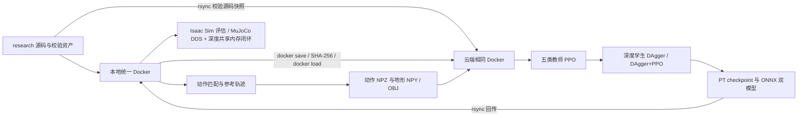

# PHP Parkour：统一 Docker 配置与运行

本分支将动作匹配、Isaac Sim 教师训练/学生蒸馏、Isaac Sim checkpoint 评估、ONNX 导出以及 MuJoCo 深度策略闭环放进同一个镜像 `php-parkour:research`。本地和云端复制同一镜像与校验过的源码、资产，宿主机不安装 Conda 或项目 Python 包。[usage.md](usage.md) 保存逐项验收与图像/视频；官方功能范围见 [README](README.md)、[训练指南](wbt_training/README.md)、[原生部署指南](wbt_training/DEPLOY.md)。

项目机器人是半球手的 Unitree G1，29 个关节。动作匹配有 17 种内置场景、29 个技能注册项；公开训练流程提供五类教师数据。动作数据库中的更多翻越技能并不自动成为公开深度策略掌握的技能。

## 1. 机器、目录与环境

| 位置 | 用途 | 持久路径 |
| --- | --- | --- |
| 本地 RTX 4070 Ti SUPER，16 GiB | 动作生成、可视化、MuJoCo、Isaac Sim 小规模评估 | 当前仓库 `outputs/research/`、`logs/` |
| `tencent-231`，8 × RTX PRO 5000，72 GB | 显存较大的官方训练 | `/diff/dzp_is_sb/php-parkour-research/` |
| 两端统一镜像 | Isaac Sim 5.1.0 / Isaac Lab 2.3.0 / Torch 2.7 CUDA 12.8 | Docker 镜像层，构建依赖均在容器中安装 |



镜像里的 `train-python` 使用 NVIDIA 的 Python 3.11.13；`motion-python` 与 `inference-python` 使用各自隔离的 Python 3.12.3 环境。动作生成/Pinocchio 的 NumPy 2 依赖与训练的 NumPy 1.26.4 分开安装。它们都属于同一镜像，绝不要求宿主安装对应环境。Isaac Lab 的产品 release 为 2.3.0，而上游 `isaaclab` Python distribution 显示 0.47.1；doctor 会同时保留实际版本。最终依赖以镜像内 `/opt/php-build/*.freeze.txt`、[版本约束](docker/) 和 doctor 报告为准。

仓库映射为 `/workspace/php_parkour`，研究产物为 `/outputs`，资产为 `/data/assets`，缓存为 `/data/cache`。同一容器内仿真进程与推理进程共享私有 `/dev/shm`；不要给此容器启用宿主 IPC。大数据、checkpoint 和缓存不进 Git。

## 2. 首次克隆与构建

宿主只使用已有 NVIDIA 驱动、Docker/NVIDIA Container Toolkit、Git、SSH、rsync、gzip 和标准库 Python。以下命令均从仓库根目录执行，除非另有说明：

```bash
git clone --branch research --recurse-submodules https://github.com/superboySB/php_parkour.git
cd php_parkour
# 已有 checkout 则从这里开始
git switch research
git submodule update --init --recursive
bash scripts/research/docker.sh build
```

[Dockerfile](docker/Dockerfile) 固定 NVIDIA 官方基础镜像 digest；Holosoma 固定为 Git 子模块 commit。构建会安装容器系统库及三个运行环境，首次下载需留出足够磁盘空间。根目录及 Dockerfile 专用 `.dockerignore` 排除 Git 元数据、凭据、日志、checkpoint 和下载缓存。

无头启动本地统一容器：

```bash
bash scripts/research/docker.sh up
bash scripts/research/docker.sh doctor --require-gpu
bash scripts/research/docker.sh shell
```

`shell`进入容器交互终端；执行`exit`返回宿主后再运行本手册后续的`docker.sh`、`docker exec`和`cloud.py`命令。

需要 Tk 键盘交互或 MuJoCo 窗口时，先确认本地 X11 的变量，**在启动训练/评估前**选择 GUI 模式：

```bash
test -n "$DISPLAY" && test -f "$XAUTHORITY"
bash scripts/research/docker.sh gui
```

切换 `gui` 会重建当前容器，应先结束其中的作业。它复用同一镜像与数据目录。退出 shell 不会停止容器；`bash scripts/research/docker.sh down` 停止本项目容器，数据和缓存保留。

## 3. 下载与验证全部公开资产

以下脚本只用 Python 标准库下载文件，**不在宿主安装任何包**。它校验每个压缩包及其中每个文件，已有正确文件不会重复下载。

```bash
python3 scripts/research/verify_assets.py
python3 scripts/research/verify_assets.py --verify-only
```

| 组件 | 内容 |
| --- | --- |
| `databases` | 19 个数据库、32 个 OBJ 与 32 个地形描述 JSON |
| `student` | `depth_backbone.onnx` 与 `student.onnx` |
| `motions-locomotion` | 100 组动作/地形 |
| `motions-low-step` / `motions-high-step` | 56 / 60 组动作/地形 |
| `motions-low-climb-76` / `motions-high-climb-76` | 各 40 组动作/地形 |

默认落在 `outputs/research/assets/`，容器对应 `/data/assets/`。公开发布没有教师 `.pt` 或学生原生 `.pt`；ONNX 不能直接当训练教师，也不能替代 Isaac Sim 的 checkpoint 评估输入。

## 4. 动作匹配、可视化与自定义数据

完整场景及技能验收在容器中执行，输出目录应为空：

```bash
bash scripts/research/docker.sh motion scripts/research/motion_matching_matrix.py \
  --skills --seed 42 --jobs 4 --output-dir /outputs/motion-matching
bash scripts/research/docker.sh motion scripts/research/render_motion_evidence.py \
  --matrix /outputs/motion-matching/matrix.json --output-dir /outputs/motion-videos
```

这会生成参考动作与配对地形，并逐项校验字段、有限值、四元数、50 FPS 与 15 维方向指令。参考录像脚本默认使用 CPU OSMesa，不需要 DISPLAY；`PHP_REFERENCE_GL` 可显式指定其他后端。录像是参考轨迹的运动学回放，不能用来证明学习策略完成了障碍。

只运行官方某个场景：

```bash
docker exec php-parkour-research mkdir -p /outputs/custom-motion
docker exec -w /outputs/custom-motion php-parkour-research \
  motion-python -m motion_matching.run --mode generate --scenario high_speed_climb_76 --jobs 1
docker exec php-parkour-research motion-python -m motion_matching.motion_visualizer \
  --motion-file /outputs/custom-motion/motion_matching_results/high_speed_climb_76
```

浏览器打开终端显示的 Viser URL（通常 `http://localhost:8080`）。结束当前服务按 Ctrl+C，再执行交互或数据库回放：

```bash
bash scripts/research/docker.sh motion -m motion_matching.run --mode interactive
# 结束交互服务后再执行：
bash scripts/research/docker.sh motion -m motion_matching.play_database \
  --database /data/assets/databases/database_g1_locomotion.bin
```

交互动作匹配需要 GUI 容器与 Tk；交互和数据库浏览器均使用 `http://localhost:8081`，不能同时占用该端口。运动文件浏览器使用8080。Tk窗口使用 I/K/J/L 前后左右、Tab切换速度、界面列出的技能键触发参考动作，Quit同时停止动作匹配循环。

自定义动作的格式、数据库生成、技能注册方式见 [motion_matching/README.md](motion_matching/README.md)。原生示例中的 `python` 替换为容器的 `motion-python`，所有输入均应放在已挂载目录中。生成数据库的源 qpos 顺序是 `[root_quat_wxyz, root_pos_xyz, dof29]`，需要显式指定源 FPS。

新生成的动作是29关节/30 body的tracking格式，训练需要转换为36维位置/35维速度/32 body的Holosoma native格式；公开的296组训练数据已转换。转换上面的自定义场景，并保留同名地形配对：

```bash
bash scripts/research/docker.sh train -m wbt_training.training_runs.motion_convert \
  /outputs/custom-motion/motion_matching_results/high_speed_climb_76 \
  /outputs/custom-native/high-speed-climb-76
docker exec php-parkour-research bash -c \
  'cp /outputs/custom-motion/motion_matching_results/high_speed_climb_76/*_terrain.npy /outputs/custom-native/high-speed-climb-76/'
```

转换器的目录模式只转换NPZ，不自动复制地形。训练时将该完整bundle指定为`file:///outputs/custom-native/high-speed-climb-76`，不能把任意qpos NPZ直接传给训练。

训练数据使用`file:///data/assets/motions-...`或自己生成的本地native bundle。离线工作流将数据物化到本地目录、逐文件复核SHA-256，再通过实际`file://` registry解析；服务器无需访问外部注册表。训练曲线由TensorBoard记录和查看。

从上面的完整矩阵产生的 BeyondMimic 动作转为原生训练格式，可运行真实转换及逐数组验收：

```bash
bash scripts/research/docker.sh train scripts/research/verify_conversion.py \
  --source /outputs/motion-matching/scenarios/low_speed_step/forward_walk0.5s_step0s_motion.npz \
  --terrain /outputs/motion-matching/scenarios/low_speed_step/forward_walk0.5s_step0s_terrain.npy \
  --output /outputs/conversion/low-step
```

单文件与目录转换均调用官方 `wbt_training.training_runs.motion_convert`，随后诊断并校验原生 registry。输出目录需要为空。

## 5. 服务器免密登录与完整镜像同步

本机已有 `~/.ssh/id_ed25519.pub` 已授权给 `tencent-231`，配置检查：

```bash
ssh -p 22 -o BatchMode=yes -o PasswordAuthentication=no tencent-231 'id -un'
python3 scripts/research/cloud.py status
```

新机器使用自己的密钥，先运行 `ssh-copy-id -i ~/.ssh/id_ed25519.pub -p 22 tencent-231` 并交互输入一次登录凭据。密码、私钥不写进仓库或镜像。

```bash
python3 scripts/research/cloud.py deploy
python3 scripts/research/cloud.py exec train-python scripts/research/verify_runtime.py \
  --require-gpu --output /outputs/docker/cloud-runtime.json
```

`deploy` 先同步按内容 SHA-256 命名的源码快照及全部资产，再 `docker save` 完整镜像、压缩、rsync 传输、核对包 SHA-256、`docker load`，最后核对镜像配置及层内容。镜像归档分别保存在本地 `outputs/research/cloud/images/` 和远端 `images/`，可断点续传。远端没有任何 Conda/pip/apt 安装步骤。

真正启动时重新检查 GPU，选择**没有计算/图形进程、显存不超过 64 MiB 且利用率为零的最小 nvidia-smi 编号**。记录对应 UUID 并以 UUID 映射进容器，容器内仅使用 `cuda:0`。服务器的 Linux minor number 与 nvidia-smi 编号不同，不能用 `/dev/nvidiaN` 推断该编号。无空闲卡时脚本退出，不挤占其他作业。`--gpu 1` 可要求指定卡，但仍必须通过空闲检查。

远端统一容器名为 `php-parkour-cloud-research`。已有同名容器时 `deploy` 拒绝替换，避免结束正在训练的进程。`cloud.py sync` 仅上传新的独立源码快照和资产，不更换运行中容器的源码。这样每次训练使用的源码保持明确；再次部署应先检查并停止自己的旧作业。

## 6. 教师训练、两种蒸馏与恢复

先以显式 smoke 配置检查完整路径；这是运行验收，产物没有收敛质量保证：

可以一次顺序执行五类教师、六个教师 preset、两种学生及各自评估/导出：

```bash
python3 scripts/research/cloud.py --detach exec bash -c \
  'bash scripts/research/run_training_acceptance.sh > /outputs/training-acceptance.log 2>&1'
```

或分阶段执行以下命令；不要与上面的一键验收同时启动：

```bash
python3 scripts/research/cloud.py exec bash scripts/research/train_pipeline.sh \
  teachers --profile smoke
python3 scripts/research/cloud.py exec bash scripts/research/train_pipeline.sh \
  eval-teachers --profile smoke --eval-steps 250
python3 scripts/research/cloud.py exec bash scripts/research/train_pipeline.sh \
  distill-pure --profile smoke
python3 scripts/research/cloud.py exec bash scripts/research/train_pipeline.sh \
  distill-finetune --profile smoke
python3 scripts/research/cloud.py exec bash scripts/research/train_pipeline.sh \
  eval-student --profile smoke --student-kind pure --eval-steps 250
python3 scripts/research/cloud.py exec bash scripts/research/train_pipeline.sh \
  export --profile smoke --student-kind pure
python3 scripts/research/cloud.py exec bash scripts/research/train_pipeline.sh \
  eval-student --profile smoke --student-kind finetune --eval-steps 250
python3 scripts/research/cloud.py exec bash scripts/research/train_pipeline.sh \
  export --profile smoke --student-kind finetune
```

正式复现使用 `official`，默认五个教师按顺序在选中的一张卡训练，随后学生使用相同顺序的五个教师与五组注册表：

```bash
python3 scripts/research/cloud.py exec bash scripts/research/train_pipeline.sh \
  teachers --profile official
python3 scripts/research/cloud.py exec bash scripts/research/train_pipeline.sh \
  distill-pure --profile official
python3 scripts/research/cloud.py exec bash scripts/research/train_pipeline.sh \
  distill-finetune --profile official
```

| 阶段 | 默认并行环境 | 默认总迭代 |
| --- | ---: | ---: |
| 每类 height-scan 教师 | 4096 | 20000 |
| 纯 DAgger 学生，`FINETUNE=0` | 2048 | 10000 |
| DAgger + PPO 学生，`FINETUNE=1` | 2048 | 30000 |

脚本记录每次命令、环境变量、checkpoint、日志与状态；`--skills locomotion` 可先只跑一种技能，`--plan` 只显示计划。`--num-envs` 与 `--iterations` 是显式改动，报告必须保留实际值。恢复训练使用相同 profile、output、skills 和 `--resume`。底层 Holosoma 的恢复迭代数是额外迭代，研究脚本按 checkpoint 中的迭代计算剩余量，以维持目标总迭代数。

原生 checkpoint 保存的是最后一次迭代的零起始编号，恢复时会重做这个编号对应的一步；脚本遵循原生语义，不声称恢复前后逐位等价。已达到目标的 checkpoint 不再多训练一步。评估/导出的跳过判断包含输入 checkpoint 的 SHA-256，评估还检查本次新录像，导出再运行双 ONNX 模型的真实推理检查。

关闭 SSH 后仍需运行的任务，可用下面的方式启动，并检查 `/outputs/training/official/manifests/` 中的状态和对应日志：

```bash
python3 scripts/research/cloud.py --detach exec bash -c \
  'bash scripts/research/train_pipeline.sh teachers --profile official > /outputs/official-teachers.log 2>&1'
```

先用前台小规模检查确认环境正确，再启动长训练。不要与上述前台命令同时运行同一阶段，或启动多个作业竞争同一张卡。训练命令成功结束只证明执行完成；是否学会技能需要无辅助 rollout 和明确评估指标。

默认入口设置 `LOGGER=tensorboard`、`WANDB_MODE=disabled`，使用 Holosoma 本地 SummaryWriter。数据注册表与 checkpoint 全部来自本地路径，不需要服务器访问外网或登录实验平台。在云端容器启动曲线服务：

```bash
python3 scripts/research/cloud.py --detach exec train-python -m tensorboard.main \
  --logdir /outputs/training --host 127.0.0.1 --port 6006 --load_fast false
ssh -p 22 -N -L 6007:127.0.0.1:6006 tencent-231
```

保持 SSH 转发运行，在本地浏览器打开 `http://127.0.0.1:6007/`。若训练指定了其他 `--output`，同步调整 `--logdir`。查看本仓库已验收的原始曲线则用本地 Docker 的 `--logdir /workspace/php_parkour/usage_assets/tensorboard`，打开本地 6006 端口；同一端口只启动一个服务。

评估入口 `eval-teachers` / `eval-student` 会生成 `quality.json`：checkpoint SHA、实际仿真时间、失败/超时 reset、跟踪误差、观察到的 motion IDs、录像 SHA 和本地 TensorBoard `Evaluation/*`。`--eval-steps` 控制本次有界 rollout 的步数；报告中的实际片段数才是覆盖范围，不能从步数推断遍历了整套动作。

六种教师 preset（含默认 noscale、no-heightscan、pelvis）及两种学生 preset 见 [验收定义](scripts/research/acceptance_matrix.json)。用 `teacher-presets --profile smoke --skills locomotion` 检查六个教师配置；直接 CLI 用 `train-python -m wbt_training.train_agent exp:... simulator:isaacsim ...`。其中 no-heightscan 教师默认 60000 迭代，不能把标准教师的 20000 误当该配置的默认训练量。`--skip-completed` 仅在成功记录、配置与经校验的 checkpoint 都满足目标时跳过阶段。

完整日程也可交给单个可续跑 driver：

```bash
python3 scripts/research/cloud.py --detach exec bash -c \
  'bash scripts/research/run_official_acceptance.sh /outputs/official-full > /outputs/official-full-driver.log 2>&1'
```

它依次完成五教师、最终教师 ONNX 检查、五教师质量评估、两种学生训练/质量评估/独立导出。同一输出目录有文件锁；重启会恢复有效 checkpoint，重新生成丢失或被改动的验收产物。训练保留 4096/2048 环境、官方迭代数和每 500 轮保存设置，质量评估单独使用 64 环境 × 3000 步。预计需多天；状态以各阶段 manifest 和原始日志为准。

研究分支让障碍预处理在未提供 `obstacle_seed` 时使用 `training.seed`，并写回保存配置。单 GPU 训练原入口已提前设种子；本修复主要保证独立评估、导出和直接调用 hook 时生成相同地形。显式障碍种子优先。回归实际比较了不同全局 RNG 状态下的地形/动作数组，以及原单 GPU 隐式 seed 42 与显式 seed 42 的几何一致性；这不保证完整训练或 checkpoint 恢复逐位相同，也不声称多 GPU 地形行为等价。

## 7. 导出、回传与仿真闭环

云端 checkpoint/ONNX 与评估结果回传：

```bash
python3 scripts/research/cloud.py pull
```

远端 `/outputs` 回传至本地 `outputs/research/cloud/results/`，`logs/` 单独回传。本地重新评估 `.pt` 时需使用本地实际路径并指定本地注册表，不能照搬只存在于远端的绝对路径。原生手工导出命令及 `.pt` 与 ONNX 的区别见 [训练导出说明](wbt_training/README.md#export-to-onnx)。

先验证公开 ONNX 双图的结构、元数据和真实 CPU 推理：

```bash
bash scripts/research/docker.sh inference scripts/research/validate_onnx.py \
  --models /data/assets/student --output /outputs/onnx/released.json
```

有界 MuJoCo 闭环通过原生 DDS 桥和 D435i 深度共享内存传输状态与动作；自动输入只替代键盘操作：

```bash
bash scripts/research/docker.sh train scripts/research/sim2sim.py \
  --models /data/assets/student --terrain plane --commands 1 --gl egl \
  --seconds-per-command 8 --output /outputs/sim2sim/plane-forward
bash scripts/research/docker.sh train scripts/research/sim2sim.py \
  --models /data/assets/student --terrain step --commands 6 --gl egl \
  --seconds-per-command 20 --output /outputs/sim2sim/step-forward
```

`--terrain custom --mesh /absolute/path/course.obj` 选择自己的网格；`--commands all` 顺序发送 12 种已部署指令，用于输入通路检查，增加 `--isolate-commands` 则逐指令启动新进程与场景，防止前一指令跌倒影响后续结果。12、13、14 三个保留方向槽位仅在 ONNX 合约测试中检查，不宣称它们具有独立行为。时长按仿真时间计，报告另外保存实际墙钟时间和步数。

手动 GUI 使用两个终端，均进入同一容器：

```bash
# 终端 1；等待 DepthShmPlugin created 提示
docker exec -it php-parkour-research bash ./run_php_sim.sh
# 终端 2
docker exec -it -e BACKBONE=/data/assets/student/depth_backbone.onnx \
  -e STUDENT=/data/assets/student/student.onnx php-parkour-research bash ./run_php_inference.sh
```

MuJoCo 窗口中 `8` 放下吊架、`9` 移除吊架、Backspace 重置。推理终端 `]` 启动策略、`o` 阻尼停止、`i` 恢复初始站姿；`w/s` 前后，`a/d` 左右 45°，`q/e` 左右 90°，`z` 站立，`=` 切换速度，`c` 开始/结束录制。方向键释放检测需要可用显示会话。启动新仿真前结束旧仿真/推理，避免覆盖仍在使用的深度共享内存。

有界闭环增加 `--record-policy` 可验证原生录制、STOP 自动保存和阻尼模式。原生 SDK 的 qpos 录制布局是 `[wxyz, 零 xyz 占位, dof29]`，不是世界坐标轨迹或 BeyondMimic 文件；不能直接送入训练转换器。位移和真实根位置使用闭环输出的 `trajectory.csv`。任意 OBJ 可加载不代表公开策略能通过任意障碍，实际成功与失败片段见 usage。

## 8. 验收与定位问题

```bash
python3 scripts/research/cpu_tests.py --output-dir outputs/research/cpu-tests
```

测试、矩阵与录像输出目录都应使用新的空目录，避免把旧产物记作新结果。查看子进程退出状态和对应 JSON，不能仅根据日志里出现一次 `ready` 判断通过。镜像依赖问题修改 Dockerfile/约束后重建；数据问题先运行 `verify_assets.py --verify-only`；checkpoint 问题确认 teacher/student 类型、注册表次序与文件路径；仿真问题保留完整日志再重跑。修复记录及最终验证范围见 [usage.md](usage.md)。

motion/inference 的 `pip check` 已通过。NVIDIA 基础训练环境仍有三条上游元数据冲突：两个 SRL/URDF 包声明缺少 `usd-core` distribution（运行时 `pxr` 已随 Isaac 提供），以及 SRL 的 `lxml<5` 与 Dex retargeting 的 `lxml>=5.2` 不兼容。当前遵循 SRL 的 4.9.4；实际 Isaac 训练、加载和录像另外验证，不能把这些运行成功写成训练环境 `pip check` 全通过，也不要在宿主安装 `usd-core` 来绕过。
