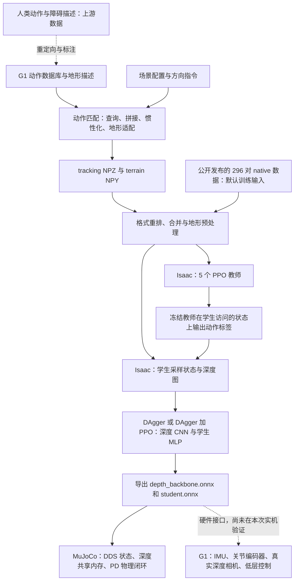

# PHP Parkour：学习、数据流与 real2sim2real 技术说明

本文解释当前 `research` 分支的实际实现：每个模块接收什么、产生什么、监督信号从哪里来，以及训练得到的动作如何进入机器人控制器。配置与命令见 [note.md](note.md)，真实运行结果、录像与失败记录见 [usage.md](usage.md)。本文件独立于 README。

截至 2026-10-10，完整官方五教师、两学生训练仍在云端运行；本文中的算法说明来自源码和已执行的有界实验，不表示完整日程或真机验收已经完成。

北京时间15:48，旧629物理扫描已因SDK退出异常及父监督漏查最终worker退出码而有序中断，全部相关本地进程退出。原279项reported completed中也已发现崩溃日志，因此这些状态不能作为正常退出验收；修复监督和SDK后，原五个显式失败配置的新试跑已正常退出，fresh629仍须独立执行。[原状态及停止回执](usage_assets/reports/sim2sim-cohort-halt/summary.md)、[漏记崩溃实证](usage_assets/reports/worker-exit-completed-log-audit/report.md)、[新SDK五例闭环](usage_assets/reports/sdk018-native-pilot/summary.md)。下文带具体时间的运行快照均保留历史含义。

## 1. 先把整个系统连起来

PHP 先用动作匹配生成长参考轨迹，再让具有特权信息的教师通过强化学习跟踪轨迹，最后把教师的控制能力蒸馏给使用深度图的学生。部署时运行深度 CNN 和学生策略，输出 29 个关节的位置目标偏移。



本次从官方已重定向的 G1 数据库和 native 动作资产开始。17 个动作场景都能生成参考轨迹；当前完整训练 driver 使用五组指定技能数据。动作库的场景数量、学生训练涉及的技能、最终策略实际成功的场景需要分别验证。

| 阶段 | 输入 | 输出 | 目标或 label 来源 |
| --- | --- | --- | --- |
| 人类动作重定向，上游工具 | 世界坐标人体关节、机器人模型、接触/障碍约束 | G1 根位姿与关节轨迹 | 原始人体运动、接触和人工几何约束；本次未重新采集或重定向原 MoCap |
| 动作匹配 | G1 数据库、当前库帧特征、预测目标轨迹、场景几何 | 长参考动作、15 维指令、配对地形 | 查询参数、已存动作和几何变换；不训练一个动作生成网络 |
| tracking 导出 | 合成 qpos、机器人模型、时间步长 | 29 关节、30 body 的姿态/速度 | FK 与有限差分，无人工身体姿态标签 |
| native 转换与合并 | tracking NPZ、terrain NPY、关节/身体映射 | Holosoma native NPZ、合并 OBJ、边界/专家索引 | 保留输入世界姿态/速度，重排、补根列与边界，不重新做 FK |
| 教师 PPO | 当前仿真状态、参考动作、特权地形 | 29 维策略分布、critic 的标量 value | 参考轨迹跟踪奖励、物理惩罚；return/advantage 由 rollout 计算 |
| 纯 DAgger | 学生访问的状态、深度图、方向指令 | 学生动作；训练得到 CNN/MLP 参数 | 对应冻结教师在同一状态上的动作 |
| DAgger + PPO | 同上，另有特权 critic 状态和环境奖励 | 可探索的学生策略、训练用 critic | 教师动作回归与环境 reward 的组合 |
| ONNX 与部署 | 编码器/IMU、深度帧、操作者指令、上一动作 | 位置目标、零目标速度/前馈和 PD 增益 | 只做前向推理与控制，不更新网络参数 |

这里的三种“目标”有不同含义：参考动作是希望物理机器人跟踪的运动；DAgger label 是教师计算出的动作；PPO 的 value target 是由奖励和 bootstrap 得到的回报估计。深度图是学生的输入，没有另一个人工标注的深度预测 label。

## 2. 数据格式与非学习处理

### 2.1 同名字段不代表同一种布局

用 `T` 表示帧数，最终训练数据为 50 FPS；原始 G1 样本可为 30 FPS，动作匹配内部为 60Hz。位置单位米，关节角为弧度，速度分别为 m/s 和 rad/s。下表磁盘四元数顺序为 `wxyz`；Holosoma 内部 unified state 会转成 `xyzw`。

| 数据 | 主要字段与 shape | 语义 |
| --- | --- | --- |
| 动作匹配内部 qpos | `[T,36] = [quat_wxyz(4), root_xyz(3), dof(29)]` | G1 根位姿和关节姿态；这是运动学数据 |
| tracking / BeyondMimic NPZ | `fps:[1]`；`joint_pos/joint_vel:[T,29]`；四种 `body_*_w:[T,30,3或4]`；可选 `vel_cmd:[T,15]` | 关节按导出的 Isaac 顺序；30 个 body，姿态为世界坐标 |
| Holosoma native NPZ | `joint_pos:[T,36]=[xyz,wxyz,dof29]`；`joint_vel:[T,35]=[root_lin3,root_ang3,dq29]`；`body_*_w:[T,32,3或4]`；名称数组及可选 `vel_cmd` | converter 重排关节/身体并复制踝部数据为两个脚接触点；学生 command preset 必须有 `vel_cmd` |
| 合并训练 NPZ | native 字段，以及 `motion_ends`、`motion_idxs` 等 | `motion_ends` 保存源片段边界，`motion_idxs` 保存 registry/expert 来源 |
| SDK 策略录制 qpos | `[T,36]=[wxyz,零 xyz 占位,dof29]` | SDK 状态没有世界根位置；它不能直接冒充 native 训练文件或世界轨迹 |

真实转换例子的输入有 364 帧，输出 native 的位置为 `[364,36]`、速度为 `[364,35]`、32 个 body、15 维指令，已逐数组检查映射。[实测转换报告](usage_assets/reports/motion-conversion.json)。格式转换实现见 [tracking 导出](motion_matching/motion_matching/utils/tracking_format.py)与 [native converter](wbt_training/training_runs/motion_convert.py)，固定顺序见 [robot_config.py](wbt_training/config_values/robot_config.py)。

tracking 导出先用机器人模型做正向运动学得到身体位置/姿态，再由相邻帧差分得到速度；native converter 随后保留这些数值，只做重排、根状态组装及两个 contact-point body 的复制。它没有独立计算新的足底测点。这些目标来自参考轨迹，没有神经网络预测身体标签。

### 2.2 方向指令不是关节动作

`vel_cmd` 是每帧 15 维 one-hot。它给学生提供高层运动意图，网络仍输出 29 维低层动作。已部署的索引如下：

| 索引 | 含义 |
| --- | --- |
| 0 | 站立 |
| 1 / 6 | 低速 / 高速前进 |
| 2 / 7 | 低速 / 高速左转，生成侧 nominal yaw rate +45°/s |
| 3 / 8 | 低速 / 高速左急转，生成侧 +90°/s |
| 4 / 9 | 低速 / 高速右转，生成侧 −45°/s |
| 5 / 10 | 低速 / 高速右急转，生成侧 −90°/s |
| 11 | 后退 |
| 12–14 | 保留槽位，不能当作已实现的独立行为 |

训练用指令由场景步骤的 `vel_cmd_idx` 指定，按帧保存 one-hot；不是从传感器识别出来的标签，也不是 29 个技能的分类。调速时用 zero-order hold 重采样指令。部署时由键盘/操作者设置；转向类别不保证最终世界朝向恰好转过 45°/90°。教师通过参考关节位置与速度得到跟踪命令，学生接收这 15 维 one-hot。专家编号来自有序 registry，表示训练时查询哪个教师，与 command 索引分别管理。

### 2.3 上游人类动作、重定向与数据库

PHP 上游先把人类动作重定向到 29 DOF G1，再人工标注技能起止、entry window 和配对 box。论文第2页、§III-B2第4页、Appendix A.1第12页分别说明这些步骤。本次从已经发布的 G1 数据库与 native bundles 开始，没有采集真人动作或从原 MoCap 重跑 retarget。[PHP 官方论文](https://php-parkour.github.io/static/images/paper.pdf)

相关 OmniRetarget 数据卡列出 OMOMO 与上游自有 MoCap；PHP release 没有逐数据库片段到原人体文件/采集设备的映射，不能据此给每个 PHP clip 指定原始数据集。[OmniRetarget 数据卡](https://huggingface.co/datasets/omniretarget/OmniRetarget_Dataset/blob/main/README.md)

仓库包含两个不同入口：

- [PHP database generator](motion_matching/motion_matching/generate_database.py#L182) 消费已经是 G1 的 `qpos=[wxyz,xyz,29 joints]`，做镜像、URDF运动学、重采样、速度/接触估计和二进制写盘；不训练网络。
- [Holosoma retargeter](thirdparty/holosoma/src/holosoma_retargeting/holosoma_retargeting/src/interaction_mesh_retargeter.py#L65) 另有 SQP 风格 diffIK：输入人体世界关节 `human_joints:[T,J,3]`、人体/机器人映射与交互几何，线性化 Jacobian，最小化 interaction-mesh Laplacian 误差，并加脚约束、非穿透、关节限位与 trust region，由 CVXPY/CLARABEL 逐帧求解；示例保存 `qpos:[T,36]`、`human_joints` 和 `fps=30`。目标来自人体运动与几何约束，不是监督网络的人工动作 label。它是轨迹优化，本次没有执行这条原始人体数据路径。

独立 Holosoma retarget 示例内部/保存的 qpos 是 `[xyz,wxyz,joints]`（[源码](thirdparty/holosoma/src/holosoma_retargeting/holosoma_retargeting/examples/robot_retarget.py#L499)），PHP generator 却按 `[wxyz,xyz,joints]` 解析，不能因同为36列就直接混用。HuggingFace发布资产的布局也应按其数据卡分别确认。

PHP内部数据库还增加了一个平面 Simulation root：31 bones 为 Simulation root、pelvis及29关节节点；这不等于 tracking 的30 bodies或native的32 bodies。Simulation root 的位置来自肩部均值投影到XY，朝向来自pelvis局部+X投影并平滑。`contact_states:[F,2]` 是左右踝世界速度 `<0.5` 后 median filter 的启发式标签，不是真实足底力测量。[数据库生成](motion_matching/motion_matching/generate_database.py#L231)

二进制 `.bin` 中，Simulation root 用世界坐标，其余节点用父坐标系。`F` 为总帧数，`R` 为拼接片段数：

| 字段 | shape / dtype | 来源 |
| --- | --- | --- |
| `bone_positions`、`bone_velocities` | `[F,31,3]` float32 | URDF 运动学及 60Hz 差分 |
| `bone_rotations` | `[F,31,4]` float32，wxyz | 关节/根姿态转成骨骼局部旋转 |
| `bone_angular_velocities` | `[F,31,3]` float32 | 四元数时间差分 |
| `bone_parents` | `[31]` int32 | URDF 层级加 Simulation root |
| `range_starts`、`range_stops` | `[R]` int32 | 源片段拼接边界 |
| `contact_states` | `[F,2]` uint8 | 左/右足速度阈值和中值滤波 |

Writer 按固定字段顺序写维度头与数组；文件没有自描述 FPS、骨骼名称或单位，60Hz/G1/SI 来自代码契约。它是 reference 数据库，不是带网络参数的 checkpoint。[二进制读盘](motion_matching/motion_matching/core/database.py#L105)。

### 2.4 动作匹配的27维特征与分数

当前runtime使用Z向上、XY地面、局部+X向前。27维不是学习的embedding，其固定组成如下：

| 索引 | 特征 | 维数 | block权重 |
| --- | --- | ---: | ---: |
| 0–2 / 3–5 | 左/右脚相对Simulation root的局部位置 | 各3 | 0.75 |
| 6–8 / 9–11 | 左/右脚世界线速度旋入root坐标系 | 各3 | 1.0 |
| 12–14 | hip/pelvis世界线速度旋入root坐标系 | 3 | 1.0 |
| 15–20 | 未来三个时刻的局部XY位置 | 6 | 1.0 |
| 21–26 | 同三个时刻的局部XY朝向向量 | 6 | 1.5 |

未来时刻为数据库+20/+40/+60帧，内部60Hz时约0.333/0.667/1秒，索引在各source range内截断。脚“局部速度”是世界速度旋入root朝向，没有再减root平移速度。[特征实现](motion_matching/motion_matching/core/features.py#L194)

先求每维均值 `μ_j`，再求每个block各维标准差的平均值 `σ_g`，保存 `scale_j=σ_g/w_g`。数据库和query都用 `z_j=(x_j−μ_j)/scale_j`；匹配分数为标准化后的平方L2和，取argmin。等价的原始单位误差系数为 `w_g²/σ_g²`。这一步只计算统计量，没有梯度loss或PCA训练。[归一化](motion_matching/motion_matching/core/features.py#L148)

当前query前15维从**当前数据库帧的cached feature反归一化**取得，未来12维由当前root与解析弹簧轨迹预测构造，不是每tick从live inertialized pose重算脚状态。普通搜索默认每0.1s或强制事件执行，排除range末尾与当前帧附近，并可加transition cost；当前调用使用默认cost=0。技能入口只搜索手工entry ranges；执行技能时按原片顺序播放，到标注末尾回locomotion。[query](motion_matching/motion_matching/run.py#L571)、[L2搜索](motion_matching/motion_matching/core/database.py#L292)

feature pickle缓存的是特征、均值、尺度和名称，不是policy checkpoint。近似镜像同分还有`1e-4`的较早帧tie rule，复现时应保留。场景中的下一skill由配置/GUI触发，matcher本身不是识别未知障碍的感知分类器。

### 2.5 惯性化、IK与地形适配的实际实现

| 模块 | 实际处理与边界 |
| --- | --- |
| 惯性化 | 跳转时记录位置/速度/四元数/角速度偏差，用解析spring-damper衰减，默认半衰期0.1s；没有训练blend网络。[实现](motion_matching/motion_matching/utils/animation_state.py#L55) |
| 脚anchor correction | 单支撑时以FK得到支撑脚位置，修正整个root的世界XY，让足轨迹跟随DB；不解新的腿关节目标。[实现](motion_matching/motion_matching/run.py#L888) |
| 名为`quat.ik`的helper | 将完整global transforms反算parent-local transforms；不是带足端目标与关节约束的IK优化器。[实现](motion_matching/motion_matching/kinematics/quat.py#L236) |
| 技能地形对齐 | 用命中entry root到当前root的rigid transform一起搬移OBJ及box metadata；调整base的Z以衔接平台，高处locomotion可沿reference补box支撑。[实现](motion_matching/motion_matching/run.py#L628) |
| PCA | 只对terrain OBJ顶点XY协方差求特征向量，拟合有向box；不用于27维动作特征降维。[实现](motion_matching/motion_matching/utils/data_utils.py#L256) |
| 地形随机化与Warp | box参数采样、yaw/顶点噪声属于几何预处理；Nvidia Warp用于训练mesh raycasting/depth。源码中不能把Warp库名解释为已经验收的未知地形非线性motion-warp算法。[预处理](wbt_training/utils/obstacle_helpers.py#L228)、[深度term](wbt_training/config_values/depth_distillation.py#L122) |

这些步骤合成运动学reference，没有用真实接触动力学反馈修复每次拼接。Viser回放和`mj_forward`导出均不能证明策略物理完成相同障碍。

### 2.6 三种动作格式、转换与控制时钟

§2.1中的三种布局还对应不同生成阶段：source样本30FPS，matcher内部60Hz，最终tracking/native参考50FPS。tracking writer先将raw `[wxyz,xyz,joints]`换成MuJoCo `[xyz,wxyz,joints]`，逐帧调用`mj_forward`求30body世界pose，再以有限差分求关节/身体速度；此处没有`mj_step`或策略action。[tracking writer](motion_matching/motion_matching/utils/tracking_format.py#L82)

native converter **不重新求FK或差分**，直接保留tracking输入的世界pose/velocity与wxyz，只重排29DOF/身体，取pelvis组成root字段，补names并输出：

```text
joint_pos[T,36] = [root_xyz, root_wxyz, MuJoCo_order_joint29]
joint_vel[T,35] = [root_linear3, root_angular3, MuJoCo_order_velocity29]
body_*_w        = 30个tracking bodies重排为32个native bodies
```

新增`left/right_foot_contact_point`分别复制tracking body18/19的ankle_roll pose及velocity；不是额外测量点，也没有计算新的足底offset。`vel_cmd/motion_ends/motion_idxs`若存在则原样保留。tracking数值通常float32，converter主要数值输出float64；不做单位/坐标轴转换。[converter](wbt_training/training_runs/motion_convert.py#L69)、[固定关节/身体顺序](wbt_training/config_values/robot_config.py#L12)

转换要求29DOF/30body、必需字段finite、正FPS及至少2帧；already-native36列输入会拒绝。目录模式只转换NPZ，不复制terrain NPY/OBJ。native磁盘quaternion仍为wxyz，训练MotionLoader读入后才变成运行时xyzw。[校验](wbt_training/training_runs/motion_convert.py#L44)、[loader](thirdparty/holosoma/src/holosoma/holosoma/managers/command/terms/wbt.py#L124)

**文件FPS不自动驱动训练重采样。** MotionLoader读取fps，但MotionCommand每个control tick仅推进一reference frame。当前50FPS数据与200Hz物理/decimation4的50Hz控制匹配；自定义非50FPS输入必须先重采样并验收，不能只保留fps字段就认为时钟对齐。[推进reference](thirdparty/holosoma/src/holosoma/holosoma/managers/command/terms/wbt.py#L1000)

terrain的三种文件也不能互换：

| 文件 | schema与用途 |
| --- | --- |
| source JSON | `pos:[3], quat:[4]wxyz, size:[3]`，size是full extents；注释source box与OBJ |
| `*_terrain.npy` | `[B,V,10]`，列为`[x,y,z,qw,qx,qy,qz,sx,sy,sz]`；当前V=10，空地形可为`[0,10,10]`；不是深度图 |
| `*_terrain.obj` | 米制reference mesh，含已变换障碍及ground；不含FPS、commands或所有NPY variants |

scenario输出NPZ+NPY+OBJ，不另输出JSON。普通box随机化主要沿local X扩展，训练preprocess另加yaw/顶点噪声，故OBJ基准预览不等于所有训练随机地形。[terrain输出](motion_matching/motion_matching/run.py#L1440)

off-path clutter在完整root轨迹已知后采样，每个NPY variant列独立生成完整scene并联合检查净空/重叠；Viser共用一列显示全部box。训练sampler却为每个box独立选variant，所以不保留整列scene联合约束，不能由每列无重叠推论混列后也无重叠。[生成](motion_matching/motion_matching/io/terrain_io.py#L213)、[训练采样](wbt_training/utils/obstacle_helpers.py#L61)

grid preprocess只平移`body_pos_w`并复制其他逐帧字段，native `joint_pos`的root列未同步平移；当前MotionLoader剥去这些root列，使用body世界pose。第三方重用preprocess缓存作qpos播放时需注意一致性。[offset](wbt_training/utils/obstacle_helpers.py#L148)

### 2.7 Command标签、GUI保存与训练数据边界

§2.2的15维command来自场景手工指定`vel_cmd_idx`，每帧one-hot记录；不是29技能分类label，也不是从MoCap测得的瞬时速度。默认低/高速为0.8/2.2m/s；random locomotion中的`left_45/right_90`表示+45/−90°/s的turn rate，场景先乘duration，生成器再除duration，不能理解为整段固定转角。技能过渡步可以使用不同具体speed。[标签定义](motion_matching/motion_matching/scenarios/builtin.py#L6)、[转向生成](motion_matching/motion_matching/run.py#L1179)

GUI控制desired input与skill trigger，录制的是matcher产生的qpos。修复后的Start/End Recording保存同目录、同stem的tracking NPZ、terrain NPY/OBJ与录制JSON；**仍不保存`vel_cmd`**，sidecar和界面明确提示没有方向标签。若用于方向条件学生训练，需要另有真实、逐帧对齐的command标签，再转换格式；不能由位移倒推意图。Viser速度编辑会保留/重采样已有commands，并复制全部源地形变体和OBJ到匹配名称，不会创造缺失标签。[GUI保存](motion_matching/motion_matching/run.py#L1712)、[Viser保存](motion_matching/motion_matching/motion_visualizer.py#L776)、[两条真实GUI流程与转换/加载验收](usage_assets/reports/gui-workflows/summary.md)。

显式ordered `file://` registries按相对路径顺序找`*motion*.npz`和同stem的`*terrain*.npy`，合并为native NPZ并添加`motion_ends`原片边界及`motion_idxs`专家/registryID；后者顺序须与teacher checkpoints相同。registry门卫检查必需keys与terrain schema，完整shape/finite检查还依赖converter/验收工具。函数名中保留`wandb`不表示本次离线路径调用SDK。[本地解析](wbt_training/utils/registry.py#L60)、[合并与expertID](wbt_training/utils/multi_motion_helpers.py#L26)

296对公开native训练输入=100 locomotion+56 low-step+60 high-step+40 low-climb76+40 high-climb76；本次另生成17场景629组reference并转换native。29项registry=1 locomotion+28 traversal入口，部分共享数据库。它们分别是数据对数、生成配置数、注册入口数，不能互相替代，也不等于策略成功数。[生成验收](usage_assets/reports/motion-matching.json)、[925份native本地工作流](usage_assets/reports/motion-workflows.json)

合并100源片后顶层loader仍可`num_motions=1`，不代表只加载1原片或已覆盖100片。源片访问应由`motion_ends`与实际reference time indices映射；`motion_idxs`是expertID。teacher eval通常phase0重置；多expert学生分支均匀选expert后从其frame pool抽帧，不能统称“源clip均匀采样”。

## 3. 教师强化学习：状态、动作、奖励与 loss

五类默认教师都使用 `g1-wbt-terrain-ref-noscale`：locomotion、low-step、high-step、low-climb-76、high-climb-76。网络、奖励与控制方法相同，registry 和参考地形不同。下面是当前这套配置的实际数值；更换 preset 后应重新读取保存的 YAML。

### 3.1 环境状态怎样变成 actor / critic 输入

Isaac 内部状态包含关节、根/身体运动、接触和参考帧等。策略读取的是由这些状态构造出的 observation。ObservationManager **按 term 名称排序拼接**，history length=1，默认所有 scale=1；不能按配置字典的书写顺序拼接。

| 教师 actor term，实际顺序 | 列范围，左闭右开 | 维数 | 内容 |
| --- | --- | ---: | --- |
| `actions` | `[0,29)` | 29 | 上一 policy tick 的 raw 动作 |
| `base_ang_vel` | `[29,32)` | 3 | 机器人 base 坐标系角速度 |
| `base_lin_vel` | `[32,35)` | 3 | 机器人 base 坐标系线速度 |
| `dof_pos` | `[35,64)` | 29 | 实际关节角减默认姿态 |
| `dof_vel` | `[64,93)` | 29 | 实际关节角速度 |
| `height_scan` | `[93,382)` | 289 | 仿真 mesh 的 17×17 地形射线读数 |
| `motion_command` | `[382,440)` | 58 | 参考帧的 29 关节位置与 29 关节速度 |
| `motion_ref_ori_b` | `[440,446)` | 6 | 参考 anchor 相对机器人 anchor 的旋转，矩阵前两列 |
| `motion_ref_pos_b` | `[446,449)` | 3 | 参考 anchor 在机器人 anchor 坐标系中的位移 |

教师 actor 输入 `[N,449]`。Critic 先接收同样的 449 项，再接 14 个 tracked body 的局部旋转 `14×6=84` 和位置 `14×3=42`，共 `[N,575]`，输出 `[N,1]` 的状态价值。默认 anchor 是 `torso_link`。教师 actor 的参考轨迹、地形 oracle 和 critic 的身体真值都来自仿真特权信息。

上述维度对应正式五教师使用的默认 `ref-noscale`。六个注册教师 preset 的差别如下；实际保存PT和ONNX已经逐份检查，不能把所有教师都按449维加载。[六配置实际CPU证据](usage_assets/reports/teacher-presets-cpu/summary.md)。

| preset 后缀 | actor / critic 输入 | reference anchor | PD目标的动作缩放 |
| --- | --- | --- | --- |
| `ref` | 449 / 575 | torso_link | `0.25 × effort_limit / Kp` |
| `no-heightscan` | 160 / 286 | torso_link | 同上 |
| `ref-noscale` | 449 / 575 | torso_link | 1.0 |
| `no-heightscan-noscale` | 160 / 286 | torso_link | 1.0 |
| `ref-pelvis` | 449 / 575 | pelvis | `0.25 × effort_limit / Kp` |
| `no-heightscan-pelvis` | 160 / 286 | pelvis | 同上 |

no-heightscan移除289维地形oracle，剩余状态仍按原有term名字排序，动作输出都是29维。pelvis配置改变参考anchor，不能仅凭相同输入形状互换。当前学生五专家流程构造449维teacher输入并剥离路由列；160维ablation不能直接插入该流程，缩放或anchor不同的教师也不能冒充正式noscale专家。六份两轮smoke模型共72个图内参考查询与60个PT/ONNX动作均值对照通过，最大误差约6.33e-8。之后五个非默认preset也逐一完成16环境×100步的实际Isaac重载，原生保存YAML确认输入/anchor/scale未变、四项tracking指标各1600样本有限；它们累计251次failed episode resets、quality_verified=false，仍不证明收敛。[重载的真实质量、配置和短录像](usage_assets/reports/teacher-preset-reload-sdk018-v3/summary.md)。

Actor 各项默认还叠加均匀噪声：角速度 ±0.2、线速度 ±0.5、关节位置 ±0.01、关节速度 ±0.5、参考相对旋转 ±0.05、参考相对位置 ±0.25。Critic 的外层噪声关闭。默认 eval 保留 actor 配置的外层噪声；`set_is_evaluating()` 不会自动关闭它。

`height_scan` 的网格间距为 0.1m、范围 1.6×1.6m，yaw 对齐。实际 raycaster 挂在 pelvis，配置射线起点 z offset=20；读数按 `sensor_z - hit_z - 0.5` 计算。这是当前实现的数值契约，不能直接当作实机深度相机像素。源码：[教师观测配置](wbt_training/config_values/terrain.py#L112)、[排序与噪声](thirdparty/holosoma/src/holosoma/holosoma/managers/observation/manager.py#L130)、[观测物理定义](thirdparty/holosoma/src/holosoma/holosoma/managers/observation/terms/wbt.py)、[height scanner](thirdparty/holosoma/src/holosoma/holosoma/simulator/isaacsim/isaacsim.py#L464)。

### 3.2 动作怎样驱动物理机器人

Actor MLP 为 `449→512→256→128→29`，hidden activation 为 ELU，输出 29 维对角 Gaussian 的均值，另有可训练 std，初始为 1.0。训练采样动作，评估/导出使用均值。Critic 为 `575→512→256→128→1`。默认不做 empirical normalization。

在 noscale 配置下，位置目标为：

```text
q_target = q_default + clip(action, -100, 100)    # action_scale = 1
```

29 个动作是关节角目标的偏移，控制器再用 PD drive 产生力矩。这里 `q_default` 是运行时 `env.default_dof_pos`：默认 startup 随机化给每关节加 ±0.01rad bias，踝关节额外加 ±0.05rad，同时改变动作目标与相对关节观测的基准。零动作对应这个环境的默认姿态；部署中的 damping stop 是另一个控制模式。

| 动作索引 | 顺序 |
| --- | --- |
| 0–5 | 左 hip pitch / roll / yaw、knee、ankle pitch / roll |
| 6–11 | 右 hip pitch / roll / yaw、knee、ankle pitch / roll |
| 12–14 | waist yaw / roll / pitch |
| 15–21 | 左 shoulder pitch / roll / yaw、elbow、wrist roll / pitch / yaw |
| 22–28 | 右 shoulder pitch / roll / yaw、elbow、wrist roll / pitch / yaw |

Isaac 默认物理步长 0.005s，即 **200Hz physics**；decimation=4，因此 **50Hz policy/control**。一个动作保持四个物理步。Isaac 用 implicit actuator，由引擎求解 PD 与约束；部署 MuJoCo 的 500Hz physics 是后文另一条路径。

电机 builder 用自然频率 `ω=20π`、阻尼比 `ζ=2` 和 nominal armature 计算 `Kp=Iω²`、`Kd=2ζIω`，并设置 effort/velocity limits。典型 hip pitch/yaw 的 Kp/Kd 约 40.179/2.558，hip roll/knee 约 99.098/6.309，ankle 约 28.501/1.814。[动作目标实现](thirdparty/holosoma/src/holosoma/holosoma/managers/action/terms/joint_control.py#L15)、[电机参数与关节顺序](wbt_training/config_values/robot_config.py)、[Isaac 步长](thirdparty/holosoma/src/holosoma/holosoma/config_values/simulator.py#L36)。

### 3.3 奖励来自哪里

每个 0.02s 控制步得到一个标量：`r_t = 0.02 × Σ_j w_j R_j`。其中 `p/q/v/ω` 分别为位置、四元数、线速度和角速度，body 平均取 14 个 tracked bodies。

| raw reward `R_j` | 权重 |
| --- | ---: |
| `exp(-||p_ref-p_anchor||² / 0.3²)` | +1 |
| `exp(-angle(q_ref,q_anchor)² / 0.4²)` | +1 |
| `exp(-mean_body ||p_ref_relative-p_robot||² / 0.3²)` | +1 |
| `exp(-mean_body angle(q_ref_relative,q_robot)² / 0.4²)` | +1 |
| `exp(-mean_body ||v_ref-v_robot||² / 1²)` | +1 |
| `exp(-mean_body ||ω_ref-ω_robot||² / 3.14²)` | +1 |
| `Σ(action_t-action_(t-1))²` | −0.1 |
| 关节超出 soft limits 的距离之和，soft range 为 hard range 的 0.9 倍 | −10 |
| 非允许接触 body 的计数，接触力阈值 1 | −0.5 |

相对参考身体会做 anchor/yaw 对齐。接触项允许指定脚/踝和 wrist yaw body 的接触，其余选中 body 的意外接触受罚。参考运动提供了姿态、速度和接触上下文，环境据此计算 reward；强化学习没有直接回归一个人工标注的 29 维动作。

训练 episode 默认最长 10s；原生 eval 使用单独的 `eval_overrides`，默认 timeout 为 100000s，有界验收另由 `max_eval_steps` 结束。BadTracking 在以下任一条件成立时终止：参考 anchor **三维位置 L2** 误差 >0.5m；参考/机器人投影重力 **z 分量差绝对值 >0.8**；四个 ankle/wrist 指定 body 中任一个**三维位置 L2** 误差 >0.5m。0.8 是该重力分量阈值，不能当作 0.8rad 的四元数角。到达 motion 边界还可触发参考重采样，和物理失败终止分别统计。

源码：[地形奖励与终止配置](wbt_training/config_values/terrain.py#L290)、[继承的奖励权重](thirdparty/holosoma/src/holosoma/holosoma/config_values/wbt/g1/reward.py)、[奖励公式](thirdparty/holosoma/src/holosoma/holosoma/managers/reward/terms/wbt.py#L32)、[RewardManager 的 dt 因子](thirdparty/holosoma/src/holosoma/holosoma/managers/reward/manager.py#L126)、[BadTracking](thirdparty/holosoma/src/holosoma/holosoma/managers/termination/terms/wbt.py#L59)。

### 3.4 PPO 的样本与 loss

本次默认单 GPU 每轮采样 `4096 env × 24 steps = 98304 transitions`，记录观测、动作、reward、done、old value、old log probability、old Gaussian 参数。每轮用 5 epochs、4 minibatches 更新，共 20 次 actor/critic 优化；默认每 minibatch 为 24576 条。Buffer 更新后清空。

GAE 和回报标签来自这批 rollout：

```text
δ_t = r_t + γ(1-done_t)V_old(s_(t+1)) - V_old(s_t)
A_t = δ_t + γλ(1-done_t)A_(t+1)
return_t = A_t + V_old(s_t)
γ = 0.99，λ = 0.95；advantage 在完整 rollout 上标准化
```

Timeout 的 reward 路径额外做 value bootstrap。令 `ρ=exp(logπ_new-logπ_old)`、`ε=0.2`：

```text
l_surrogate = max(-Aρ, -A·clip(ρ, 0.8, 1.2))
V_clip = V_old + clip(V_new-V_old, -0.2, 0.2)
L_value = mean(max((V_new-return)², (V_clip-return)²))
L_actor = mean(l_surrogate) - 0.005·mean(entropy)
L_critic = 1.0·L_value
```

这里 value MSE 没有额外的 0.5 系数。Actor/critic 分别用 AdamW，weight decay=0，初始 LR=1e-3，grad norm clip=1。KL 目标为 0.01；过大则 LR÷1.5，过小则 LR×1.5，边界为 1e-5..1e-2。默认 symmetry=False，因此 mirror loss 不加入本次目标。Loss 的梯度更新网络参数，不经过 Isaac 物理 dynamics 反向传播。

源码：[PPO rollout、GAE 与 update](thirdparty/holosoma/src/holosoma/holosoma/agents/ppo/ppo.py#L387)、[本项目默认超参](wbt_training/config_values/experiment.py#L81)。

## 4. 深度学生：输入、在线 label 与两种学习方式

### 4.1 实际输入与网络结构

学生的 flat actor 状态为 108 维，同样按名称排序、history=1：

| term | 列范围 | 维数 |
| --- | --- | ---: |
| `actions` | `[0,29)` | 29 |
| `base_ang_vel` | `[29,32)` | 3 |
| `dof_pos` | `[32,61)` | 29 |
| `dof_vel` | `[61,90)` | 29 |
| `robot_anchor_projected_gravity` | `[90,93)` | 3 |
| `velocity_command` | `[93,108)` | 15 |

Projected gravity 是机器人实际 anchor quaternion 逆旋转重力向量所得的姿态线索。学生不接收教师的参考 joint command、anchor 误差或 height scan，而是另接 `[N,58,87]` 深度图。学生 flat actor 的外层均匀噪声为 gravity ±0.05、gyro ±0.2、q ±0.01、dq ±0.5；actions/command 不加此噪声。

深度 CNN 为 `Conv1→16(k5,s2)→32(k3,s2)→64(k3,s2)→global average pool→Linear64→32`，使用 ELU，输出 `[N,32]` latent。拼接 `[actor108, latent32]` 得到 140 维 MLP 输入。纯学生 MLP 为 `140→512→256→128→29`；混合学生为 `140→2048→1024→512→256→128→29`。它们是前馈网络，上一动作在 flat state 内；深度 buffer 用于延迟采样，不将六帧一起送进 CNN。

原生评估的 `--show-depth True` 将当前 `obs['depth_camera']['depth_cam']` 按环境平铺、加0.5并放大4倍后显示到OpenCV窗口；显示的是同一延迟输入，没有另生成一份无延迟图。实际4环境×100步显示100帧、98种数组SHA，所有值有限，两张真实窗口截图已验。[窗口与数据流证据](usage_assets/reports/depth-gui/summary.md)。

训练使用 Warp raycasting 生成深度，原始相机为 106×60，FOV=89.5°，range=0.3–3m；先裁 top2/left4/right4，再 resize 到 58×87。相机在 torso，nominal offset=(0.01,0.01,0.44)m、Euler=(1°,27°,1°)，另有安装扰动。六帧 buffer 从延迟 3 或 4 帧读取，对应 50Hz 下约 60–80ms。图像还做边缘扰动、Perlin holes、像素 Gaussian 与每环境深度 bias，std 各 0.03m。

最后归一化为 `(depth-0.3)/2.7-0.5`；加噪后没有最终 range clamp，不能保证所有值严格在 `[-0.5,0.5]`。Depth group 的外层 `enable_noise=False` 不关闭上述 term 内部的随机处理，默认 eval 也保留这些内部处理。

源码：[学生观测/延迟配置](wbt_training/config_values/depth_distillation.py#L50)、[深度处理实现](thirdparty/holosoma/src/holosoma/holosoma/managers/observation/terms/depth.py#L202)、[相机参数](thirdparty/holosoma/src/holosoma/holosoma/sensors/warp/camera_config/d435i_depth_config.py)、[实际 CNN](thirdparty/holosoma/src/holosoma/holosoma/agents/modules/depth_backbone.py#L50)。

### 4.2 教师 label 在学生访问的状态上生成

每个环境同时构造 `[N,450]` teacher observation：449 维教师输入，加最后一列 `which_motion` 路由。路由列按 live observation manager 查出并剥离，剩余 449 维交给对应冻结教师。五个教师 checkpoint 与五个 registry 按相同顺序对应专家 0..4。

Label 是教师的 **29 维 deterministic mean action**，在 `no_grad` 下计算后 detach 存入 rollout。它由学生当前实际访问的状态及其参考帧计算，因而是在线 DAgger 式数据；不是直接取 NPZ 的关节角，也不是只回放教师成功轨迹。

学生默认先均匀选择 expert，再从该 expert 的全部帧池均匀选起始帧，避免长数据集因帧数多而占据大部分样本。`motion_idxs` 定义 expert 来源。此多专家分支里的 `motion_ids` 也表示 expert 编号，不能用来统计原始 clip 覆盖。

如果原生跟踪误差超出 `which_motion` 的 0.5/0.8/0.5 阈值，它会返回 −1，教师动作 label 变成全零。**纯学生仍回归这些零 label；混合学生将这些行的 DAgger loss 置零。** 混合实现以 label 是否全零判断失效，即便有效教师恰好给出全零动作，也会被同样 mask。Mask 保留整 batch 分母。

学生另有 termination curriculum：common vectorized step 24000→240000 时，BadTracking 终止阈值从 1 倍线性放宽到 2 倍，之后保持；每个向量环境 step 只加一，不乘 2048。该 curriculum 不同步放宽 `which_motion` 的失跟阈值。

源码：[路由与两种 loss 的区别](wbt_training/utils/student_teacher.py#L63)、[专家采样与 which_motion](wbt_training/config_values/motion_command.py#L339)、[curriculum](wbt_training/config_values/curriculum.py#L97)。

### 4.3 纯 DAgger

默认 2048 env、每轮 24 steps，共 49152 条样本；2 epochs、96 minibatches，每 minibatch 512 条，共 192 次更新。每轮 buffer 保存 actor108、teacher450、depth58×87、学生动作、教师 label、done，更新后清空，没有永久积累全部历史的离线 replay 数据集。

```text
L_BC = mean_(batch,29)((student_mean - frozen_teacher_action)²)
```

Adam、LR=3e-4、grad norm clip=1，更新学生 MLP 与 depth CNN。默认 warmup=0，因此学生从开始就驱动物理环境，教师只提供在线 label；初始采样 std=0.001，该 std 不在纯 DAgger 优化器中。纯模式没有实际 critic、GAE、PPO 或 entropy loss；环境 reward 用于日志。

源码：[pure 配置](wbt_training/config_values/experiment.py#L253)、[采样与 MSE update](thirdparty/holosoma/src/holosoma/holosoma/agents/distillation/distillation.py#L267)。

### 4.4 DAgger + PPO

混合学生保留同样的在线教师标签，另用 575 维特权 critic 计算 GAE/return，并对学生策略做 PPO。Default 2048 env、24 steps、2 epochs、96 minibatches、30000 iterations；初始 std=0.01。

第 `i` 轮标量系数为 `c_i=min(i/10000,0.9)`，所以第 9000 轮已经达到 0.9。设 `g_n` 是下一节的逐样本 gate，`h_n=c_i g_n`；`d_n` 是 mask 后的 29 维动作 MSE，`s_n` 是 PPO clipped surrogate：

```text
L_total = L_value
        + mean_n[h_n · (s_n - 0.001·entropy_n)]
        + mean_n[(1-h_n) · 10 · d_n]
```

Value loss 不乘 `c_i` 或 gate；默认非 warmup 分支从第 0 轮就训练 critic。上述均值都以完整 batch 为分母。学生 MLP、critic、depth CNN、std 分组使用 AdamW，初始 LR=3e-4；depth 的 weight decay=0.01，其余为 0。Std LR 和 adaptive KL 仅在 `c_i>0.1` 时启用。混合 KL 用 gate 加权统计。

梯度路径是：BC 与 PPO actor loss→学生 MLP/CNN；value loss→独立 critic；entropy/PPO 分布项→可训练 std。当前 critic 的 `evaluate()` 只读 575 维 critic observation，所以 value 梯度**不经过 depth CNN**。教师 label、gate 和旧 rollout 均无梯度。

TensorBoard 的 `behavior` 记录 `mean[(1-h_n)d_n]`，没有乘最终 coefficient 10；部分 surrogate/entropy 日志也是未 gate 的原始均值，不能直接将曲线数值相加当作实际 total loss。

源码：[混合采样、系数与 loss](thirdparty/holosoma/src/holosoma/holosoma/agents/distillation_ppo/distillation_ppo.py#L369)、[独立 critic evaluate](thirdparty/holosoma/src/holosoma/holosoma/agents/modules/student_teacher_modules.py#L470)、[masked BC](wbt_training/utils/student_teacher.py#L190)。

## 5. 本仓库额外的 residual-driven PPO gate

当前混合配置默认启用 gate，用“学生和教师的动作差异”决定哪些参考相位应承受更多 PPO 权重。它是统计表，没有一个额外神经分类器或人工“困难阶段” label。纯 DAgger 虽复用 command 配置，但其算法不更新/消费 gate。

1. 将合并 motion 的全局帧轴切成约 1s 的 bins，收集未失跟样本的 raw 动作 MSE。
2. 每个控制步对 bin residual sum / sample count 做 EMA，alpha=0.001。丢失专家的零 label 不参与 EMA。
3. 累计至少 500000 个有效 env samples 且至少 8 个 seen bins 前，gate=1。数量按样本计算，不是 500000 个 iteration。
4. 对 seen bins 的平均残差取 q50/q95，线性映射并裁到 0..1；unseen bin 取 1。
5. 默认取当前/下一 bin 的最大值，把未来难阶段的权重向之前约 1s 扩散；再映射为 `g=0.5+0.5u`。

因此默认 gate 范围为 `[0.5,1]`，在 `c=0.9` 后有效 PPO 权重为 0.45..0.9。较容易模仿的相位保留更多 BC；高残差相位给予更多 reward 优化压力。当前 bin 表按全局合并帧轴建立，未给 clip/expert 边界做隔离。

Gate EMA/counters 是 detached 统计，当前不进入网络 checkpoint；BaseTask 的 env state 为空，common step/curriculum 进度也不恢复。Resume 能恢复模型、优化器和迭代调度，但 gate 会重新 warm up，curriculum common step 从零开始；它不保证完整统计状态或随机序列的精确续接。当前长训练保持冻结源码，未为写本文修改正在训练的 sampler。

源码：[gate 配置](wbt_training/config_values/depth_distillation.py#L216)、[EMA、分位数、向前取 max 与 gather](wbt_training/config_values/motion_command.py#L99)、[save/load 字段](thirdparty/holosoma/src/holosoma/holosoma/agents/distillation_ppo/distillation_ppo.py#L849)、[BaseTask env state](thirdparty/holosoma/src/holosoma/holosoma/envs/base_task/base_task.py#L217)。

## 6. 从 PT 导出到 ONNX，再到关节控制

教师 ONNX 与学生 ONNX 的契约不同。默认教师输入为 `obs(1,449)`（no-heightscan为`(1,160)`）、`time_step(1,1)`，输出 `actions(1,29)`、参考 `joint_pos/joint_vel(1,29)`、`ref_pos_xyz(1,3)`、`ref_quat_xyzw(1,4)`。教师 exporter 内嵌**整个合并 reference**，每帧 65 个 float32；正式 locomotion 的 71042×64=4546688 帧仅这些常量就占 1182138880 bytes，解释了约 1.18GB 的图文件。体积主要来自轨迹表，不能用来推断策略网络参数量。[教师 exporter](thirdparty/holosoma/src/holosoma/holosoma/utils/inference_helpers.py#L151)、[实际图与常量检查](usage_assets/reports/technical-audit/teacher-export-contract.json)。

学生部署使用两个 ONNX 文件组成一条策略：depth backbone 把深度图编码成32维latent，student MLP把该latent与状态、指令一起映射到29维动作。它们不是两种可切换策略。`DepthDistillationPolicy` 校验恰好两个路径，两个session都使用 `CPUExecutionProvider`。

当前真实发布权重的CPU检查结果如下，完整metadata和SHA见 `usage_assets/reports/onnx-released.json` 与 [实际模型/preset CPU 检查](usage_assets/reports/technical-audit/deployment-cpu-inspection.json)。

| 模型 | float32输入 | 输出 |
| --- | --- | --- |
| `depth_backbone.onnx` | `depth_image (1,58,87)` | `depth_latent (1,32)` |
| `student.onnx` | `obs (1,140)`；`time_step (1,1)` | `actions (1,29)`，以及辅助reference字段 |

student的辅助输出为joint_pos/vel `(1,29)`，body_pos/lin_vel/ang_vel `(1,32,3)`、body_quat `(1,32,4)`；这里辅助四元数来自运行时数组，为 `xyzw`。当前exporter只嵌第一段reference。两种图的 `time_step` 都从 float32 转成整数并做参考表上界截断，只决定辅助 reference 输出，action 分支由 obs 计算。部署每tick给time_step=0，只用返回的第0项actions。reference输出不是控制器要求机器人逐帧replay的轨迹，也不能证明原片段覆盖。

源码：[exporter.py:69–127](wbt_training/utils/exporter.py#L69)；[depth_distillation.py:189–258,483–520](thirdparty/holosoma/src/holosoma_inference/holosoma_inference/policies/depth_distillation.py#L189)。

部署输入的精确顺序如下。范围为Python半开区间；不能按旧发布metadata的声明顺序重排。

| 范围 | 观测 | 来源 |
| --- | --- | --- |
| 0:29 | 上一次未缩放action，model joint order | policy反馈 |
| 29:32 | base angular velocity | SDK IMU body gyro |
| 32:61 | joint position − default joint angles | SDK编码器q，经joint_names映射 |
| 61:90 | joint velocity | SDK编码器dq，经joint_names映射 |
| 90:93 | torso anchor projected gravity | root quat与waist chain，world `[0,0,-1]`旋入anchor |
| 93:108 | 15维one-hot command | 键盘、手柄或上层输入分类 |
| 108:140 | 32维depth latent | backbone ONNX |

前五项共93维；训练actor还含15维command，共108维，追加32维latent后为140。训练ObservationManager按名称字母序拼接；部署列表预先对齐，并关闭再次排序。当前发布ONNX的observation_names仍是旧声明顺序；本分支新exporter已写真实排序。

源码：[depth_distillation.py:50–87](wbt_training/config_values/depth_distillation.py#L50)；[manager.py:159–171](thirdparty/holosoma/src/holosoma/holosoma/managers/observation/manager.py#L159)；[observation.py:177–218](thirdparty/holosoma/src/holosoma_inference/holosoma_inference/config/config_values/observation.py#L177)。

29关节接口顺序为左腿6、右腿6、腰3、左臂7、右臂7。G1 preset的joint2motor/motor2joint是identity；模型顺序则以ONNX joint_names为准，policy构造robot→model与model→robot双向索引。观测q/dq进model order，上一action留在model order，发命令前再重排，向量action_scale也同步重排。当前发布权重CPU检查为identity，不应推断任意自定义模型也一样。

metadata读取与配置优先级有两个重要边界：

- action_scale可为scalar或29维；KP/KD可读kp/kd或joint_stiffness/damping，但robot preset显式KP/KD优先。
- `default_joint_pos`虽写在ONNX metadata里，当前部署policy没有自动采纳；观测减、命令加的默认角都来自robot preset。当前发布权重逐项相等，换自定义训练姿态时必须一起对齐preset。

源码：[depth_distillation.py:256–340](thirdparty/holosoma/src/holosoma_inference/holosoma_inference/policies/depth_distillation.py#L256)；`.../policies/base.py:70–79,458–498,587,743–746`。可选joint_offsets_deg只在命令侧转rad后相加，默认未设；它不是自动标定程序。

每个50Hz策略tick执行：读state → 构造140维输入 → 两个CPU ONNX → actions clip[-100,100] → joint映射与scale → `q_target=action_scaled+default_angles+joint_offsets` → DDS lowcmd。cmd_dq和cmd_tau默认零，网络输出的是关节位置增量，不是29个直接扭矩。

MuJoCo bridge在每个物理substep计算并裁剪：

```text
tau = clip(tau_ff + Kp * (q_target - q) + Kd * (dq_target - dq), ±torque_limit)
```

KP/KD由preset公式 `Kp=armature*ω²`、`Kd=2*ζ*armature*ω`给定，ω约62.83rad/s、ζ=2。Isaac训练使用implicit position actuator；MuJoCo用bridge显式PD。配置一致不意味着物理驱动器频响、实际力矩或两模拟器动态完全相同。

源码：[robot_config.py:118–131](wbt_training/config_values/robot_config.py#L118)；[robot.py:237–260](thirdparty/holosoma/src/holosoma_inference/holosoma_inference/config/config_values/robot.py#L237)；[basic_sdk2py_bridge.py:104–108](thirdparty/holosoma/src/holosoma/holosoma/bridge/base/basic_sdk2py_bridge.py#L104)。

DDS接口为G1/HG/PR路径。早期`far-unitree-sdk==0.1.6`只读wheel审计确认`unitree_hg::msg::dds_::LowCmd_`、`LowState_`及`rt/lowcmd`、`rt/lowstate`字面量；preset配置29个活动motor，不是HG wire类型全部槽都参与策略。当前主Docker约束与新统一镜像使用0.1.8，train/inference两份实际原生扩展SHA已核对，五配置native闭环正常退出；旧wheel审计保留原版本语义，不冒充新wheel逐字节审计。当前网卡为lo，物理网络与固件执行周期没有本次实测。[新SDK与原生证据](usage_assets/reports/sdk018-native-pilot/summary.md)、[新统一镜像](usage_assets/reports/sdk018-canonical-offline/summary.md)。

源码：[unitree_interface.py:26–39,66–103](thirdparty/holosoma/src/holosoma_inference/holosoma_inference/sdk/unitree/unitree_interface.py#L26)。task默认domain0，但Pythoncreate_robot实际只传网卡、robot type和message type；不能把任意domain_id变更说成已验。

## 7. Real2sim2real 的实现与验证边界

这里的real2sim先从已经retarget到G1的发布数据开始。上游论文描述人类动作→OmniRetarget→G1技能与人工box/entry标注；本次没有采集真人动作，也没有从原始MoCap重跑retarget。Motion matching产出运动学reference；Isaac中的teacher/student才学习在接触与动力学下执行。真实来源及格式见第2节与 [动作数据审计](usage_assets/reports/technical-audit/motion-data.json)。

### 机器人描述与坐标约定

官方preset使用`g1/main_mesh_arm_collision_halfspherehand.urdf`，IsaacLab运行时转换为USD；MuJoCo使用独立`g1/g1_29dof_halfspherehand.xml`。CPU静态XML检查确认两者活动关节都是29、名称集合一致；声明质量总和约33.249142022kg与33.591142kg。URDF固定head/logo合并影响逐link比较，wrist_yaw质量也有不同声明。这不是转换后USD或真实机器人质量测量，不能称两模拟器完全相同动力学。

源码：[experiment.py:100–117](wbt_training/config_values/experiment.py#L100)；[isaacsim.py:346–379](thirdparty/holosoma/src/holosoma/holosoma/simulator/isaacsim/isaacsim.py#L346)；[run_php_sim.sh:32–39](run_php_sim.sh#L32)。静态明细：[URDF/MJCF 静态明细](usage_assets/reports/technical-audit/asset-description-inspection.json)。

| 边界 | 约定 |
| --- | --- |
| native qpos | XYZ+wxyz+29 joints；米/弧度 |
| Holosoma unified root state | XYZ+xyzw；linear与angular velocity都为world frame |
| MuJoCo freejoint | XYZ+wxyz；linear qvel为world、angular qvel为local，backend负责双向旋转 |
| SDK IMU | wxyz quaternion与body-frame gyro |
| c键交互录制 | wxyz+XYZ+29 joints，与native qpos不同 |

源码：[motion_convert.py:87–108](wbt_training/training_runs/motion_convert.py#L87)；[mujoco.py:1102–1125](thirdparty/holosoma/src/holosoma/holosoma/simulator/mujoco/mujoco.py#L1102)；`.../bridge/base/basic_sdk2py_bridge.py:286–315`。

SDK adapter的root XYZ和linear velocity是零占位。当前学生不消费这两项，但c键录制不含可用的世界根轨迹，不能直接当native训练bundle；研究MuJoCo trajectory CSV另从simulator读真实world root。可选odometry默认关闭，也未自动替换这两个字段。

IMU frame尚有实机待核对处：policy注释说硬件IMU在torso、模拟floating base在pelvis，实际_get_anchor_quat总是再乘waist yaw/roll/pitch。若物理SDK已给torso quat则可能重复chaining；若给pelvis则合理。本次模拟root/bridge为pelvis，不能据此确定物理消息frame。需要真实消息和腰部静态动作校准，本文不将条件性疑点写成已确认故障。

源码：[unitree_interface.py:45–64](thirdparty/holosoma/src/holosoma_inference/holosoma_inference/sdk/unitree/unitree_interface.py#L45)；`.../policies/depth_distillation.py:342–379,434–470`。

### 深度的模型、传输与时钟

训练D435i模型为raw106×60、HFOV89.5°、VFOV约58.5953°，torso mount=(.01,.01,.44)m、RPY=(1,27,1)°。Warp的+Z相机转成MuJoCo−Z相机使用`q_user*q_base*Rx(180°)`；两侧都是metric image-plane depth。

基本预处理为：metric clip[.3,3]m → crop top2、left/right4得58×98 → bicubic antialias resize58×87 →只clamp far、<.15m视作empty设far → `(depth−.3)/2.7−.5`。near侧bicubic undershoot可能保留，训练噪声也可越出名义[-.5,.5]。MuJoCo camera frustum near=.1m保留近处几何，之后metric clamp；不能用frustum near=.3替代它。

源码：[d435i_depth_config.py:16–59](thirdparty/holosoma/src/holosoma/holosoma/sensors/warp/camera_config/d435i_depth_config.py#L16)；`.../config_values/wbt/g1/sensor.py:139–168`；`.../managers/observation/terms/depth.py:272–297,364–366`；`.../simulator/plugins/depth_shm_plugin.py:332–364`。

MuJoCo depth插件独立线程默认10Hz渲染，写`depth_img_shm`：float32 `(1,1,58,87)`，**20184 bytes**。50Hz策略反复读最近一帧；消费者只校验尺寸并copy，不再预处理或采集硬件。实际发布backbone rank3表示单帧，不能因config depth history=3就称模型使用三帧输入。

心跳为独立ZMQ `ipc:///tmp/depth_img_shm.heartbeat`，只有seq/state等liveness信息，没有图像capture timestamp。收到心跳后，seq停滞.25s警告、.5s或FAILED进入stiff hold；producer重启seq倒退会重新attach。首次心跳从未到达时仅警告、保持unchecked。它不是端到端延迟测量，也没有图像seqlock原子快照协议。

源码：[plugin.py:402–477](thirdparty/holosoma/src/holosoma/holosoma/config_types/plugin.py#L402)；[depth_shm.py:88–160](thirdparty/holosoma/src/holosoma_inference/holosoma_inference/sensors/depth_shm.py#L88)；`.../sensors/depth_heartbeat.py:158–168`；`.../policies/depth_distillation.py:604–641`。

时钟需要分别看：

- Isaac官方physics200Hz、decimation4→policy50Hz；MotionCommand每control tick推进1参考frame。公开296 native clips实际都是50fps，任意自定义fps不会因NPZ字段自动重采样。
- MuJoCo启动器physics500Hz、policy目标50Hz；交互policy按wall-clock Rate.sleep。研究headless矩阵用sim-clock/ACK每.02sim秒控制并分别记录wall/sim duration。
- 训练depth延迟随机3或4控制帧，名义60/80ms；模拟plugin latency_frames默认0，若设1代表10Hz渲染帧的100ms，二者不是同一个计数单位。

源码：[simulator.py:36–55](thirdparty/holosoma/src/holosoma/holosoma/config_values/simulator.py#L36)；`.../managers/command/terms/wbt.py:90,1000–1014`；[sim2sim.py:200–215](scripts/research/sim2sim.py#L200)；[depth_distillation.py:124–146](wbt_training/config_values/depth_distillation.py#L124)。

### 哪些随机化已实现，哪些未标定

| 项目 | PHP当前preset |
| --- | --- |
| material | static friction .4–1.3，dynamic .4–1.1，restitution0–.5，startup |
| torso COM | x±.025m、y/z±.05m，startup |
| default pose bias | joints±.01rad，ankle独立再加±.05rad，startup |
| push | 间隔.5–1s；maxvelocity=[.1,.1,.05,.1,.1,.1] |
| actuator gain / RFI | range[1,1]且两个enable=False，关闭 |
| action delay | ctrlsteps[0,1]但enabled=False，关闭 |
| camera placement | 每env初始化translation±.025m，RPY±(2.5,3,2.5)° |
| depth | edge shuffle/empty、Perlin holes、每帧Gaussianσ.03m、每env固定offsetσ.03m、3–4ctrlframe延迟 |

startup default pose bias同时修改qtarget中心与观测`q−default`基准，不改simulator raw encoder读数。部署joint_offsets则只改命令侧。二者都不代表本次发现或校准了实体编码器误差。

源码：[terrain.py:200–284](wbt_training/config_values/terrain.py#L200)；[locomotion.py:299–352](thirdparty/holosoma/src/holosoma/holosoma/managers/randomization/terms/locomotion.py#L299)；`.../managers/action/terms/joint_control.py:96`；`.../managers/observation/terms/wbt.py:94`；`.../managers/observation/terms/depth.py:103–120,299–354`。

原生eval不会自动关闭actor的外层uniform noise；实测official pilot eval保存配置也仍True。teacher_obs/critic/depth group本来False，但depth内部augmentation没有group gate。研究eval固定training seed42和obstacle_seed42；它仍逐tick抽样，且torch_deterministic默认False，不能称无噪声或跨硬件bitwise确定性。

源码：[experiment.py:213–246](thirdparty/holosoma/src/holosoma/holosoma/config_types/experiment.py#L213)；`.../managers/observation/manager.py:140`；`.../utils/common.py:93–112`；[eval_quality.sh:24–25](scripts/research/eval_quality.sh#L24)；证据 [actual-eval-config.yaml:247](usage_assets/reports/official-pilot-quality/actual-eval-config.yaml#L247)。

### 本次到达的边界

本次已经实际验证ONNX contract、MuJoCo原生DDS/depth/PD闭环，以及Isaac有界训练/eval/export接口；旧17场景各选1实际OBJ运行10sim秒，14有height/tilt门槛事件、3无事件，17个父进程都报告completed。旧监督未保存及最终复查所有worker退出码，这不等于完整正常终态；17场景日志未见fatal也不能反证退出码0。旧12指令中的command02则已发现模拟器SIGSEGV被父进程漏记。[退出审计](usage_assets/reports/worker-exit-completed-log-audit/report.md)。这些物理轨迹仍可用于对应指标，但不作为629覆盖或技能全部成功证明。两次official20iter pilot的3971累计terminated episodes与最长.08s录像是未收敛失败证据，quality_verified=false。

本地16GiB已真实接收官方4096env/64variants训练20iter的PT，以64env/1variant做250steps评估：exit0、wall36.861s、采样总显存峰值5797MiB，compute4826MiB。它证明远端训练结果可以拉回本地缩小评估接口；不证明4096env full训练能在16GiB运行，也不证明策略质量。

真机仍需实际网卡、外部D435i producer/DepthSensor注入、外参/IMU frame与控制参数核对。PHP启动器使用lo与MuJoCo深度插件；仓库没有本次已验的真实D435i采集/标定流水线。未测物理mass/inertia、电机动态、地面摩擦与完整sensor-to-actuator时延。上游普通G1 WBT真机workflow存在，不替代本PHP depth student实机验证。

证据：`usage_assets/reports/sim2sim-scene-matrix.json`、`usage_assets/sim2sim/scenarios/`、`usage_assets/reports/official-pilot-quality/summary.json`、`usage_assets/reports/official-pilot-local-quality/summary.json`。真机接口源码：[run_php_sim.sh:32–39](run_php_sim.sh#L32)、[run_php_inference.sh:59–63](run_php_inference.sh#L59)、[depth_distillation.py:158–186](thirdparty/holosoma/src/holosoma_inference/holosoma_inference/policies/depth_distillation.py#L158)。

## 8. 目前实现到了哪里，怎样判断复现完成

### 8.1 训练产物与观测记录

| 产物 | 内容与用途 | 是否可直接用于部署 |
| --- | --- | --- |
| `holosoma_config.yaml` | 本次运行解析后的真实 preset、环境数、观测 term、registry、随机化、相机与算法超参 | 用来核对模型来源；不是权重 |
| `model_XXXXX.pt` | PyTorch 网络、优化器及迭代等训练状态；不同算法字段不同 | 原生训练/Isaac eval 使用；不能直接替换 ONNX 路径 |
| `depth_backbone.onnx` + `student.onnx` | CPU 前向推理图及关节/控制 metadata | 两个模型作为一条学生策略配套使用 |
| native motion NPZ + terrain NPY/OBJ | 参考运动、command 与障碍几何 | 提供训练目标；部署学生不需要在线查询动作库 |
| TensorBoard `events.out.tfevents.*` | loss、reward、采样统计和独立评估标量 | 离线日志，没有 W&B 账号或云注册表依赖 |
| quality JSON、视频、轨迹 CSV | checkpoint/config/SHA、真实 rollout、失败与跟踪误差 | 用于判断策略表现；文件存在不等于通过技能质量验收 |

实际 PT 字段也已在 Docker 内读取核对：教师分别存 `actor/critic_model_state_dict` 与两套 optimizer；纯学生存 `model_state_dict`、optimizer、`learning_rate`、`num_teachers`、`teacher_loaded`；混合学生另存 `ppo_coef`。学生 state dict 包含 CNN、学生网络及冻结教师，混合模式再有 critic。三者都存 `experiment_config`、`iter` 和 `iteration`；当前检查的样本没有 `env_state`。所以一个 PT 并非只有部署 actor 参数，也不代表完整环境快照。[实际 checkpoint schema](usage_assets/reports/technical-audit/checkpoint-schema.json)。

在训练图中，梯度更新 CNN、学生/教师 actor 或 critic；FK、最近邻搜索、参考 motion、环境物理、冻结教师标签及 residual gate 都不参与端到端可微学习。当前也没有训练深度估计网络、人体识别器、路径规划器或独立技能分类器。

### 8.2 已有证据与仍在继续的工作

| 项目 | 已执行的范围 | 当前结论 |
| --- | --- | --- |
| 统一容器与云端同步 | 一个镜像、本地/云端相同 Config/RootFS 指纹、完整镜像离线传输、内容校验源码快照、SSH 密钥登录 | 环境与传输已验证；主机和服务器未安装项目依赖 |
| 动作生成 | 17 场景、629 配置，28 个独立 traversal executor；公开资产 296 对 native 数据 | 运动学生成与格式通路通过，不等于策略学会全部技能 |
| 原生训练接口 | 最终冻结源码下 22/22 个有界训练、评估、导出阶段；13 次真实权重更新检查 | 通路通过，smoke 不代表官方日程或收敛完成 |
| 正式训练 | 五教师各 20000 轮、纯学生 10000、混合学生 30000 的顺序 driver 已启动 | 截至本文快照，仍在第一教师；不能确认全部完成 |
| 云端 PT 回传本地 | iteration 19 pilot 与正式 iteration 500 都真实加载，在 16GiB 卡运行 64env×250step | 模型传输与 Isaac 推理通路通过；两次均 `quality_verified=false` |
| 逐原始源片段验收 | 296 对输入逐项校验、48 项 CPU 回归、3 次真实独立 Isaac 片段尝试 | teacher500为158策略步，两种student smoke各21步后失败；0片段完成，尚未跑完296源×三策略 |
| 发布学生的物理 sim2sim | 原生 ONNX、DDS、深度 SHM、PD；平地 12 个有效 command 与 17 场景各一个 OBJ | 新SDK12command已复测24worker正常退出/12视频全解码；旧17代表场景有真实轨迹但未证明所有worker正常终态，fresh629仍待执行 |
| 全部生成几何的物理扫描 | 旧629计划已于15:48停止；原状态279 reported completed、5执行失败、1中断、344未运行 | 已发现10份reported completed日志带SIGSEGV；旧状态不能用于完整验收，修复后须fresh计划重跑 |
| 实体 G1 | 审计 SDK、映射与相机接口，没有本次真实机器人运行 | 未验证；论文作者的实机成绩不能记成本次结果 |

正式 iteration 500 的同设置短评估记录 **75 次失败重置**，iteration 19 pilot 为 **3971 次**；这是 64 个环境反复终止的累计回合数，不是机器人数量。500 轮模型的四项跟踪误差各有 16000 个有限样本，最长 env0 原片为 3.22s，仍有失败且没有完成整个 course。两个 checkpoint 来自不同训练运行，不能视为同一条逐轮配对实验。详见 [本地 pilot](usage_assets/reports/official-pilot-local-quality/summary.md) 与 [500 轮中间检查点](usage_assets/reports/official-progress-0500-local/summary.md)。

独立的 [逐源片段工具](scripts/research/eval_source_coverage.py) 将原始 `source_clip_id`、原训练 expert 和 singleton native expert 分开记录：每个源复制为一个本地 bundle，生成一份地形变体，保留实际 native NPZ/OBJ/YAML、逐步参考帧、失败标志、动作、误差、录像和 TensorBoard。原始296个NPZ都没有存储 `motion_idxs` / `motion_ends`；合并时才补上本地 expert0 和最后一帧边界。`plan/preflight` 只做 CPU 检查，`run` 逐片段运行，首次失败/超时/边界即停。原生两次零动作 warmup 与策略控制分列，真正策略参考帧为 `1..T-2`，frame0与最后的边界标记不伪称被策略控制。

正式模型后的 [自动衔接](scripts/research/posttrain_coverage.py) 等待全部官方训练、质量评估和导出结束，核验七个PT的迭代、环境数、variant、seed和算法；学生内嵌五专家的完整MLP和观测normalizer还须逐tensor等于对应最终教师。随后才准备三套296源计划，并在固定GPU空闲时执行888个首次尝试。61项CPU调度回归及实际smoke模型的专家格式核验已通过；正式模型尚不存在，不能把这项准备工作记作888次完成。[检查证据](usage_assets/reports/posttrain-monitor/summary.md)。

等待进程已实际部署在独立源码快照，远端全文件/镜像校验与只读dry-run通过，目前等待原五教师/两学生driver完成，没有额外GPU任务；正在训练的旧源码挂载未变。[真实部署回执](usage_assets/reports/posttrain-monitor-deployment/summary.md)与CPU报告分别保留，避免将代码准备、启动成功、最终策略质量混为同一结论。

正式部署模型还有独立的[选择性回传入口](scripts/research/pull_final_students.py)：输入是16阶段manifest、七个最终PT身份、有序专家证明与已成功CPU容器的回执，输出为两组学生ONNX及原始来源JSON。它不传教师图或PT，也不更新模型参数；只允许字节/SHA一致的显式文件集合。57项CPU检查和真实waiting检查通过，最终模型不存在时不创建目的目录。[证据](usage_assets/reports/final-student-transfer/summary.md)。最终两学生还需分别实际执行CPU ORT、本地12个有效指令及17个代表地形；公开ONNX的扫描不能作为自训策略验证。

首次真实尝试发现 WBT 的 `reset_all → init_buffers` 清零 relative body target，下一步却先 termination/reward/log、后 `command.step` 刷新目标；这使三个片段在策略开始前误终止。独立工具仅在 warmup 前提取原生 `MotionCommand.step` 的同一对齐公式，刷新两个缓存，保留公式/文件 SHA 和缓存前后值，并核对时间、采样 ID、边界及 RNG 不变。没有推进后回写时钟或放宽失败条件，也没有更换云端训练源码。修复后相同PT和完整源进入158/21/21个实际策略步，随后真正跟踪失败，尚无片段完成。[前后真实结果与原生公式推导](usage_assets/reports/source-coverage-pilot/summary.md)。旧64env报告统计的是策略阶段，不含这些warmup误终止；其原始数值保留。

CPU 测试也保留实际边界：根目录/训练 289 项通过；motion matching 213 项通过、12 个历史 raw-hash 比较失败，未跳过或重写 golden。基线比较中 36 个语义数组逐字节一致，九项不变量通过；仍不能将该 legacy suite 写成全绿。详细原始测试与基线差异见 [usage 的测试记录](usage.md#8-全量测试同步与结果来源)。

后续需要等七个正式模型实际训练结束，核验最终 PT/ONNX 与配置/专家来源，再检查长 rollout 和逐源 clip / 场景覆盖。当前顶层 `motion_id=0` 与学生的 expert ID 都不足以证明 296 源片或 629 场景配置已覆盖。真实硬件还需独立完成相机 producer、IMU/外参/默认角核对及实机验收，之后才能宣称此次 real2sim2real 的最后一段已经完成。

旧629配置扫描使用发布学生ONNX和各配置的实际OBJ，原计划选定的340份依赖、模型和1887个输入文件绑定SHA。两例预检各500策略ticks，其中一例有高度/倾斜阈值事件，原片完整解码通过；旧扫描现已停止。[启动时逐例快照](usage_assets/reports/sim2sim-all-configs-start/summary.md)保留历史状态，不能将运动学生成629组或后台启动回执当作629例物理完成。

low-step配置41的首次attempt仍记为执行失败：推理完成JSON后约53ms出现内核`command_writer`段错误，父进程随后记录worker退出异常，模拟器继续保存完整轨迹和视频，父进程最终exit1。即使两个worker各自有完成JSON，也不能代替整个进程的正常终态；该次没有补写result或伪造通过。具体worker归属缺少旧PID映射，原14个文件与时间线完整保留。[失败取证](usage_assets/reports/sim2sim-worker-failure/report.md)。

配置数与网格身份也分开：629配置含580个不同OBJ字节SHA，50个平地配置共享相同OBJ；同一几何的不同序列化也可能有不同SHA，因此未宣称580种独立形状。[输入计数核验](usage_assets/reports/sim2sim-configuration-vs-mesh.json)。

### 8.3 如何复核本文

算法数值来自当前实际 Python 配置与源码，文件布局另以真实 NPZ/ONNX 和已保存 YAML 核对。以下机读审计记录保留源码 SHA、字段范围与具体行号：

- [学习与 loss 审计](usage_assets/reports/technical-audit/learning.json)、[解析后的默认配置](usage_assets/reports/technical-audit/resolved-defaults.json)。
- [动作与地形审计](usage_assets/reports/technical-audit/motion-data.json)、[实际 NPZ/NPY 文件头](usage_assets/reports/technical-audit/motion-data-specimens.json)。
- [部署与 real2sim2real 审计](usage_assets/reports/technical-audit/real2sim2real.json)、[实际 ONNX/preset CPU 检查](usage_assets/reports/technical-audit/deployment-cpu-inspection.json)、[URDF/MJCF 静态比较](usage_assets/reports/technical-audit/asset-description-inspection.json)。
- [上述证据的 bytes/SHA 清单](usage_assets/reports/technical-audit/evidence-manifest.json)，以及 [usage.md](usage.md) 中原始训练、视频和浏览器验收记录。

原算法源码审计对应 `79d82bb` 工作树与固定 Holosoma 子模块；之后的GUI保存修复有独立[修改前/后源码](usage_assets/reports/gui-workflows/source-after/manifest.json)与真实控件证据，旧审计的源码和哈希保留。正在云端长训的源码仍为冻结 `3439cb7` 快照，文档同步不会更换它。后续修改配置时应重新检查真实保存 YAML、模型 metadata 和文件内容 SHA，不能用镜像 tag、函数名或旧注释代替这些记录。

当前部署入口还有一项兼容细节：固定版本`sshkeyboard.listen_keyboard()`同步阻塞并返回None，原生监听线程曾在返回后调用`.start/.join`而报错。根目录引导器仅替换该线程的`run`方法，保留键位、队列广播和重复延迟，并核对依赖版本/源码SHA；子模块保持原始提交。真实PTY验证的是事件传递与监听结束，尚不能替代GUI、DDS和机器人控制验收。[修复与原始证据](usage_assets/reports/native-keyboard-bootstrap/summary.md)。

本地退出验收修复已应用：父监督现在检查最终两worker退出码，按独立PGID/SID和PID出生时间追踪已知成员；身份未知时拒绝发送信号，清理等待后仍有成员则失败。新schema3计划强制fatal-signal诊断，封存必须绑定双方入口和最终退出三份收据，不能只读body JSON的completed。应用后监督37项加19子用例、矩阵76项、发布34项CPU回归通过；这些检查及真实普通CPU进程组测试尚不代表SDK/DDS物理运行已通过。[监督修复原始证据](usage_assets/reports/worker-exit-supervisor/review.json)、[独立封存审查](usage_assets/reports/worker-exit-sealing-review/review.md)。

发布器对schema3使用与矩阵相同的三收据校验，并保留seal原始SHA到复制阶段，拒绝“校验后、复制前”发生变化的历史文件。34项CPU回归与独立注入复审通过；旧schema2只可生成明确标注未证明正常退出的历史预览，不能发布完整629通过页。[发布复制校验与原失败反例](usage_assets/reports/publisher-schema3-review/review.md)。

隔离快照的实际启动又暴露依赖集合边界：旧340份没有覆盖metadata动态选择的Unitree bridge和部分父包初始化文件，不能称完整Python导入闭包。两次失败分别是只读挂载点缺失和`holosoma.bridge.unitree`缺失，均未验证SDK/DDS正常退出。376份集合保守加入所有bridge Python和父包初始化副作用，新增两项回归后矩阵78项CPU测试通过；随后实际CPU预检确认train150/inference49个仓库模块与所选metadata入口都在冻结SHA集合内，再完成五个历史失败配置的native闭环。全部10worker终态0且进程组为空；一个高速攀爬配置仍跌倒。该五例既不统计排除间歇性竞态，也不代替完整629。[失败原字节、修复和范围](usage_assets/reports/sdk018-native-setup/summary.md)、[新五例的实际入口、收据与视频](usage_assets/reports/sdk018-native-pilot/summary.md)。

当前四模块联合CPU回归为172项测试加19个子用例全部通过；[精确源码、命令与原始JUnit](usage_assets/reports/worker-exit-integrated/review.json)绑定本轮修复版本。该结果不包含原生SDK/DDS、Isaac重载或fresh629物理运行。

IsaacLab的URDF converter会在asset_root下生成USD缓存。五个非默认教师首次重载因只读源码下的converted_rank*写入失败，原生eval捕获异常返回0但没有任何rollout报告；本轮将原始URDF/mesh按SHA复制至独立RW数据目录，再用公有asset_root参数重试，源Python仍RO。当前`eval_quality.py`在checkpoint SHA不变、正整数实际步数/环境数、finite actions/root等检查满足且生成全新quality报告后才正常退出，不能再凭父进程0认定已经仿真。[首次失败原字节](usage_assets/reports/teacher-presets-reload-ro-failure/summary.md)、[报告门卫14项CPU验证](usage_assets/reports/eval-quality-exit-guard/summary.md)。这些运行约束不改变PPO奖励、DAgger动作标签或网络输入输出。

独立可写资产目录的五次重试均已生成实测报告，五份原始PT/ONNX和原始/复制的35份URDF/mesh全部SHA未变。32段实际短MP4完整解码、5份TensorBoard各17项scalar与质量报告一致；保留251次失败重置，不冒充稳定策略。新SDK0.1.8统一Docker由6cb2ae2完整构建，265版本及断网实际训练/ONNX验收通过，10.90GB完整镜像也已离线上传远端并核验，云端原训练进程未替换。[五preset复测](usage_assets/reports/teacher-preset-reload-sdk018-v3/summary.md)、[完整镜像验收](usage_assets/reports/sdk018-canonical-offline/summary.md)、[镜像传输与身份](usage_assets/reports/sdk018-canonical-upload/summary.md)。

新统一SDK0.1.8镜像的12个原平地方向指令另已完成真实复测：每例400ticks/8仿真秒，全部24worker正常退出/进程组为空、24精确host线程映射、12原MP4完整解码；同一发布ONNX pair、原命令/seed/配置和默认wall373秒均保持。路径和转角按真实轨迹报告，例如连续left90指令会累积绕圈，不能把指令名解释为固定终点90度旋转。[完整逐例表与原视频](usage_assets/reports/sdk018-directions/summary.md)。本地默认容器也已实际采用新镜像；云端长训练保留原冻结版本直到完成。[接入与版本边界](usage_assets/reports/sdk018-local-adoption/summary.md)。

评估重试另保存独立证据：旧quality及其同级TensorBoard先原字节归档并记录路径/SHA映射，新报告仍位于固定stage路径；有效skip不修改历史，重跑不混入旧事件。58项pipeline加14项既有exit-guard共72项目标CPU测试通过。该改动影响证据与恢复流程，不改变参考动作、教师label、reward或loss。[重试缺口实证与修复](usage_assets/reports/eval-quality-retry-integration/summary.md)。

独立只读复核已逐段核对本说明604行版本的数学、维度、数据格式与实机边界，115份源码身份和154个本地引用通过；原报告绑定该版本SHA，后续追加的运行状态单独验收。[复核记录](usage_assets/reports/technical-pipeline-independent-review/summary.md)。

逐源验收的后续执行器现采用schema2 selection/plan/case，明确绑定35个原始G1 URDF/mesh与独立RW转换根、五份harness源码SHA、原生参数及解析后配置。首次CPU准备复制资产，之后只校验，源码保持RO；原始资产或副本改变即拒绝。116项目标CPU回归通过，真实Isaac转换与运行证据另行记录。这只改变资产初始化与证据合同，不改变reference frame推进、暖身缓存公式、reward、label、loss或首次尝试停止规则。[修复与原始测试](usage_assets/reports/runtime-robot-assets/summary.md)。
