# PHP Parkour 功能复现与验收

配置和首次启动见 [note.md](note.md)。本项目使用 Unitree G1 29 DOF，功能覆盖以 [验收定义](scripts/research/acceptance_matrix.json) 和代码注册表为准。本文件随真实运行结果更新；没有对应日志、JSON 和源文件校验记录的项目不记为通过。

学习流程、输入输出、数据/label 来源与 real2sim2real 实现细节见独立的 [technical_pipeline.md](technical_pipeline.md)。

新增[TensorBoard原始日志完整性实测与正式学生曲线工具](usage_assets/reports/student-training-curves-integrity/index.md)：独立CPU Docker正常退出0，20个正常/损坏协议案例、3个CRC标准向量，以及真实教师事件的1,040,001条记录全部符合预期。

纯DAgger的[完整10,000轮曲线与原件归档](usage_assets/reports/official-student-pure-training-curves/index.md)现已实际通过CPU提取、绘图、公开包校验和全新目录恢复。原事件30,454,498 B含430,001条完整CRC记录；43个tag共430,000条有限标量，均完整覆盖step0..9999。两项核心loss、奖励和回合长度没有缺步或重复；原始值与25样本后向均值分别显示，未删除后期loss上升或奖励下降的实际数据。混合学生30,000轮的最终曲线仍待原生终态；记录完整不等于收敛或技能质量。

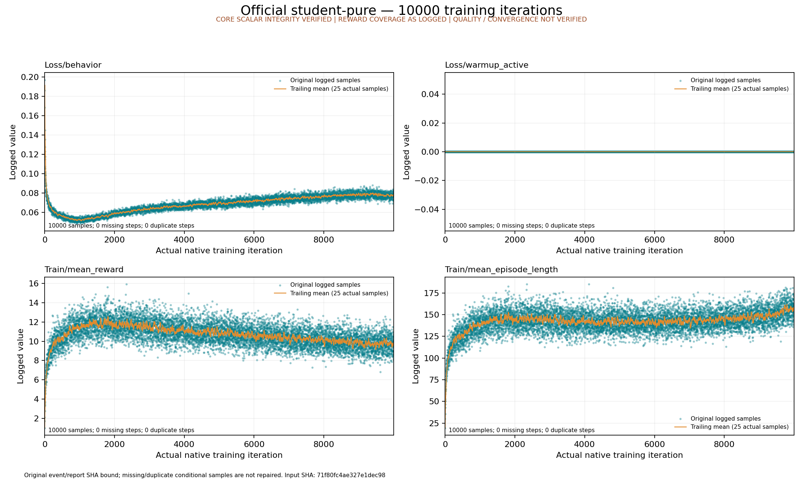

[从公开包完整重放](usage_assets/reports/official-student-pure-training-curves-replay/index.md)已实际恢复原输入和四份代码，在新CPU容器中重新提取、绘图，两个阶段及容器均正常退出0。43个tag的全部430,000行、coverage、原生身份与事件元数据和原结果逐项相等；新时间戳、来源SHA及完整新标量压缩另存，原包未改写。

**当前进度（2026-10-13，北京时间）：五类官方教师均已完成20,000轮，最终checkpoint为19999；五份最终产物均已完成独立CPU验收。** 第四个low-climb-76于10月12日16:22:35、第五个high-climb-76于10月13日07:14:48完成原生训练；两份[低攀爬](usage_assets/reports/official-low-climb-76-final/index.md)/[高攀爬](usage_assets/reports/official-high-climb-76-final/index.md)公开包已生成。纯DAgger学生已于10月13日17:34:35完成10,000轮、最终checkpoint9999，混合学生已自动开始30,000轮训练；16阶段全日程、官方物理评估、云端888逐源尝试、最终自训学生58例和两学生各629配置均未完成。CPU有限性、训练记录完整或公开包恢复通过，不表示策略收敛、技能成功或真机验收。

**历史进度快照（2026-10-11 17:39 UTC）：官方教师已完成3/5，locomotion、low-step与high-step各完成20,000轮及最终CPU验收；整套复现尚未完成。** 三者均使用4096环境、64地形变体、seed/obstacle_seed 42，最终checkpoint为`model_19999.pt`。high-step于17:10 UTC自然完成，原顺序任务自动进入low-climb-76；17:12 UTC真实阶段快照确认该第四教师已开始运行。其余两教师、两学生、官方物理评估、888逐源尝试及最终自训学生58例仍待完成。公开ONNX的全629逐帧闭环结果已另行出版，不能代替正式自训学生验收。[首教师历史最终产物与CPU验收](usage_assets/reports/official-locomotion-final/index.md)及首次失败记录保持原样。

**验收范围补充：** 正式两学生的原58例包括每模型12个平地方向项（各8秒）与17个代表场景项（固定前进各10秒）。每模型仍有612配置未选，代表场景的10秒前进也不等于完整原参考序列；后续须各执行全629配置的完整15维、50Hz指令，合计1258例、2516个正常worker/宿主映射及1258段全片解码。[全629参考指令准备](usage_assets/reports/final-student-reference629-preparation/index.md)现仅源码审查和缺前提`status`实际退出0并返回waiting；CPU计划、正式模型绑定和物理验收尚未执行。公开ONNX结果不能代替，执行完成也不等于技能或课程成功。

正式两学生全629的[结果发布与恢复工具](usage_assets/reports/final-student-reference629-publication-preparation/index.md)现已完成源码审查、两个帮助入口与缺前提waiting分支的实际执行，以及[隔离源码恢复实测](usage_assets/reports/final-student-reference629-publication-source-checks/index.md)：模拟Git权限变化后，92个源码路径的内容与原目标权限均核对通过。完整1258例、2516个worker/宿主映射、1258段MP4全片解码、实际结果发布及完整结果恢复仍待正式模型和原前置任务完成；公开ONNX已有结果不能代替。`quality_verified=false`、`obstacle_course_completion_verified=false`。

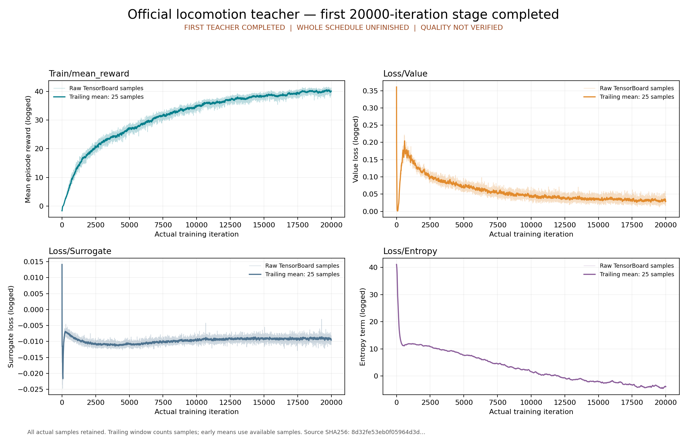

[low-step最终产物与可复现CPU验收](usage_assets/reports/official-low-step-final/index.md)已实际通过五阶段，宿主等待与容器退出均为0。完整PT的68个tensor均有限，actor/critic输入为449/575维、动作29维；相对同run的iter0 PT，actor和critic权重更新，Adam计数从20推进到400,000。iter0已经过第一轮优化，不能当成未训练初值。四条TensorBoard tag各有20,000个有限样本，覆盖step 0–19999；原ONNX的12项CPU检查通过，内嵌参考表长度`T=1,643,264`。12项是两种合成观测×六个时间索引，不是全部参考帧或56个原动作片段的物理覆盖。YAML仅`actor.output_dim`由`['robot_action_dim']`解析为`[29]`，其余配置精确相等，PT与ONNX内嵌全配置也精确一致。[checkpoint报告](usage_assets/reports/official-low-step-final/cpu-01/validation/checkpoint.json)、[完整标量](usage_assets/reports/official-low-step-final/cpu-01/validation/scalars.json)、[ONNX报告](usage_assets/reports/official-low-step-final/cpu-01/validation/onnx.json)及[绑定报告](usage_assets/reports/official-low-step-final/cpu-01/validation/bind.json)保留数值和来源；`quality_verified=false`、`convergence_verified=false`、`pt_onnx_numerical_parity_verified=false`。 [公开恢复入口的实际复跑记录](usage_assets/reports/official-low-step-final-replay/index.md)另行封存：恢复输入SHA与原件一致，五阶段及容器再次实际退出0；原验收包保持不变。

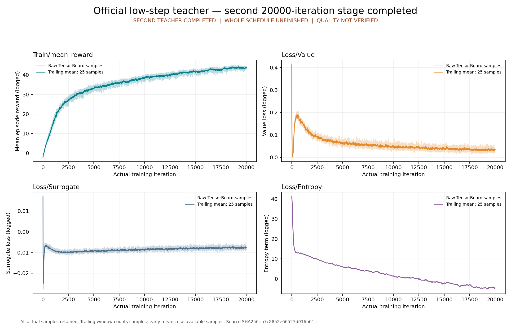

第三个high-step教师于2026-10-11 17:10:20 UTC自然完成20,000轮，最终checkpoint为19999；原顺序任务已进入low-climb-76。17:27 UTC，[high-step最终产物与五阶段CPU验收](usage_assets/reports/official-high-step-final/index.md)的checkpoint、scalars、ONNX、bind、plots均实际退出0，容器自然退出0。68个tensor有限，actor/critic输入449/575维、动作29维，同run的iter0/最终PT全配置相等，权重更新且Adam计数20→400,000；iter0已经过第一轮优化。四条TensorBoard tag各有20,000个有限样本；原442,848,025-byte ONNX通过12项CPU检查，参考表`T=1,696,832`。12项仅为两种合成观测×六个时间索引，T也不是独立动作数或课程成功数。YAML仍只允许`robot_action_dim→29`这一项原生解析，PT与ONNX内嵌全配置精确相等；`quality/convergence/PT-ONNX parity=false`。[公开恢复入口的实际复跑](usage_assets/reports/official-high-step-final-replay/index.md)已用无损还原的同一输入再次实际通过五阶段与容器退出0，原封存验收包保持原字节。在上述2026-10-11历史快照中，官方教师当时完成 **3/5**，其余两教师和后续任务当时仍待完成；当前5/5状态见本文开头。


第四、第五教师最终产物已分别[独立验收并出版](usage_assets/reports/official-low-climb-76-final/index.md)、[独立验收并出版](usage_assets/reports/official-high-climb-76-final/index.md)：

| 官方教师 | 原生完成时间（北京时间） | 最终PT SHA-256 | 原ONNX字节数／图内参考帧数 | 实际CPU范围 |
| --- | --- | --- | --- | --- |
| low-climb-76 | 2026-10-12 16:22:35 | `ae7573e3d94ec77b679af87d2adbad7d847e9577da45b64554ffe74e6aabf19e` | 547,696,678 B／2,100,096帧 | 五阶段实际0；12项ORT |
| high-climb-76 | 2026-10-13 07:14:48 | `654ba5619704da6b3d8a8f8f7b1ee60ab8d8a73efafc660f6706eb11f89f9e0e` | 420,849,957 B／1,612,224帧 | 五阶段实际0；12项ORT |

两者实际保存配置均为4096环境、64地形变体、seed/obstacle_seed42、20,000轮，最终`iter/iteration=19999`。完整PT各68个tensor有限，actor/critic/action为449/575/29维；同次训练iter0→19999配置一致，actor/critic权重有限非零更新，Adam计数20→400,000。iter0已经过首轮优化。四条TensorBoard tag各20,000个有限样本、step0..19999；图中保留原始值及明确标注的25样本后向均值。YAML仅允许原生`robot_action_dim→29`单字段解析，PT与ONNX内嵌全配置精确一致。12项ORT仍只是两种合成观测×六个时间索引，不是全部参考帧对照或40个source clip的物理技能验收。

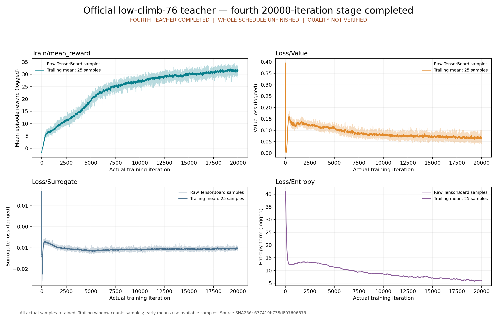

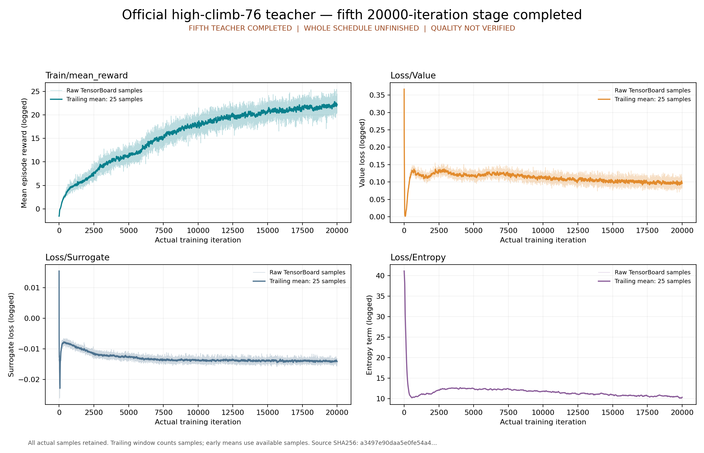

[高攀爬公开恢复入口的真实复跑](usage_assets/reports/official-high-climb-76-final-replay/index.md)已还原同一五份产物及完整事件，五阶段、宿主attach wait与新隔离容器自然退出均为0；原封存包保持原字节。[低攀爬公开replay的实际复跑](usage_assets/reports/official-low-climb-76-final-replay/index.md)也已通过五阶段、宿主attach wait与新隔离容器自然退出0，五份原件共640,979,040 B与原CPU输入一致；4×20,000个标量科学字段相同，ONNX的12项/T=2,100,096完整报告字节相同，独立回执已封存。CPU及归档验收保留`quality_verified=false`、`convergence_verified=false`、`pt_onnx_numerical_parity_verified=false`和全日程未完成；五个训练manifest通过不等于16阶段通过。旧teacher-only PID仅观察为absent，无法推断退出原因或OS返回码。

旧SDK历史纠正：北京时间15:48已有序停止旧629物理批次，原279 reported completed/5失败/1中断/344未运行均保留。旧监督遗漏最终worker退出码，已有10个reported completed及旧12指令的command02存在模拟器SIGSEGV；这些不能作为正常退出验收。修复监督与SDK后，原5个显式失败配置的新闭环全部正常退出，[新五例原生试跑](usage_assets/reports/sdk018-native-pilot/summary.md)、[停止回执](usage_assets/reports/sim2sim-cohort-halt/summary.md)、[逐日志实证](usage_assets/reports/worker-exit-completed-log-audit/report.md)保持原始范围；新629的实际终态见下文。

13:27 UTC历史记录：fresh629的原宿主监督会话实际返回143，容器内原始仿真继续执行；原launch receipt保持原字节。[监督中断与四例观察缺口](usage_assets/reports/fresh629-supervision-interruption/index.md)保留当时工具结果、Docker原exec身份及578例时的统计。

14:21 UTC恒定指令扫描完成恢复验收与出版：原629配置覆盖17场景，每例500个策略tick，1258个worker正常退出，629段视频完整解码；原host观察有1250个唯一映射和8个历史缺口，另四例独立补验提供8个新映射、4段完整视频。实际共633次attempt，覆盖629个唯一配置，原退出143与旧缺口永久保留。[629配置画廊及全部原始证据](usage_assets/reports/sim2sim-full629-sdk018-recovered/index.md)记录139例高度/倾斜阈值事件与490例未触发结果，`quality_verified=false`。完整离线画廊已[实际浏览器检查](usage_assets/reports/sim2sim-full629-sdk018-recovered-browser/index.md)。

[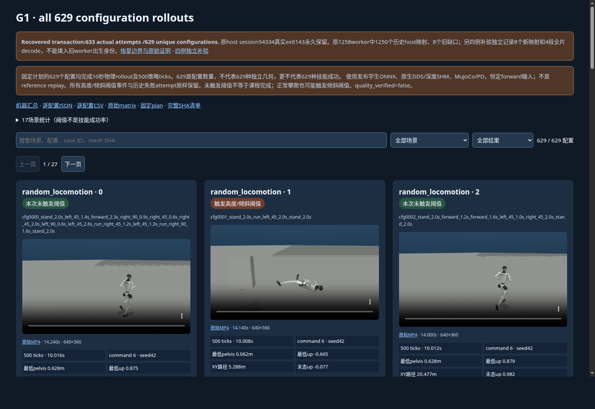](usage_assets/reports/sim2sim-full629-sdk018-recovered/playback.html)

完整方向键与Backspace也已[实际通过](usage_assets/reports/native-keyboard-reset-allkeys/index.md)：一份424帧录制覆盖0–11全部部署指令，每个非零标签至少12帧；真实窗口重置使MuJoCo time从11.57秒归零，随后物理/控制/深度继续推进。双方原main/atexit与wrapper正常退出，全部原事件、录制、原视频和宿主进程映射已保存。

新增[原始逐帧指令的真实闭环试跑](usage_assets/reports/reference-command-native-pilot/index.md)：`high_speed_speed_vault/run_left_45_0.3s`的341帧、6.82秒指令全部送入公开策略，原生录制的完整15维标签逐元素一致，两个worker正常退出，原MP4完整解码，最终147项CPU回归通过。原629扫描只使用恒定前进，不能证明这些时序。新试跑仍触发倾斜阈值0.18秒，`quality_verified=false`；它证明输入和物理执行通路，不证明翻越成功。后续完整629逐帧结果见下文。

[真实629配置CPU预检](usage_assets/reports/reference629-plan/index.md)已通过，逐例读取全部NPZ，合计342,651帧、6,853.02秒参考指令时长，并绑定377份依赖及1887份输入；全计划无损压缩且解压whole SHA一致。这是原生批次的输入计划，不是物理运行结果。

15:38 UTC完整逐帧批次实际启动，同容器的预启动计划与CPU计划逐字节一致；[15:40 UTC固定启动见证及首例原始产物](usage_assets/reports/reference629-native-start/index.md)保留当时4例完成、1例运行、0例执行失败的历史快照，当时尚无整批终态。

20:23 UTC全629逐帧结果已[完整出版](usage_assets/reports/reference629-full/playback.html)：17场景共342,651帧，按50Hz执行原始15维指令，参考指令时长6,853.02秒。原生宿主父进程于20:19:24 UTC真实退出0，独立CPU后验父进程于20:21:45 UTC退出0，publisher及其独立父进程也退出0；1258个worker正常退出、1258份宿主出生映射和629段原始MP4完整解码均通过，冻结源码与输入未变。321例触发高度/倾斜阈值，308例未触发，`quality_verified=false`、`obstacle_course_completion_verified=false`；未触发不能解释为课程成功。实测物理计时合计6,858.676秒，与6,853.02秒参考指令时长分别记录。[机器汇总](usage_assets/reports/reference629-full/summary.json)、[全部逐配置记录](usage_assets/reports/reference629-full/cases.json)和[完整SHA清单](usage_assets/reports/reference629-full/evidence-manifest.json)保存全部结果与原始证据。该批次使用公开ONNX，不代替仍在训练的正式自训学生验收。

完整画廊的[真实浏览器验收](usage_assets/reports/reference629-full-browser/index.md)也已退出0：逐项检查629个视频的metadata与中点seek、1258张缩略图/世界XY图、全部27页，以及321/308/629筛选、搜索和实际播放推进。14,566个发布文件逐SHA核对通过；没有重跑策略或仿真。

[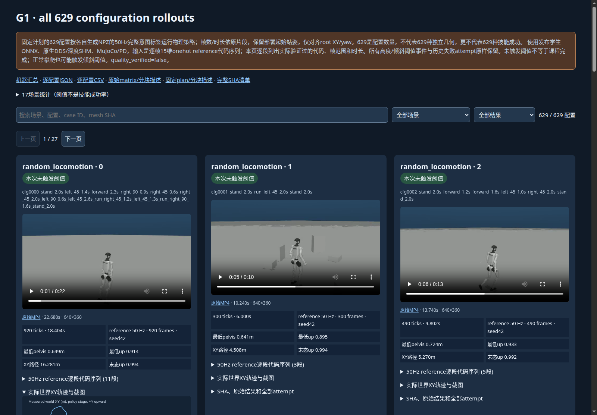](usage_assets/reports/reference629-full/playback.html)

[两例真实CPU后验](usage_assets/reports/reference629-cpu-preview/index.md)保留整批结束前的局部证据：920帧/18.4秒和300帧/6秒原生产物，共核对1220帧完整15维指令、4个正常退出worker及2个原始MP4全片解码。实际validator与独立宿主父进程均退出0，原始5184份源码、发布模型与冻结overlay未变。最终211项组合CPU检查也已通过。这个报告仍为`preview_validated`，不改写成完整629终态；[原片与逐段指令](usage_assets/reports/reference629-cpu-preview/playback.html)保留真实高度/倾斜阈值结果。生产publisher当时的真实预览及浏览器均退出0，完整发布入口则对尚未结束的批次真实拒绝并退出2；原计划103MB与运行中矩阵119MB的分块还原SHA一致。这些历史记录与之后的完整出版分别保存。

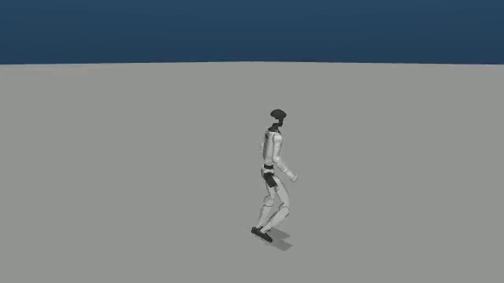

教师、纯DAgger和DAgger+PPO的[真实断点续训](usage_assets/reports/native-resume-acceptance/index.md)已完成：6次原生训练，历史3步加新15步完成原18步；优化器、权重更新、冻结专家、TensorBoard、最终ONNX与skip均通过。保存iter1后原生resume会重做index1，target4最终为iter3；这不是仅新增两轮或完整随机状态恢复。首次过严日志检查失败和一次GPU占用门卫拒绝均原样保留。

历史记录：后台交接于14:37 UTC[替换为恢复生命周期版本](usage_assets/reports/final-student-delivery-waiter-recovered/index.md)，首次真实SSH仍为waiting，未fetch/prepare/native。当时官方五教师及后续任务仍待原任务完成；当前五教师已完成，纯学生在训，不能宣称全部复现结束。

先看真实结果：[新SDK全部12指令的正常退出复测与逐段视频](usage_assets/reports/sdk018-directions/summary.md)、[新SDK五个历史失败配置的视频与跌倒结果](usage_assets/reports/sdk018-native-pilot/summary.md)、[17 场景参考动作播放页](usage_assets/motion_matching/playback.html)、[旧17场景物理轨迹播放页](usage_assets/sim2sim/scenarios/playback.html)、[逐项原始报告](usage_assets/reports/)。参考动作来自生成数组，闭环录像来自公开 ONNX 策略驱动的 MuJoCo，训练录像来自实际 Isaac checkpoint；旧17场景页不证明完整正常退出。

在本地仓库运行下面的标准库服务后，可打开 `http://127.0.0.1:8088/sim2sim/scenarios/playback.html` 或 `http://127.0.0.1:8088/motion_matching/playback.html` 交互查看；不需要安装包。

```bash
python3 -m http.server 8088 --bind 127.0.0.1 --directory usage_assets
```

[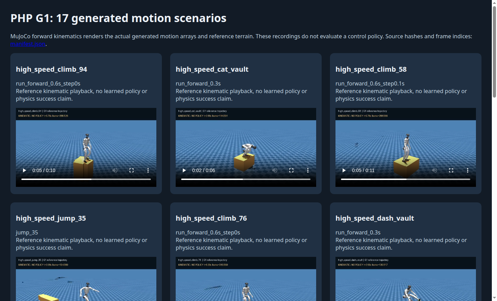](usage_assets/motion_matching/playback.html)

播放页的17个MP4已在已有Chrome中逐一加载、核对时长并seek解码关键帧；[浏览器验收报告](usage_assets/reports/motion-gallery.json)保留每个文件结果。

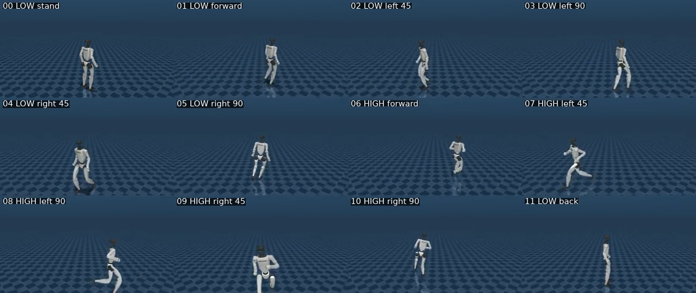

[播放这段同步视频](usage_assets/sim2sim/directions.mp4)。每项均为 8 秒仿真时间，50 Hz 原生策略控制。完整路径与转角见后文，不能把转弯绕圈时的小净位移当作没有行走。

## 1. 证据与功能边界

| 证据 | 证明的内容 |
| --- | --- |
| 资产 SHA-256 验证 | 输入与官方公开发布一致 |
| CPU 测试与配置检查 | 数据处理、导出、注册、CLI 等代码契约 |
| 全场景动作匹配 | 生成了有效的参考动作/方向指令/地形文件 |
| 参考动作视频 | 真实生成数组的运动学回放；画面带 `KINEMATIC / NO POLICY` |
| 有界训练与评估 | 实际启动、梯度更新、保存/加载 checkpoint、渲染、导出通路 |
| 默认迭代训练 | 使用记录中的默认训练量；完成迭代仍需评估策略质量 |
| MuJoCo 原生闭环录像 | 深度图、DDS 状态、ONNX 动作与物理机器人相互连接；另报告跌倒/位移 |

这几类证据分别统计。参考动作中的翻越成功不等于策略掌握该技能，吊架辅助站立不等于无辅助稳定行走，有限值 ONNX 输出不等于跑酷成功。

## 2. 公开资产

2026-10-10 已在本机完成七组资产的包及逐文件校验：682 个文件，解压文件总计 862,921,430 字节。包括 19 个数据库、32 OBJ、32 JSON、学生 ONNX 双模型以及 296 组官方动作/地形对和各组 README。完整记录为 `outputs/research/asset-verification/results.json`，输入发布清单为 [release-assets.json](release-assets.json)。

仓库内保留了可直接查看的 [逐文件验收记录](usage_assets/reports/asset-verification.json)。

```bash
python3 scripts/research/verify_assets.py
python3 scripts/research/verify_assets.py --verify-only
```

五类教师数据是 `locomotion`、`low-step`、`high-step`、`low-climb-76`、`high-climb-76`，分别为 100、56、60、40、40 对。公开发布没有原生教师 checkpoint，因此教师与自己的学生需要实际训练。

## 3. 全部动作场景与技能

全部 17 种公开场景、629 组配置来自 [builtin.py](motion_matching/motion_matching/scenarios/builtin.py)。计数由容器内实际 catalog 检查得到，含自由移动的 100 组配置：

| 类别 | 场景函数 |
| --- | --- |
| 自由移动 | `random_locomotion` |
| 台阶 | `low_speed_step`、`high_speed_step` |
| 攀爬 58 | `low_speed_climb_58`、`high_speed_climb_58` |
| 攀爬 76 | `low_speed_climb_76`、`high_speed_climb_76` |
| 攀爬 94 | `low_speed_climb_94`、`high_speed_climb_94` |
| 翻滚 | `low_speed_roll_78`、`low_speed_roll_90`、`high_speed_roll_134` |
| 跨栏与腾跃 | `high_speed_hurdle`、`high_speed_dash_vault`、`high_speed_speed_vault`、`high_speed_cat_vault` |
| 跳跃 | `high_speed_jump_35` |

技能注册表共 29 项，包含 locomotion 与 28 个方向/速度/动作技能。完整验收遍历每个场景的全部配置，再单独执行 28 个 traversal skill。仅用 `--representatives` 的首配置检查会在报告中单独标识，不能作为全配置覆盖。

```bash
bash scripts/research/docker.sh motion scripts/research/motion_matching_matrix.py \
  --skills --seed 42 --jobs 4 --output-dir /outputs/motion-matching
bash scripts/research/docker.sh motion scripts/research/render_motion_evidence.py \
  --matrix /outputs/motion-matching/matrix.json --output-dir /outputs/motion-videos
```

每个动作 NPZ 检查动作匹配导出的 tracking 字段、50 FPS、29 关节、有限值、四元数和 15 维 one-hot 方向指令，并检查配对地形 NPY 与 OBJ。该导出需要转换为 Holosoma native 格式后用于训练；不能与296组已发布native数据混称。生成数据实际使用指令索引0–11，12–14为保留维。四任务并发时每个子进程将OpenBLAS/OMP/MKL线程数设为1。参考录像默认使用CPU OSMesa，不需要DISPLAY。录像清单记录源数组和地形 SHA-256、源帧采样位置、编码参数及产物 SHA-256。所有生成结果保留在忽略目录，图片/视频验收后选取证据保存到本仓库。

实际结果是 **629/629 配置、28/28 独立 traversal 技能通过**，seed 42。每种场景各保存一个完整配置的 MP4、GIF 与 PNG，共 17 组；视频范围为每场景一个配置，数组验收范围为全部配置。自由移动视频选择含 5 个障碍的 clutter 配置，所有 50 个 clutter 配置实际含 5–15 个障碍。[全部场景计数和技能清单](usage_assets/reports/motion-summary.md)、[逐配置 JSON](usage_assets/reports/motion-matching.json)、[视频来源与哈希](usage_assets/motion_matching/manifest.json)。

| 参考轨迹示例 | 预览 | 完整视频 |
| --- | --- | --- |
| 低速台阶 | 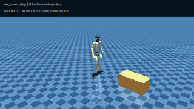 | [MP4](usage_assets/motion_matching/low_speed_step.mp4) |
| 高速攀爬 76 cm | 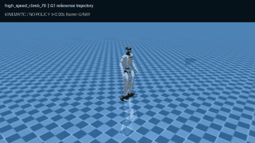 | [MP4](usage_assets/motion_matching/high_speed_climb_76.mp4) |
| 翻滚 78 cm | 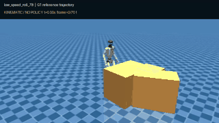 | [MP4](usage_assets/motion_matching/low_speed_roll_78.mp4) |
| Cat vault | 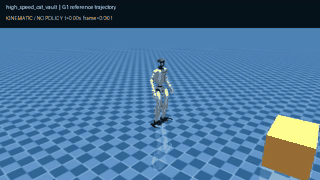 | [MP4](usage_assets/motion_matching/high_speed_cat_vault.mp4) |

这些画面标注 `KINEMATIC / NO POLICY`；[离线播放页](usage_assets/motion_matching/playback.html) 包含全部 17 场景，支持播放、暂停与拖动。

## 4. 数据库、浏览器与键盘交互

本次离线工作流使用`generate_database`、`play_database`、交互`run`、批量`run --mode generate`、`motion_visualizer`和本地`file://`数据解析。数据库生成必须使用G1 qpos格式及正确FPS。Viser页面提供播放、逐帧、速度、文件切换、关节/根位姿、地形可见性与地形变体控制；Tk键盘输入依赖GUI会话。

本分支将 GUI 到动作匹配的 JSON 文件传输改为同目录原子替换，读入异常时保留上一份有效指令，避免后台线程写文件中途导致交互主循环停止。回归测试为 [test_keyboard_controller.py](motion_matching/tests/test_keyboard_controller.py)。实际 GUI 和可视化结果按独立报告记录。

离线验收 **26/26 项通过**：数据库烘焙、五组完整发布native bundle与17场景的本地物化/校验，以及三个Viser/Tk入口。发布数据296组与生成数据629组共925组native动作；每个生成场景先将tracking动作转换并复制配对地形，再复核所有持久文件SHA-256、字段尺寸、有限值及实际`file://` registry CLI/Resolver。训练与曲线使用本地数据和TensorBoard；验收脚本阻断远端实验SDK导入，motion与registry验收进程的导入次数均为0。[工作流报告](usage_assets/reports/motion-workflows.json)保留命令和输出，[22份逐文件校验清单](usage_assets/reports/local-bundles/)保留源文件与物化文件哈希。

另按note.md的官方CLI在新的`/outputs`工作目录实际生成40组`high_speed_climb_76`，目录转换40/40个NPZ并复制40个同名terrain NPY后，Holosoma native bundle校验通过；[文档命令复查报告](usage_assets/reports/documented-motion-commands.json)记录实际字段尺寸和日志hash。参考录像脚本在空DISPLAY下默认OSMesa重录2个pilot也通过，见[默认渲染检查](usage_assets/reports/reference-render-default.json)。

真实浏览器点击播放后，Frame 从 0 推进到 94；Tk 定向按下 I/Tab、释放和退出后，JSON 指令驱动 180 步、3 秒参考运动，XY 位移 5.2125 m。截图来自本次窗口和页面，宿主使用已有 Chrome，无新增 Python 包。

按note.md切换GUI容器后，在仓库根目录复跑下列有界检查。各输出目录应为空；先结束已有Viser服务，使8080/8081空闲。输入沿用第3节生成的`/outputs/motion-matching`：

```bash
bash scripts/research/docker.sh motion scripts/research/verify_motion_workflows.py \
  --matrix /outputs/motion-matching/matrix.json --output-dir /outputs/motion-workflows-new --interactive-gui
bash scripts/research/docker.sh motion scripts/research/verify_keyboard_gui.py \
  --output-dir /outputs/keyboard-gui-new
python3 scripts/research/viser_browser.py \
  --motion-file /outputs/motion-matching/scenarios/low_speed_step \
  --output-dir outputs/research/viser-browser-new
```

最后一项使用宿主已有的Chrome/Chromium；生成服务与全部Python依赖仍在Docker。该浏览器自动检查验证播放按钮及帧推进，其他编辑控件的存在与数据格式回归不等于逐控件浏览器操作验收。

补充验收已实际操作两条完整保存流程，并修复地形配对缺失：Viser切文件、选地形variant、重随机、速度2.0保存223帧，原15维one-hot保留、源地形全部变体和OBJ同步配对；主程序用真实Tk I/J按下/释放，再点Start/End Recording，保存259帧@50Hz、空地形与ground OBJ及来源JSON。两条结果均通过单文件/目录转换、诊断、本地`file://`解析和CPU原生MotionLoader；相关IO/public测试25项通过，其中public12项、纯新增4项。交互录制仍无方向标签，sidecar与GUI明确提示，没有倒推label。[原失败、修复后截图、转换与精确源码](usage_assets/reports/gui-workflows/summary.md)。

独立`play_database`也已真实浏览器验收：27次操作覆盖全部11个可操作控件和contact读数。暂停保持帧，seek100→728切到源数据中不同姿势；Speed0.5/2.0在本次观察器下约39.1/155.0帧每秒；Min200/Max210确实clamp，Auto Play在上界停止。接触读数/marker与原DB一致，follow/XYZ/smoothness的实际client相机读回通过。原生播放器未改、主循环异常0；前四次取证脚本失败的日志也保留。[完整原生读回、命令与失败边界](usage_assets/reports/database-gui/summary.md)。

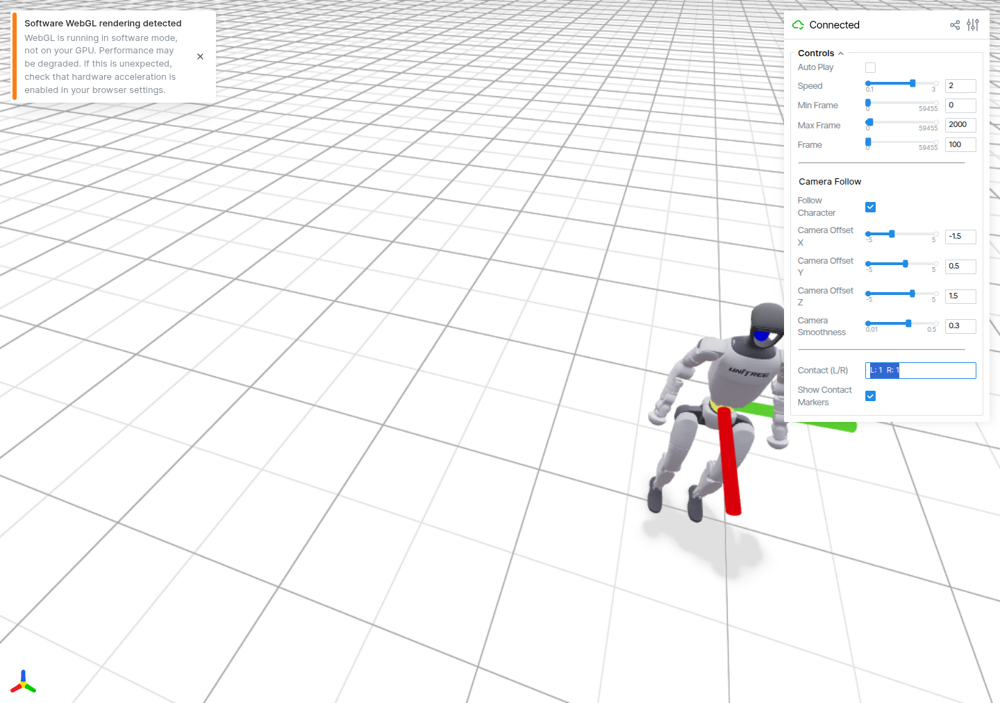

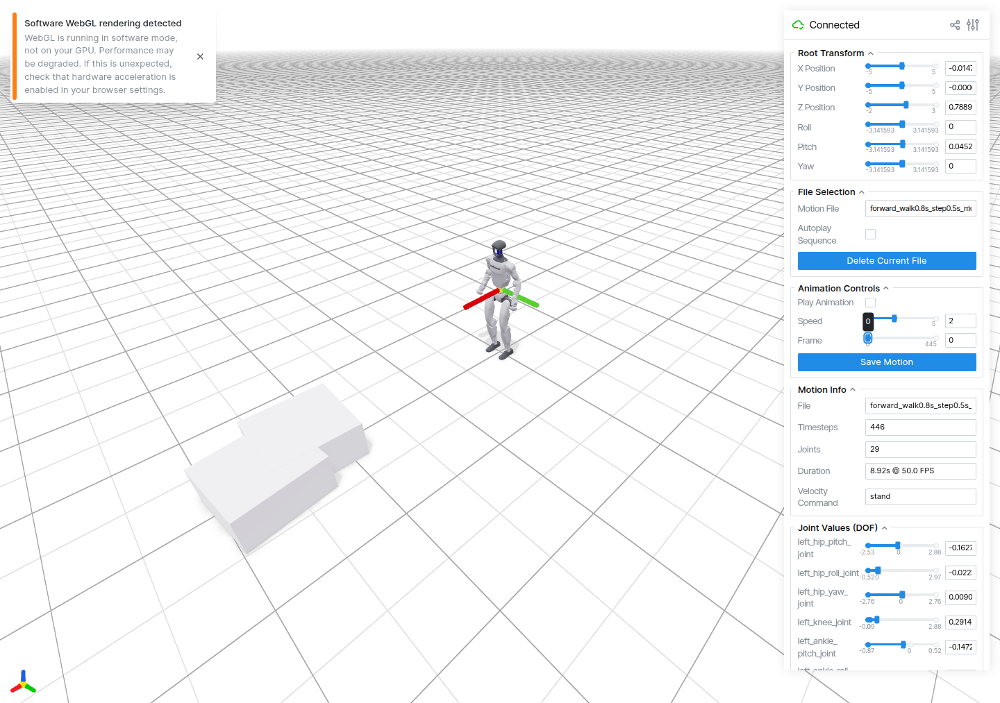

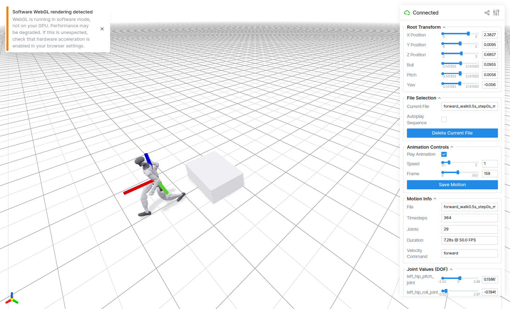

[浏览器结果](usage_assets/reports/viser-browser.json)；[键盘窗口截图](usage_assets/keyboard-controller.png) 与 [键盘结果](usage_assets/reports/keyboard-gui.json)。另外修复了从仓库根目录启动时资源路径定位错误、Quit 未同步写停止状态，以及窗口裁掉技能/退出控件的问题。

真实 low-step BeyondMimic 数据的单文件/目录转换、诊断 CLI 和原生 registry 加载已通过：364 帧，native 位置 `[364,36]`、速度 `[364,35]`、32 body 与 15 维命令，逐数组映射精确核验。[转换报告](usage_assets/reports/motion-conversion.json)。转换器现会拒绝单帧、非有限值和错误格式，并返回失败状态。

## 5. 训练、Isaac Sim 评估与导出

默认流程是五个 height-scan 教师，每个 4096 环境、20000 迭代；学生有纯 DAgger（2048 环境、10000 迭代）与 DAgger + PPO（2048 环境、30000 迭代）两种。全部六个教师配置和两个学生配置见 [acceptance_matrix.json](scripts/research/acceptance_matrix.json)。

```bash
# 每条命令都在选卡后的云端统一 Docker 中执行
python3 scripts/research/cloud.py exec bash scripts/research/train_pipeline.sh teachers --profile smoke
python3 scripts/research/cloud.py exec bash scripts/research/train_pipeline.sh teacher-presets --profile smoke --skills locomotion
python3 scripts/research/cloud.py exec bash scripts/research/train_pipeline.sh eval-teachers --profile smoke --eval-steps 250
python3 scripts/research/cloud.py exec bash scripts/research/train_pipeline.sh distill-pure --profile smoke
python3 scripts/research/cloud.py exec bash scripts/research/train_pipeline.sh distill-finetune --profile smoke
python3 scripts/research/cloud.py exec bash scripts/research/train_pipeline.sh eval-student --profile smoke --student-kind finetune
python3 scripts/research/cloud.py exec bash scripts/research/train_pipeline.sh export --profile smoke --student-kind finetune
```

smoke 采用显式缩小的并行环境、布局和迭代数，检查实际梯度更新与 checkpoint/ONNX 生成。正式训练用 `--profile official`，并记录所有显式 override。恢复按 checkpoint 中的真实迭代计算剩余量；成功记录需与 checkpoint 内容和 SHA-256 一致。Isaac Sim 评估与手动导出需要 `.pt`，不能用公开 ONNX 文件冒充。

本地 16 GiB 卡已完成 locomotion 教师实际训练：16 环境、2 迭代、768 timesteps，23.376 秒，随后真实加载 checkpoint、完成 100 步评估与 6 段原生录像。未收敛的教师频繁终止，最长片段只有 0.70 秒。[训练与评估报告](usage_assets/reports/runtime-summary.md#本地实际-isaac-smoke)、[示例 MP4](usage_assets/videos/runtime-isaac-smoke.mp4)。这是加载/渲染通路验收，不是成功的跑酷策略演示。

初版镜像的云端 **22/22 项 smoke** 已完成：五类教师、六种教师 preset、五类教师评估、两种学生训练、两种学生评估与两种独立导出。每次训练均实际更新权重；两类学生导出的双 ONNX 各通过 30 组真实推理。全部阶段耗时 683.109 秒，13 个训练 run 的 TensorBoard loss/reward 都是有限值。[初版云端汇总及原始报告](usage_assets/reports/training-cloud-summary.md)保留 checkpoint、源代码快照和模型哈希。

首版冻结统一镜像及源码 `3439cb7` 又完整复跑 **22/22 项，通过、退出码 0**，耗时 711.748 秒。13 个训练阶段逐一验证了两轮之间权重的有限性和非零更新；五教师共 60 组真实 ONNX 推理，两学生独立导出各 30 组推理均通过。七次新版质量评估、29 份原始 TensorBoard events、140 个下载产物 SHA 和运行前后 1903 个源码文件均已复核。[最终验收汇总](usage_assets/reports/training-cloud-final/summary.md)、[逐项报告](usage_assets/reports/training-cloud-final/summary.json)、[本轮视频与来源 SHA](usage_assets/reports/training-cloud-final/media.json)。未收敛的失败短片也完整保留，例如[教师 locomotion](usage_assets/videos/final-cloud/eval-teacher-locomotion.mp4)和[学生 finetune](usage_assets/videos/final-cloud/eval-student-finetune.mp4)，不能作为技能成功证据。

进一步对六种教师preset各自保存的PT/ONNX实跑CPU检查：72个图内参考查询与60个确定性动作均值对照全部通过，最大绝对误差6.33e-8，输入模型未变且CUDA未初始化。三个no-heightscan actor/critic为160/286维，其余为449/575维，pelvis/torso anchor和缩放配置分别核对。YAML与PT有原生`robot_action_dim`→29展开差异，原比较false保留且没有改写输入。新增8项错配拒绝测试通过，独立复核也通过；五个非默认preset后续已完成[SDK0.1.8原生重载验收](usage_assets/reports/teacher-preset-reload-sdk018-v3/summary.md)：各16环境、100步，五次native退出0，32段视频完整解码；累计251次失败重置，技能质量、收敛和全部原动作覆盖仍未验证。[六配置来源、输出与原始报告](usage_assets/reports/teacher-presets-cpu/summary.md)。

学生原生 `--show-depth True` 也已实际运行：同一 smoke 纯学生 PT、4环境、100步，OpenCV 真实显示100帧、98个不同数组SHA，全部有限，进程退出码0、耗时17.168秒。精确标题窗口的两张X11截图已目检，输入PT和评估源码前后未变。初始观察命令的3次参数错误及失败日志保留；修正日志参数后通过，没有修改训练/评估器。本次未达到默认视频间隔，没有生成MP4，不借用其它实验影片。[观察报告与完整命令](usage_assets/reports/depth-gui/summary.md)。

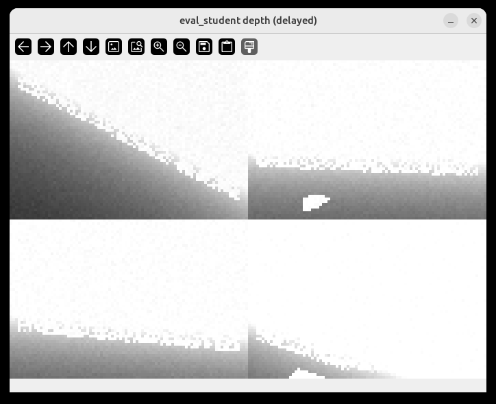

另按官方 locomotion 默认并行量和完整预处理运行 **4096 环境、20 迭代 pilot**，保存 iteration 19 的原生 checkpoint。显存采样峰值为 20479 MiB，18 个稳定核心迭代的中位耗时为 2.321 秒；对应 20000 轮的 collection+learning 估算约 12.89 小时，不包括初始化、保存和评估。其他教师和学生的耗时需要分别测量。完整官方日程尚未完成，见[pilot 实测与限制](usage_assets/reports/training-cloud-official-pilot.json)。

两种学生也已按官方并行量和完整学生预处理各运行 **2048 环境、20 迭代容量 pilot**。纯 DAgger / DAgger+PPO 的显存峰值为 11399 / 9063 MiB，去首两轮的核心耗时中位数为 3.4255 / 3.9320 秒；两者实际配置均为 3 variants、96 minibatches、2 epochs、24 steps/env、save interval 500。权重更新、各 30 组双 ONNX 推理和 TensorBoard 0–19 全部通过。[容量实测报告](usage_assets/reports/training-cloud-student-capacity.md)注明旧镜像、未收敛专家与唯一的 20 轮日程缩短；这些数据不证明正式训练质量或已训练专家下的最终吞吐。

**正式完整日程已于北京时间 2026-10-10 12:20 启动，尚未完成。** 使用最终镜像和上述冻结源码，在物理 GPU 1 上依次训练五教师各 20000 轮、纯学生 10000 轮、混合学生 30000 轮，再执行质量评估及导出；保存间隔仍为 500。首教师的实际保存配置确认 4096 环境、64 variants、seed/obstacle_seed 42。12:29 的离线 TensorBoard 已记录 step 0–114，所检查的 loss/reward 全部有限；这只是运行中的证据。[启动、配置与进度快照](usage_assets/reports/official-full-start/summary.md)。本机已建立 SSH 转发，打开 `http://127.0.0.1:6007/` 可看实时曲线；远端事件目录是 `/outputs/official-full`，无需登录。完整训练预计需要多天，最终模型与质量结论需等实际完成后补验。

独立质量入口还真实复跑本地未收敛教师：16 环境 × 100 control steps，共 32 env-seconds，49 次失败 reset、0 次超时；四项跟踪误差各记录 1600 个有限样本。它在 reset 清除状态前采样，关联 checkpoint SHA、实际录像和 17 个 `Evaluation/*` TensorBoard 标量。[质量 JSON](usage_assets/reports/isaac-local-quality.json)、[测试记录](usage_assets/reports/research-quality-training.xml)、[真实失败短片](usage_assets/isaac/local-teacher-quality.mp4)。报告的 motion ID 0 指顶层合并 NPZ，未记录原始动作片段的覆盖范围，不能据此声称覆盖全部 locomotion 数据。

4096 环境、20 轮 pilot 的 checkpoint 也实际通过云端新版入口评估：64 环境 × 250 步，四项误差各有 16000 个有限样本，发生 **3971 次失败 reset、0 次超时**。这是同一批环境反复终止的回合总数；64 段录像均来自配置指定的环境 0，最长仅 0.08 秒，不能称为 64 个环境各录一段或学习成功。合并输入包含 100 个源动作边界，但 native teacher eval 每次从合并库起点重置，这次短回合只反复测试起始部分。[原始评估与语义核验](usage_assets/reports/official-pilot-quality/summary.md)、[最长失败原片](usage_assets/isaac/official-pilot-quality/longest-original.mp4)。

随后将同一 PT 回传本地，实际完成 **16 GiB 卡上的 64 环境 × 250 步 Isaac 评估**，退出码 0、耗时 36.861 秒。35 次显存采样中，总峰值为 5797 MiB（含桌面），评估 compute process 峰值为 4826 MiB；可能漏掉短峰值。真实重建 1 variant 的地形/动作、四项误差各 16000 个有限样本、64 个新录像与 17 个 TensorBoard 标量均核验通过，仍有 3971 次失败 reset，最长原片 0.08 秒。[本地回传闭环完整记录](usage_assets/reports/official-pilot-local-quality/summary.md)。本次验证加载与仿真通路，不是收敛结论，也不证明本地能承担 4096 环境训练。

正式长训的 **iteration 500 中间 PT** 已单独回传、校验远端/本地 SHA，并在同样 64 环境 × 250 步设置下实际评估：退出码 0、全程 wall 28.405 秒，累计 **75 次失败 reset、0 次超时**，四项误差各有 16000 个有限样本。3 段原片来自环境 0，最长 3.22 秒；相较 iteration 19 pilot 的失败次数减少，但两个 checkpoint 来自不同运行，且仍未完成课程，`quality_verified=false`。PT 从 iteration 0 到 500 的 actor/critic 权重均有真实非零更新。[检查点来源、权重差异与本地录像](usage_assets/reports/official-progress-0500-local/summary.md)。这是首教师仍在训练时的历史检查；当前五教师与学生进度见本文开头，不把中间模型质量扩大为最终模型结论。

为避免合并库 ID 掩盖覆盖范围，另实现了 [逐源片段工具](scripts/research/eval_source_coverage.py)：全部 **296 对、181236 帧、50 FPS** 的数据格式、来源 SHA 和顺序校验通过，**48/48 项独立 CPU 回归通过**。实际本地 Isaac 分别尝试完整 920 帧 locomotion 源和两次完整 455 帧 low-step 源：teacher 第500轮运行 **158 策略步**后失败，纯/混合 student 的第1轮 smoke PT 均运行 **21 步**后失败。三次执行与证据保存通过，片段完成数为0，未声称跑完296源或888次尝试。[完整记录、复跑命令与原视频](usage_assets/reports/source-coverage-pilot/summary.md)。

正式模型后的衔接脚本 [posttrain_coverage.py](scripts/research/posttrain_coverage.py) 已完成 **61项调度/来源/保留证据回归**，与原48项联合109/109通过；独立复核最终61项也通过。真实smoke PT确认两种学生各自内嵌五个专家的40个MLP tensor和15个normalizer buffer均与有序教师逐位相同，检查全程未初始化CUDA。脚本等待官方16阶段全部完成才启动CPU配置/全源预检，再等固定GPU空闲后执行888次首次尝试；已有失败不重跑，换fresh目录会生成新批次身份和容器名。新fixture漏模拟Docker inspect导致的一次失败与修正后原始JUnit均保留。这些检查没有把smoke PT升级为正式模型，也不表示888次已执行。[CPU检查与准确边界](usage_assets/reports/posttrain-monitor/summary.md)。

该watch已于北京时间14:39真实部署。远端新快照全部文件和镜像内容指纹独立复核通过，实际只读dry-run返回16项训练未完成阻塞；后台进程处于`waiting`，原训练进程仍存活、源码挂载未变、Docker容器集合未新增。首教师14:38的TensorBoard记录到step3362，四类所查标量从step0起全部有限。以上是运行中证据，七模型与888次验收仍未完成。[远端检查、启动与持续轮询回执](usage_assets/reports/posttrain-monitor-deployment/summary.md)。

14:58独立只读快照确认首教师到step3872，四项loss/reward从step0起均有限；真实训练进程和watch均存活，原挂载不变。该次本地快照核验128项完整500ticks证据及全部2230个唯一输入文件。[实际PID、事件、SHA与快照范围](usage_assets/reports/live-audit-0658/summary.md)。这份快照早于下文15:00的native段错误，不代表之后没有异常。

正式学生选择性回传工具通过57项CPU回归，root独立复核同样57项通过（不相加）。真实SSH status于15:26返回waiting/16阻塞/没有cpu-ready，模型目标目录前后均不存在；没有回传任何模型。ready时仅允许四个学生ONNX与28份绑定JSON，核验最终PT/专家来源、成功CPU容器和前后SHA；不运行ORT或MuJoCo。[测试、准确命令与原始等待响应](usage_assets/reports/final-student-transfer/summary.md)。最终自训纯/混合学生的本地CPU推理和各12指令＋17代表场景闭环仍待正式产物，共58次计划，发布学生的629扫描不能替代。

这次还定位并修复了独立评估的 warmup 目标缓存问题：原生 `reset_all` 清零缓存后先检测终止，造成策略开始前的误终止。保留的三次修复前真实记录均为0策略步；按原公式刷新当前帧缓存后才得到上述158/21/21步。参考时间、RNG和终止条件均未修改，当前云训练也未改变。[修复推导与原生逐位对照](usage_assets/reports/source-coverage-pilot/cache-diagnosis/warmup-relative-cache-review.md)、[源码/数据/逐步记录的 SHA 清单](usage_assets/reports/source-coverage-pilot/evidence-manifest.json)。新旧共18个MP4均完整解码通过，启动/预热原片计入此数，不能用录像数推断片段完成数。

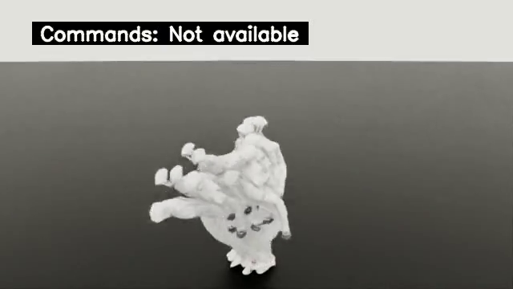

所有实验数据均为本地 `file://` 注册表，曲线使用离线 TensorBoard。在统一容器中运行以下命令，浏览器打开 `http://127.0.0.1:6006/`，即可查看入库的原始训练与评估 events：

```bash
docker exec php-parkour-research train-python -m tensorboard.main \
  --logdir /workspace/php_parkour/usage_assets/tensorboard \
  --host 127.0.0.1 --port 6006 --load_fast false
```

[TensorBoard 原始事件及 HTTP 验证](usage_assets/reports/training-cloud-summary.md#离线-tensorboard)记录了真实 loss/reward，服务器不需要外网或在线账号。

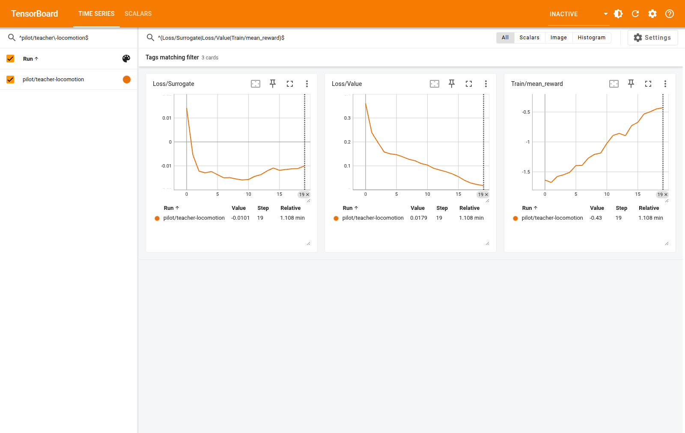

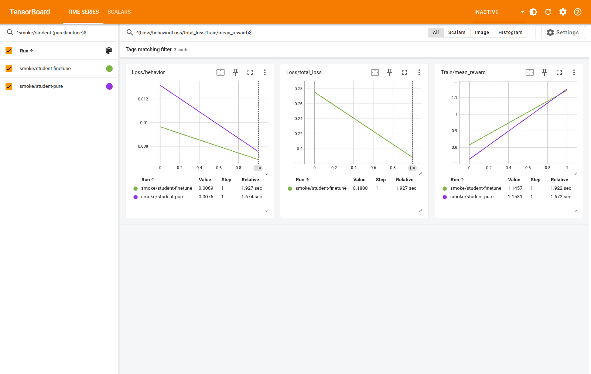

两张图均由本地 TensorBoard 页面实际筛选、绘制与截图，平滑为 0；浏览器显示的 8 条 series 已与 HTTP 原始标量逐项核对。[浏览器验收记录](usage_assets/reports/tensorboard-browser.json)。复查命令为 `python3 scripts/research/verify_tensorboard_browser.py --output-dir outputs/research/tensorboard-browser-new`，使用宿主已有 Chrome，无新增包。

## 6. ONNX 与全部部署指令

```bash
bash scripts/research/docker.sh inference scripts/research/validate_onnx.py \
  --models /data/assets/student --output /outputs/onnx/released.json
```

检查 depth backbone 和 student 两个模型的 ONNX checker、SDK 所需关节/默认姿态/动作缩放元数据、32 维深度 latent、140 维学生输入和 29 维输出。在零深度和随机归一化深度下逐一检查 15 个方向槽位，共 30 组真实 ONNX Runtime 推理。

公开模型实际 **30/30 通过**，模型 SHA-256、张量形状和每项结果见 [ONNX 报告](usage_assets/reports/onnx-released.json)。

部署指令为 0..11：站立，低速前进/左右 45°/左右 90°，高速前进/左右 45°/左右 90°，后退；12..14 为保留槽位，只做合约检查。合成输入结果只证明模型接口工作，策略表现由下面的物理闭环单独测量。

## 7. MuJoCo 场景与物理闭环

PHP 原生部署包括平面、随 Holosoma 捆绑的阶梯障碍场，以及用户 OBJ 网格覆盖。统一容器内部由训练环境运行 MuJoCo，推理环境运行原生 `DepthDistillationPolicy`；通过原生 Unitree SDK DDS（`lo`）和 D435i 58 × 87 深度共享内存连接。自动输入替代键盘事件，实际物理与网络没有替换为假接口。

```bash
bash scripts/research/docker.sh sim scripts/research/sim2sim.py \
  --models /data/assets/student --terrain plane --commands all --isolate-commands --gl egl \
  --seed 42 --seconds-per-command 8 --output /outputs/sim2sim/plane
bash scripts/research/docker.sh sim scripts/research/sim2sim.py \
  --models /data/assets/student --terrain step --commands all --isolate-commands --gl egl \
  --seed 42 --seconds-per-command 8 --output /outputs/sim2sim/step
```

每个指令独立启动，按仿真时钟运行。报告包含实际物理步数、策略 ticks、命令、无吊架轨迹、位移、最低骨盆高度、基座朝上余弦和跌倒判据。视频经过 ffprobe 时长检查及实际解码，保存中间帧 PNG。跌倒判据是移除吊架后骨盆低于 0.4 m 或朝上余弦低于 0.35；这不是论文中的完整课程成功率指标。

平地 12/12 指令各独立运行 8 秒，均未触发该阈值。[逐指令报告](usage_assets/reports/sim2sim-plane-matrix.json) 与下面的实测轨迹显示，持续发送 45°/90° 转向指令会继续转身绕行；路径长度与末端净位移分别统计。

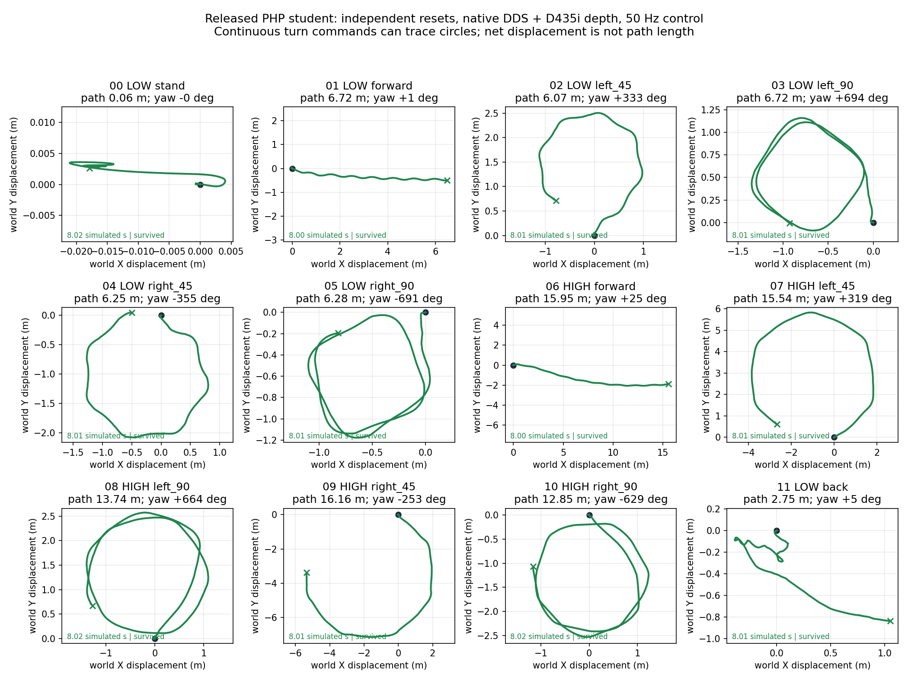

后退索引 11 的输入通路工作，但本次末端 X 位移为 +1.05 m，不能称后退跟踪成功。阶梯与自定义地形的实际结果如下，均保留原片与失败结果：

| 地形与输入 | 实际结果 | 视频 |
| --- | --- | --- |
| 官方阶梯，高速前进 20 秒 | 末态站在 0.76 m 块上；攀爬时触发倾斜阈值 | [原片](usage_assets/sim2sim/step-forward.mp4) |
| 官方阶梯，高速前进 36 秒 | 后半程偏离障碍列，没有完整课程穿越结论 | [原片](usage_assets/sim2sim/step-course-36s.mp4) |
| 生成的 high-climb-76 OBJ，高速 12 秒 | 越过区域后继续行走，有倾斜事件与偏航 | [原片](usage_assets/sim2sim/custom-high-climb-76.mp4) |
| 生成的窄 low-step OBJ，低/高速各 12 秒 | 两次均实际跌倒 | [低速](usage_assets/sim2sim/custom-low-step.mp4)、[高速](usage_assets/sim2sim/custom-high-step.mp4) |
| 官方阶梯，外部航向按键引导 44 秒 | 第 2 块附近失败；引导使用仿真真值，属于辅助输入 | [失败原片](usage_assets/sim2sim/step-course-guided-44s.mp4) |

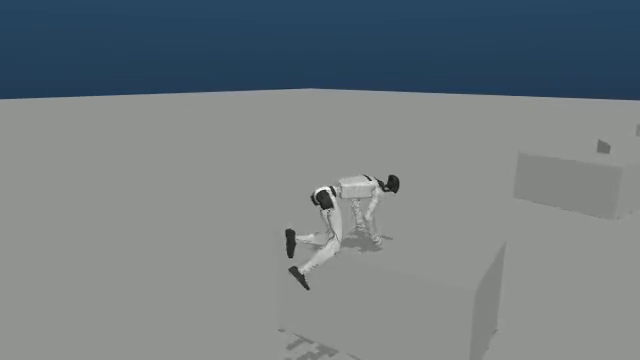

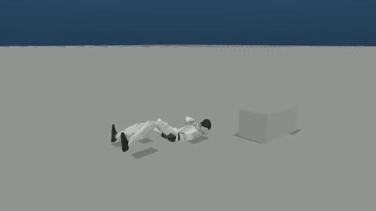

[详细数值、引导算法与逐条复跑命令](usage_assets/reports/deployment-summary.md)。所有这些试验都未声明完整课程成功率，单次没有阈值事件也不能推广为任意地形泛化。

旧镜像还逐项运行了全部 **17 个生成场景的代表几何**：每场景独立 seed 42、500 次策略控制、约 10 仿真秒，17个父进程都报告completed。旧监督没有最终worker退出码门卫，不能将父进程报告等同完整正常终态；17场景日志没有fatal标记也不能反证退出码0。[后续只读审计](usage_assets/reports/worker-exit-completed-log-audit/report.md)。轨迹中14场景触发高度或倾斜阈值，3场景未触发；部分倾斜后能恢复，不据此认定越障成功。每种场景只选一个配置，未声称覆盖全部629配置的策略表现。[逐场景数值与限制](usage_assets/reports/sim2sim-scenes-summary.md)、[包含模型/OBJ SHA 的完整矩阵](usage_assets/reports/sim2sim-scene-matrix.json)。

[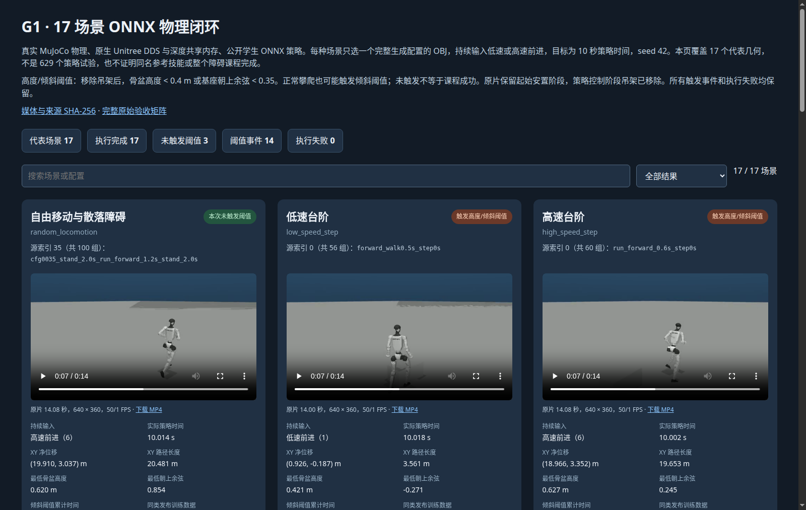](usage_assets/sim2sim/scenarios/playback.html)

[离线视频页](usage_assets/sim2sim/scenarios/playback.html)提供全部 17 个原片、截图、世界轨迹和阈值记录。已有 Chrome 逐一加载并 seek 解码全部视频，另检查实际播放、搜索与筛选，[浏览器验收](usage_assets/reports/scene-gallery.json)。视频包含起始安置阶段，视频时长不等于正式策略控制时长。

现已进一步启动**全部629配置**的真实物理扫描：2026-10-10北京时间14:19快照逐项核验16例完成、1例运行中，尚未完成全部扫描。固定计划保存340项运行依赖和1887个输入文件SHA；每例seed42、500策略ticks、10仿真秒、恒定forward command，不回放参考动作。两例预检执行通过，其中一例出现高度/倾斜阈值；原始视频均CPU完整解码通过。首次CPU fixture测试与真实仿真并行被进程门卫拒绝、空闲重跑28/28通过，两轮原始JUnit均保留。[固定计划、运行快照、两例视频与失败记录](usage_assets/reports/sim2sim-all-configs-start/summary.md)。这扩展几何覆盖，不构成629配置技能成功的结论。

完整结果页的独立发布工具已通过24项CPU检查及两例真实PREVIEW的浏览器媒体/筛选/轨迹检查；当前完整发布被实际门卫拒绝，没有发布629完成页。[发布工具与两例截图](usage_assets/reports/full-scene-publisher/summary.md)。2026-10-10北京时间15:12快照为177例完成、1例执行失败、1例运行中、450例待运行；失败low-step index41虽有完整500ticks/10.002s轨迹，父进程检测到worker非零退出，不能补造result记为通过。内核`command_writer`段错误发生在推理完成JSON后约53ms，模拟器在parent失败后才完成收尾；旧记录没有足够PID映射确定具体worker和C++根因。[14个原文件、内核日志与准确时间线](usage_assets/reports/sim2sim-worker-failure/report.md)。待扫描结束后再处理该项，冻结代码未改。

629是配置数；其中有580个不同OBJ文件SHA，50个平地配置使用同一OBJ。不同文件SHA也不自动等于不同几何形状，本次没有几何等价性判定。[基于冻结计划的计数](usage_assets/reports/sim2sim-configuration-vs-mesh.json)只核输入身份，没有新增物理运行。

15:33的新只读PID/计数快照为237完成、2执行失败、1运行、389待运行，原driver和native后代仍存活。[原始快照](usage_assets/reports/technical-pipeline-review/scan-counts-pids.json)。第二项是`low_speed_climb_58:0022:left_90_walk2.0s_plat0s`：500ticks、10仿真秒、无吊架轨迹有限且未触发姿态阈值，但模拟器PID与shell的`Segmentation fault`记录直接匹配，父进程最终exit1。[14份原文件、两条内核记录及共同模式](usage_assets/reports/sim2sim-worker-failure-second/report.md)。这明确保留执行错误，不能因body数据完整就改记成功；具体kernel线程与worker仍缺完整映射。

后续只读审计检查275个reported completed的550份worker日志，发现10份模拟器段错误且封存SHA完全一致；旧12指令command02也有同样退出故障，说明原监督门卫存在实质漏记。旧批次已停止并完整保留340项原依赖集合的76.77MB本地归档，另逐项证明可由记录的Git提交恢复。[原字节与Git来源](usage_assets/reports/sim2sim-cohort-halt/summary.md)。上游SDK0.1.8已有等待writer结束后再析构的修复；独立候选`caf61487…`离线构建及无GPU导入/API检查通过，当时原镜像和pins未变；当前主Docker已另行升级并构建SDK0.1.8统一镜像，旧运行容器仍保留。[上游源码与二进制审计](usage_assets/reports/unitree-lifecycle-independent/report.md)、[候选实际CPU结果](usage_assets/reports/unitree-sdk018-candidate/summary.md)。新worker门卫已应用并通过CPU回归；候选前两次启动错误已保留；补齐动态入口后原五个失败配置的新试跑正常退出，该历史五例不替代后续已出版的fresh629全量结果。[五例真实视频与退出收据](usage_assets/reports/sdk018-native-pilot/summary.md)。

```bash
bash scripts/research/docker.sh sim scripts/research/sim2sim_scene_matrix.py \
  --matrix /outputs/motion-matching/matrix.json \
  --models /data/assets/student --seed 42 --seconds 10 --gl egl \
  --output /outputs/sim2sim/scene-matrix-new
```

`--record-policy` 已真实验证录制开关、STOP 自动保存和阻尼发送，Kp=0、Kd≥3。原生 Unitree 状态把 root xyz 填为零，所以录制 NPZ 只包含 SDK wxyz 四元数、零 xyz 占位、29 关节和指令；不能直接当作世界轨迹或训练 bundle。真实机器人位移记录在 simulator 的 `trajectory.csv`。

## 8. 全量测试、同步与结果来源

```bash
python3 scripts/research/cpu_tests.py --output-dir outputs/research/cpu-tests
python3 scripts/research/cloud.py status
python3 scripts/research/cloud.py sync
python3 scripts/research/cloud.py pull
```

CPU 测试统一在 Docker 中运行，分别保留根目录/训练和 motion matching 的 JUnit、日志、计数及日志 SHA-256。`PHP_DOCKER=0` 只用于隔离原生安装路径的 subprocess double 测试，解释器仍在容器内；真实容器路径由 doctor、训练和闭环运行验证。

首版冻结镜像 `88254ac0…`、源码 `64ebc5f` 上完整复跑：根目录及训练 **289 passed、0 failed、0 skipped**；动作匹配 **213 passed、12 failed、0 skipped**。[本次汇总](usage_assets/reports/cpu-tests-final.json)与[原始 JUnit/日志](usage_assets/reports/cpu-final/)包含全部结果。

此后恢复逻辑又补充了参数与教师来源检查：环境数、注册表、FINETUNE 或有序教师 SHA 不符时拒绝恢复，允许合法延长总迭代数。相关 **45/45 回归通过**，两种学生自身恢复也已覆盖。[官方驱动与默认参数审计](usage_assets/reports/official-driver-audit/audit.md)保留当前脚本 SHA、实际配置计划和 JUnit；这批检查独立于上述 `64ebc5f` 全量测试记录。

动作测试目前 **213 passed、12 failed、0 skipped**。12 项均为修改前已有的历史字节 hash：未修改基线`554edcc`与research的36组数组逐字节一致，9项独立功能不变量通过，URDF零位FK的独立误差最大2.30e-16；另外用Python3.10复查6个characterization/FK hash测试，仍出现相同失败。历史`mm_hs`原始数组/环境不可得，[本机限定路径与文件名检查](usage_assets/reports/legacy-local-reference-search.json)也未找到；不能从SHA反推差异，也没有刷新golden或跳过失败。[12项原始详情](usage_assets/reports/legacy-goldens.json)、[原版数值对照](usage_assets/reports/motion-baseline-parity.json)。因此完整CPU命令保留退出码1，不能称为全绿。

用户已答复“没有”原始 motion_matching/mm_hs/FAR-pi 环境或历史参考输出。12项历史 raw-hash 失败继续保留，未刷新 golden 或跳过用例；现有原版/研究版数组对照不能替代缺失的历史基线。

还在本机检查了官方仓库全部 5 个 advertised refs、16 个可达 commit：未发现测试提到的 `0424c06c`、`mm_hs` 完整环境锁或 golden 输出数组，GitHub commit 查询也返回该 SHA 不存在。[官方历史调查](usage_assets/reports/legacy-upstream-audit.json)。

云端镜像核对压缩包 SHA-256、镜像配置和层内容，源码快照逐文件复核 SHA-256。选卡检查包含图形与计算进程，Docker 根据 GPU UUID 映射，保存物理 nvidia-smi 编号。远端容器不在本体安装任何项目包。当前运行中的结果均写入 `outputs/research/` 或远端项目持久目录，未完成项目不会在此文件中记作通过。

首次完整镜像归档 **12,014,827,234 字节**，包 SHA-256 `332e292e5b0f542c2dfec6bf1b4c007d623f6acef313c3b37b03ba1d2eaccb83`，两端 Config/RootFS 指纹相同。部署时物理 GPU 1 没有任何进程、显存 1 MiB、利用率 0%，对应 UUID `GPU-27eb1141-ab74-ebdd-42c2-6549fb7253e5`；容器内只见这张卡。[传输记录](usage_assets/reports/cloud-image-transfer.json)、[部署记录](usage_assets/reports/cloud-deployment.json)、[仅公钥登录验证](usage_assets/reports/cloud-ssh-key-check.json)。最终重建的镜像另行记录如下。

首版冻结镜像为 `sha256:88254ac0b90a3056375145601d741aa3e08726e18412d201a3c7e7915a23996f`，对应干净源码提交 `64ebc5f`，镜像内记录大小为 22,704,771,469 字节。独立容器只挂只读资产、输出和空缓存，`--network none`、私有 IPC，**没有宿主源码挂载**：三环境 doctor、全部 265 项锁定版本、真实 16 环境两轮 Isaac 训练、有限权重更新、教师 ONNX 12 组真实 CPU 推理和离线 TensorBoard 均通过。[完整离线证明](usage_assets/reports/runtime-final-offline-summary.json)及[原始记录](usage_assets/reports/runtime-final-offline/)记录源码边界、模型与镜像 SHA；motion/inference 的 `pip check` 通过，train 仍保留前述三项上游元数据冲突。

首版冻结归档 **10,858,424,068 字节**、SHA-256 `e6c0483f15242e9da95aaa136e21eb10b746a2e423a5e206f03e174b76d5e4c3` 已完整传输并在云端加载，两端 Config/RootFS 指纹为 `2a43037e2397fac3e343e8d621dd42c41ea7c27da82602789d575fddda112482`。[最终镜像传输核验](usage_assets/reports/cloud-final-image-transfer.json)保留本地/远端镜像 ID；Docker 存储实现导致两端 manifest ID 不同，层内容与配置已独立核对。

最终云端部署也已完成：仍选物理 GPU 1，实际挂载源码树 `0093aa40fbae2bcf219d39ace222e0c4d8a71e305551939a5a1b9c0e40c683ab`（来自 `3439cb7`），包含镜像构建之后的恢复来源检查修复。三套运行环境 doctor 通过。[最终部署](usage_assets/reports/cloud-final-deployment.json)、[最终云端 doctor](usage_assets/reports/cloud-final-runtime.json)。镜像内封存源码 `64ebc5f` 的独立断网证明与这次挂载源码运行分别记录。

原生推理键盘入口已修复监听结束后的`None.start`异常；真实PTY的两订阅队列均收到`] w c o i`，Esc后恢复终端且不再抛异常，应用后的23项CPU检查通过。这不代表原生GUI/策略控制已验收，Esc只结束监听。[完整原始/修复记录](usage_assets/reports/native-keyboard-bootstrap/summary.md)。旧629终态的279项文本复审及全部5个显式失败配置见[最终日志补审计](usage_assets/reports/worker-exit-final-279/report.md)。

本地退出验收修复已应用：父监督现在检查最终两worker退出码，按独立PGID/SID和PID出生时间追踪已知成员；身份未知时拒绝发送信号，清理等待后仍有成员则失败。新schema3计划强制fatal-signal诊断，封存必须绑定双方入口和最终退出三份收据，不能只读body JSON的completed。应用后监督37项加19子用例、矩阵76项、发布34项CPU回归通过；这些检查及真实普通CPU进程组测试尚不代表SDK/DDS物理运行已通过。[监督修复原始证据](usage_assets/reports/worker-exit-supervisor/review.json)、[独立封存审查](usage_assets/reports/worker-exit-sealing-review/review.md)。

发布器对schema3使用与矩阵相同的三收据校验，并保留seal原始SHA到复制阶段，拒绝“校验后、复制前”发生变化的历史文件。34项CPU回归与独立注入复审通过；旧schema2只可生成明确标注未证明正常退出的历史预览，不能发布完整629通过页。[发布复制校验与原失败反例](usage_assets/reports/publisher-schema3-review/review.md)。

候选SDK018的两次隔离启动原始失败均已保留：首次Docker只读挂载点错误，第二次首例加载`holosoma.bridge.unitree`失败，这两次本身没有策略rollout或SDK析构通过证据。该错误证明旧340项冻结依赖集合遗漏metadata动态入口与部分父包初始化；历史文件不改，新集合376项、矩阵78项CPU测试通过后，已实际CPU导入train150/inference49个仓库模块及所选metadata入口，并完成新五例native闭环。[两次启动日志、进程收据、源码和新增测试](usage_assets/reports/sdk018-native-setup/summary.md)。

补齐动态入口后的当前四模块联合CPU回归为172项测试加19个子用例全部通过，未跳过；[本轮命令、精确源码与原始JUnit](usage_assets/reports/worker-exit-integrated/review.json)独立于较早的全仓CPU测试统计。

主Dockerfile及约束现已升级为SDK0.1.8。干净源码`6cb2ae2`重新构建的统一镜像`2be18521…`，实际以`--network none`、私有PID/IPC、只读资产、独立空缓存且**没有宿主源码挂载**运行：三个环境doctor、265版本、真实Isaac16环境×两轮×24步、非零有限权重更新、12组教师ONNX推理全部通过；52个TensorBoard scalar tag的两步样本均有限。train的原三条上游pip元数据冲突如实保留。[新镜像完整日志、版本和模型SHA](usage_assets/reports/sdk018-canonical-offline/summary.md)。旧0.1.6镜像的历史证明没有改写。

新完整镜像包10,897,464,145字节已上传服务器并加载，两端归档SHA与Config/RootFS内容均复核一致。云端官方训练的container/image/PID/StartedAt和挂载内容不变，旧research tag保留。[上传、首次顺序误报及独立核验](usage_assets/reports/sdk018-canonical-upload/summary.md)。截至北京时间17:21，第一教师TensorBoard到step7629，所核loss/reward样本均有限；这仍不是第一教师完成，更不是七模型完成。

先行SDK0.1.8候选还对旧批次五个显式失败配置各做一次新原生闭环：3类场景、2500策略ticks、5父进程/10worker全部返回0、最终进程组为空，精确PID出生时钟与host command_writer映射保留，5原MP4完整解码。高速攀爬配置0000检测到跌倒，其它四例只是在10秒内没触发同一启发式。[逐例表、两个真实帧与全部视频](usage_assets/reports/sdk018-native-pilot/summary.md)。该结果检验了本轮退出完整性，不冒充629覆盖或全部技能成功。

五非默认教师的首次重载虽父进程0，但每例因只读URDF资产目录无法生成USD缓存而未开始rollout，均记失败。[原始日志与无报告证据](usage_assets/reports/teacher-presets-reload-ro-failure/summary.md)。入口现拒绝覆盖旧报告，缺少有效新quality.json即非零退出；14项CPU检查通过。[源码及测试](usage_assets/reports/eval-quality-exit-guard/summary.md)。后续独立资产目录重试的结果另行核对，不覆盖这五次失败。

独立可写资产目录下的五次重试现已完成实测与独立后验，每例16环境×100策略步、seed42/1variant，四项tracking指标各1600有限样本，finite_actions/root为true，保存YAML的160/449维观测、anchor和scale均与各自原PT一致。32段新MP4全部完整解码，5份TensorBoard的17项scalar与报告相同；原source、PT/ONNX及35份原始/复制URDF/mesh的SHA未变。累计251次failed episode resets、0 timeout，quality_verified=false。这是有界重载通过，短录像不证明100原源动作覆盖或收敛。[完整配置/质量/失败计数与原始记录](usage_assets/reports/teacher-preset-reload-sdk018-v3/summary.md)。

| 五个非默认preset | 输入维度 | failed resets | 最长原始episode录像 |
| --- | ---: | ---: | --- |
| no-heightscan | 160 | 50 | [0.94秒](usage_assets/isaac/teacher-presets-sdk018-v3/g1-wbt-terrain-no-heightscan.mp4) |
| no-heightscan-noscale | 160 | 51 | [0.62秒](usage_assets/isaac/teacher-presets-sdk018-v3/g1-wbt-terrain-no-heightscan-noscale.mp4) |
| no-heightscan-pelvis | 160 | 50 | [0.88秒](usage_assets/isaac/teacher-presets-sdk018-v3/g1-wbt-terrain-no-heightscan-pelvis.mp4) |
| ref | 449 | 51 | [0.84秒](usage_assets/isaac/teacher-presets-sdk018-v3/g1-wbt-terrain-ref.mp4) |
| ref-pelvis | 449 | 49 | [0.96秒](usage_assets/isaac/teacher-presets-sdk018-v3/g1-wbt-terrain-ref-pelvis.mp4) |

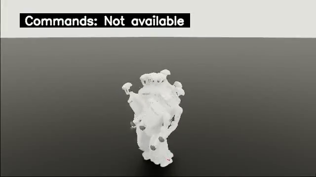

全629新版批次已通过完整5206文件冻结核验、同镜像实际CPU入口/17场景配置预检与19项外层检查。[准备输入与新计划](usage_assets/reports/fresh629-sdk018-preparation/summary.md)不计作实际完成；后续启动与首两例后验见下文。全量验收仍须629例和1258个worker真实正常终态及629原视频完整解码。

新统一镜像上的12方向指令已全部实际复测并独立核验：每例8仿真秒/400ticks，24worker退出码0且进程组最终为空，24份精确host command_writer映射、12段原MP4完整解码、3332冻结文件SHA均通过。命令0–11、seed42、平地独立重置和原配置相同，实际单例wall373秒，无120秒override；宿主总耗时248.185秒。12例均未触发存活启发式失败，但不据此声称动作质量或越障成功。[逐例路径/转角、真实截图和全部视频](usage_assets/reports/sdk018-directions/summary.md)。旧command02的异常记录仍保留，新结果不改写历史。

本地默认统一容器已采用该SDK0.1.8镜像，原镜像保留；接入前确认只剩本项目TensorBoard与sleep，重建后doctor通过、TensorBoard6006的HTTP检查返回200，其它本地容器保持原身份与状态，云端没有变更。[本地接入原回执](usage_assets/reports/sdk018-local-adoption/summary.md)。

评估重试已补齐与新报告门卫的集成：真正重跑前归档旧quality与其TensorBoard原字节/路径/SHA，保持最终学生回传使用的固定路径；有效skip不动文件，unsafe路径与部分移动/child失败均保留证据。实际CPU重现了旧流程的“已有报告被新门卫拒绝”，修复后58项pipeline加14项既有evalguard共72项通过，其中15项是新增回归；不包含新的GPU/策略训练。[原始复现、补丁与JUnit](usage_assets/reports/eval-quality-retry-integration/summary.md)。

### 逐源执行器的只读资产初始化合同

五个教师preset重载曾暴露RO源码下URDF converter写缓存失败，因此未来296源×三策略的执行器也补齐了独立RW资产根。原始35个URDF/mesh的源/副本SHA、五份harness、原生CLI和实际配置共同绑定到schema2计划，原Python仍RO。116项目标Docker CPU检查通过；初轮110通过、1项异常类型检查失败的原XML保留。[修复源码、最小差异和测试证据](usage_assets/reports/runtime-robot-assets/summary.md)。该项本身不计作888次物理验收。

新技术说明的独立源码复核绑定604行版本SHA，核对115份源码与154个本地链接；未发现新的实质性数学/格式/标签来源错误。[原始复核](usage_assets/reports/technical-pipeline-independent-review/summary.md)。

真实单源验证使用原iter500教师和完整920帧locomotion source，实际158策略步（3.16仿真秒）后首次failed，timeout=0、reference boundary=false。35资产的USD转换在RW目录实际完成，3356封存输入SHA不变；四项tracking指标各158有限样本，三段原生录像完整解码。[配置、标签/时钟、质量与原始回执](usage_assets/reports/source-coverage-ro-assets-pilot/summary.md)，[最长原片3.18秒](usage_assets/isaac/source-coverage-ro-assets-pilot/teacher-iter500-source000.mp4)。

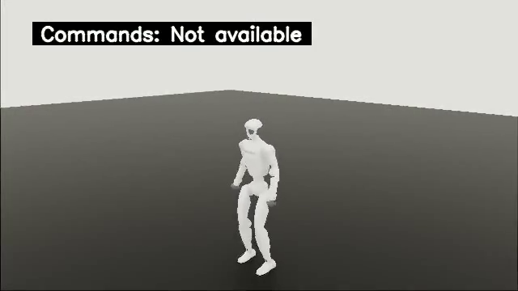

正式训练后的逐源watch已于北京时间18:09实际升级为PID4074213，使用同步核验的02bc源码与新的`coverage-official-final-ro-assets-v2`目录，waiting、gpu_started=false。只通过pidfd停止精确身份的旧waiting进程；原status/log/launch字节保留，正式训练容器/镜像/源码挂载/训练PID出生身份与全部Docker IDs前后完全一致。[两阶段真实升级、25项CPU门卫与旧原始归档](usage_assets/reports/posttrain-monitor-ro-assets-v2/summary.md)。

### 原生GUI、键盘与录制的实际验收

第五次真实平地接口验收通过，前四次失败原日志/退出码/计划全部保留。窗口8/9控制吊架；独占真实终端的`]`启动策略，`c`开始/手动保存，`=`切换速度，`o`停止并自动保存，`i`保持；真实X11按住/松开w产生低速command1和高速command6。两份原NPZ169/196帧，fps50，标签来自原policy.velocity_command；qpos的XYZ是占位零，不能当作世界轨迹或完整训练bundle。双方原main/atexit返回、实际wrapper均0、出生身份绑定的进程组为空，无TERM/KILL兜底。

第四次在保存视频和atexit之后原生abort，整体保留为失败；第五次只将离屏depth/video的`MUJOCO_GL`从glfw改egl，可见passive viewer仍GLFW，生产GUI compose同样修复。一次对照不能证明所有内存问题已根除。[五次实际尝试、完整NPZ/视频解码与源码身份](usage_assets/reports/native-keyboard-gui/summary.md)、[可播放原片与全部截图](usage_assets/reports/native-keyboard-gui/playback.html)。

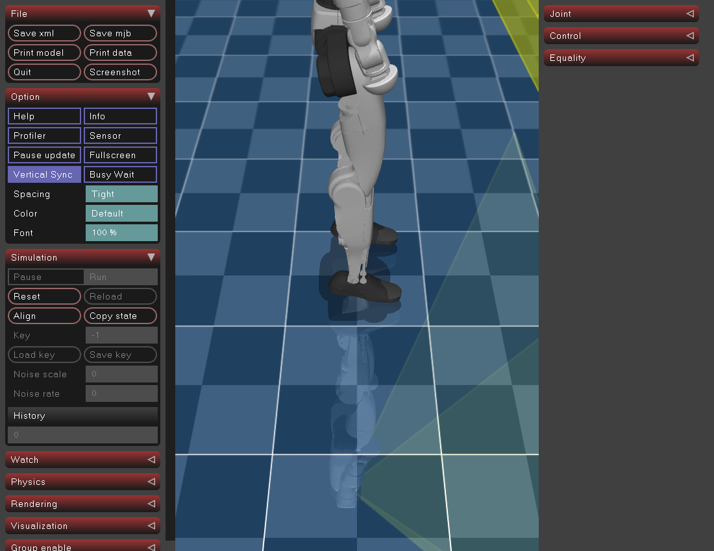

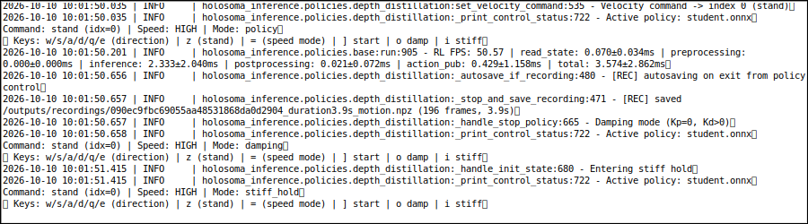

[该次真实原片](usage_assets/reports/native-keyboard-gui/attempts/05-egl-completed/outputs/video/episode_0_1791626513.mp4)。forward6原截图因Camera tracking OFF而只有地板，原样保留，不作为高速步态可视化证据；命令输入由真实keys/state/NPZ标签证明。GUI接口通过不等于障碍通关、实时性能或实机成功。

### 新版629批次的真实启动与首两例

2026-10-10 10:02 UTC已启动独立新版629批次，原生容器`2d09d396…`、统一SDK0.1.8镜像2be、固定GPU与network none；5206文件输入冻结不变。10:10:23 UTC固定快照为21 completed/1 running/607 planned。独立CPU后验仅验最前两例：每例500策略ticks、首末10仿真秒，4 worker退出0且进程组为空、4 host command_writer出生身份映射、两原MP4全片解码均通过；第二例确实跌倒。[完整原始启动、固定快照与检查过程](usage_assets/reports/fresh629-start-first-two/summary.md)。

| 首两例 | 执行完整性 | 物理结果与原片 |
| --- | --- | --- |
| random_locomotion cfg0000 | 正常退出 | 未触发生存阈值；[原片](usage_assets/sim2sim/fresh629-start-first-two/random-locomotion-cfg0000.mp4) |
| random_locomotion cfg0001 | 正常退出 | 触发跌倒阈值；[原片](usage_assets/sim2sim/fresh629-start-first-two/random-locomotion-cfg0001.mp4) |

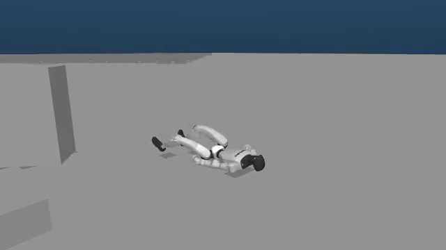

这是发布ONNX对的几何扫描，quality/course均false；首两例不是629全量验收。初次CPU checker错误假设轨迹起点为0的失败原件也已保留，改为依据实际ACK偏移检查首末10秒跨度后通过，没有改动原生轨迹。

学生回传入口同步绑定新watch的02bc源码、`coverage-official-final-ro-assets-v2`和schema2共享资产合同，77/77 Docker CPU检查通过。10:19 UTC root真实SSH status为waiting，16阶段阻塞，没有cpu-ready、GPU验收或模型回传；四ONNX加28JSON白名单保持。[最小补丁、原JUnit与真实等待响应](usage_assets/reports/final-student-transfer-ro-assets-integration/summary.md)。旧57项与15:26状态只作历史记录，不与新测试相加。

### 最终两学生的58项验收与实际后台交接

本地适配入口已冻结并通过47项Docker CPU控制面测试，真实缺fetch时只返回waiting、不建cohort；初轮33pass/1fail及中间41pass原件保留。真正模型到达后，每学生先CPU ORT30，再执行12方向和17代表场景，共58例；终态必须同时满足116正常worker/空组、116精确hostwriter出生映射和58原MP4全片解码。8/10仿真秒、默认wall373/413、seed42均保持，原core/helper按SHA复用；质量与课程成功仍false。[冻结源码、完整设计索引、恢复前提及独立审查](usage_assets/reports/final-student-native58-preparation/summary.md)。当前实际最终模型prepare、60项ORT和58次native均未执行。

交接程序另经55项Docker CPU检查，含真实普通CPU父孙进程取消/回收，独立审查无剩余必须修正项。root于11:03:25 UTC（北京时间19:03）实际启动PID1121672，封存PGID/SID/出生ticks/boot_id及准确argv。首轮真实SSH helper exit0且session为空，waiting/16阶段阻塞，fetch/prepare/run均false，两个交付目录未建，本地Docker ID集合不变。[原始测试、预审、实际启动与首轮收据](usage_assets/reports/final-student-delivery-waiter/summary.md)。它每600秒等待，真正ready后仅一次回传、待现629/GPU正常释放再调用冻结入口；错误和partial保留，不自动重试。这是11:03历史启动；旧进程已受控取消，当前恢复版交接见本文开头，勿并发手动fetch或final58。

11:00 UTC另一次实际Docker inspect/top确认云端原official driver/train与本地629 wrapper/simulator均存活；固定快照158completed/1running/470planned。同期首教师TensorBoard为step10315，所选四tag全部历史样本有限。[实际活进程和scalar快照](usage_assets/reports/final-student-delivery-waiter/active-jobs/summary.json)。这是进度证据，正式训练、629全量后验与最终模型58项验收仍未完成。

### 当前629发布合同与云端默认镜像的剩余步骤

独立审查确认旧发布器不能直接读取当前隔离批次：其`/outputs`与`/workspace`映射、driver格式和模块ROOT不同，而且尚未绑定新批次的5206输入冻结、1258份hostwriter映射与629次完整解码后验。[原始兼容性审查、15个固定依赖及恢复边界](usage_assets/reports/fresh629-publisher-compatibility-review/index.md)已保存；该审查仅检查兼容性，未产生完整结果页，也未把运行中的动态摘要补造成历史原件。

新统一镜像已在云端加载，当前默认仍保留SDK0.1.6官方训练环境。[训练完成后接入方案及原始证据](usage_assets/reports/cloud-sdk018-postcompletion-adoption-plan/index.md)已冻结，需等official16、原生checkpoint CPU就绪、888终态及watch退出/锁释放后才保留旧容器并切换。该项目前是方案，未执行云端默认SDK0.1.8接入或其运行时验收。

新版专用发布工具最终80/80 Docker CPU fixture检查与独立审查通过；原候选73/80日志和精确源码保留。11:44 UTC root在真实运行中cohort调用status/prepare/publish均exit0/waiting，未建完整页或partial、没有额外仿真、原容器身份和Docker集合不变。root初轮汇总因未开始行缺少status字段失败，原接口收据与错误保留，改正统计后在新目录完成核验。[冻结源码、最终JUnit、独立审查和两轮真实接口原件](usage_assets/reports/fresh629-publication-preparation/summary.md)。

11:44:49 UTC实际Docker top仍确认原云端driver/train和本地629 wrapper/simulator活跃；固定进度279 completed/1 running/349 planned。11:34:36 UTC首教师step11255，所选奖励/loss历史值有限。这些进度摘要不代替完整终态。适配器须原生629/1258worker/1258host映射/629全片解码/5206冻结及2266输入绑定全通过才完整发布；原observer日志无损连续分块，质量及课程完成标记均false。这是11:44历史准备状态；之后已执行恢复校验并生成本文开头链接的完整629结果。

[出版包独立复核](usage_assets/reports/fresh629-publication-package-independent-review/summary.md)确认追加本链接之前的94个暂存文件与Git index逐字节一致、87项外层依赖和原内层清单匹配、42个新增/包内链接有效，README/技术说明/Holosoma身份未变，无必须修正项。此核对不重复物理验收。

### 完整功能复查新增的实测缺口

[29项要求与证据对应清单](usage_assets/reports/final-function-coverage-ledger/index.md)保留了`b5095ba`版本的六份声明文档，核对8个preset、17场景、29技能入口及五组有序数据。该版本复查当时找到两组缺少实际验收的功能：`s/a/d/q/e/z`完整命名键派发与窗口Backspace重置，以及teacher/pure/finetune原生断点继续训练。此前真实w低/高速、12项API方向和45项恢复控制测试的范围保持原样，不能替代这两组实测。

这两组补验的历史准备合同如下，实际全键盘/重置和6次原生续训现均已完成，结果见本文开头。续训需证明原PT/固定专家SHA不变、优化器步数被恢复、之后权重有限且确实更新，并产生新的TensorBoard样本；重置需真实窗口按键、仿真time/状态变化及后续推进、双方原生正常退出。当时这些均未记录为通过，之后补验和629全量后验已完成。完整官方训练、888逐源尝试、最终学生58项闭环和云端默认镜像接入仍分别等待原任务及真实产物；高层自主长程越障质量也尚未成立。

[全键盘/重置准备原件](usage_assets/reports/native-keyboard-reset-allkeys-preparation/index.md)含最终46项CPU fixture、独立只读审查、root真实prepare计划和真实Docker双角色import/config parse；3313项冻结前后相同，未构造原生对象。历史canonical3297项与预先存在的1个bytecode分别记录，没有改动原冻结清单。该准备包本身不包含实际执行；之后真实按键、Backspace、录制与退出验收已完成。

[teacher/pure/finetune续训准备原件](usage_assets/reports/native-resume-acceptance-preparation/index.md)含最终33/33 CPU检查，旧27/29/30/31/32候选按原字节保留且不相加。真实CPU预处理解析三preset、100个locomotion clip及35文件独立RW机器人合同；既有PT确认teacher40、学生16的优化器计数，包括LR0的finetune std state。实际方案是各自baseline2→target4恢复到iter3，验证计数40→60→100或16→24→40及真实新权重/TensorBoard。HSSIM激活路径和原生INFO日志检查问题已在验收helper中修正，原生算法与加载实现未改；该准备包本身不包含六次训练；之后真实执行与首次失败、恢复结果已独立出版。

### 官方训练的真实曲线快照

[首个 locomotion 教师的曲线、原始数据与离线重绘命令](usage_assets/reports/official-teacher-learning-curves/index.md)保留官方训练 iteration 0–14,340 的四个 TensorBoard tag，各14,341个有限样本；叠加25样本后向均值，原始点和负 entropy 值均保留。数据由原云端容器实际导出，绘图在断网、GPU隐藏的Docker CPU容器中完成，退出码0。目标20,000次迭代仍未完成，这只是首个教师的历史进度，不能证明收敛、越障质量或其它教师/学生已完成。

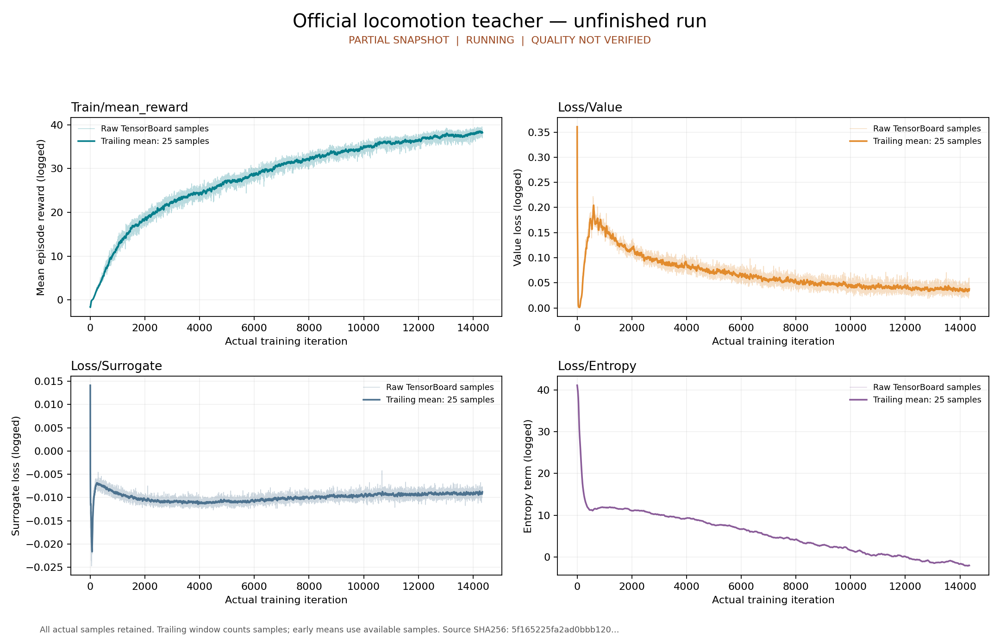
