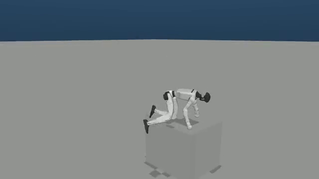

# 部署、转换与原生闭环验收简报

真实运行已覆盖发布 ONNX 的 30 组推理、真实动作转换的两种 CLI、MuJoCo 的 plane / bundled step / generated custom OBJ，以及全部 12 个部署指令。plane 的 12 个独立 8 秒试验均未触发高度/倾斜阈值。课程完整穿越、后退跟踪与任意自定义障碍泛化尚未验收通过，不能把输入通路通过写成技能质量通过。

这里测试的是官方发布的 student ONNX。五类教师、两种学生的新训练结果由云端训练报告独立验收；这些部署结果不证明新模型训练收敛。

## 可直接嵌入 usage 的媒体


[12 方向同步视频，8 秒、1280×540、H264](../sim2sim/directions.mp4)；[视频预览](../sim2sim/directions.png)；[可缩放轨迹 SVG](../sim2sim/trajectories.svg)。视频按各自记录的 gantry-release **仿真时间**裁齐，在策略 t=0 对齐，原片 50 fps、拼图 25 fps。


[bundled step，恒定高速 forward 20 秒原片](../sim2sim/step-forward.mp4)；[36 秒更长原片](../sim2sim/step-course-36s.mp4)。后者最终偏离块列，不能称完整穿越。



[custom high_climb_76，12 秒原片](../sim2sim/custom-high-climb-76.mp4)。策略越过该区域后继续行走，但转向偏移明显；没有课程完成质量结论。


[custom low_step 低速失败原片](../sim2sim/custom-low-step.mp4)；[同一 OBJ 高速失败原片](../sim2sim/custom-high-step.mp4)；[显式外部引导的 step 44 秒失败原片](../sim2sim/step-course-guided-44s.mp4)。保留失败结果，不只展示成功片段。部署媒体合计约 7.4 MB。

## 原生闭环的范围和时钟

仿真、G1 half-sphere-hand 模型、D435i 58×87 深度相机、深度共享内存、Unitree SDK DDS on `lo`、原生 `DepthDistillationPolicy` 和 ONNX 都真实执行。自动输入只替代方向键。gantry 先降低，再明确停用；统计期没有 gantry 支撑。仿真 500 Hz，每 10 个物理步只执行一次原生策略，即 50 Hz；文件握手保持仿真与策略时钟一致。OSMesa 很慢时也不会把墙钟 8 秒误算成策略已经跑了 8 秒。

每个方向使用全新 simulator / policy / reset，seed=42，ONNX CPU 单线程，EGL device 0。固定 seed 让配置与随机源可复现，但原生 DDS 调度仍会带来小幅轨迹差异，不保证逐比特一致。每次输出保存 `run.json`、命令、模型 SHA-256、仿真和墙钟时长、CSV、实际指令切换、H264 与 ffprobe 检查。

| 索引 | 速度 / 输入 | 路径长度 m | 累计 yaw ° | 无高度/倾斜阈值事件 |
| --- | --- | ---: | ---: | --- |
| 0 | stand | 0.06 | 0 | 是 |
| 1 | low forward | 6.72 | +1 | 是 |
| 2 | low left_45 | 6.07 | +333 | 是 |
| 3 | low left_90 | 6.72 | +694 | 是 |
| 4 | low right_45 | 6.25 | −355 | 是 |
| 5 | low right_90 | 6.28 | −691 | 是 |
| 6 | high forward | 15.95 | +25 | 是 |
| 7 | high left_45 | 15.54 | +319 | 是 |
| 8 | high left_90 | 13.74 | +664 | 是 |
| 9 | high right_45 | 16.16 | −253 | 是 |
| 10 | high right_90 | 12.85 | −629 | 是 |
| 11 | back | 2.75 | +5 | 是 |

持续按住转向键会持续转向，轨迹会绕圈，因此净位移不等于行走距离，也不能把 `left_90` 解读成“8 秒后只转 90°”。索引 11 的输入通路通过，但该试验的净 X 位移为 **+1.05 m**，不能据此称后退跟踪成功。索引 12–14 是预留槽位，只做 ONNX 张量契约检查。

| 场景 / 实际输入 | 策略仿真秒 | 控制次数 | 最低 pelvis m | 最终 xyz m / upright | 结论 |
| --- | ---: | ---: | ---: | --- | --- |
| bundled step / high forward | 20.002 | 1000 | 0.624 | (34.576, 0.295, 1.500) / 0.927 | 攀爬时触发倾斜阈值；末态仍在高块上 |
| bundled step / high forward | 36.006 | 1800 | 0.629 | (52.024, 18.219, 0.717) / 0.986 | 没有低 pelvis 事件，后半程偏离块列 |
| custom low_step / low forward | 12.004 | 600 | 0.061 | (0.698, −0.111, 0.356) / −0.201 | 真跌倒 |
| custom low_step / high forward | 12.018 | 600 | 0.062 | (0.487, −1.255, 0.069) / −0.001 | 真跌倒 |
| custom high_climb_76 / high forward | 12.002 | 600 | 0.625 | (11.774, 6.268, 0.734) / 0.983 | 攀爬触发倾斜阈值，之后继续行走；没有完整质量结论 |
| bundled step / **guided** | 44.008 | 2200 | 0.366 | (9.517, 0.240, 0.404) / 0.556 | 在第 2 块附近失败 |

`fall_detected` 是保守的任何时刻 pelvis<0.4 m 或 upright<0.35 标志。攀爬时躯干大幅前倾也会触发该标志；应同时读最低 pelvis、末态和视频，不能只凭它认定倒地或认定攀爬成功。所有报告保留 `quality_verified=false`、`obstacle_course_completion_verified=false`。

`--course-guide` 是显式的外部测试输入控制器，读取 simulator ground truth，不修改策略观测或动作。它令目标航向为 `atan2(-y, 2)`，航向误差超过 ±0.10 rad 时选择已有 high-left/right-45 指令，其他时候选 high-forward；upright<0.85 时保留 forward，x>62 m 时选 stand。报告保存每次指令切换及误差。它相当于操作员方向按键辅助，**不是模型学会的自主导航**，本次结果为失败。

## 录制和阻尼模式的重要限制

`--record-policy` 真实调用原生录制 toggle，STOP 自动保存 50 fps 的 NPZ，并通过原生发送路径执行一次阻尼命令；实际检查 Kp=0、Kd 最小值 3，qpos `[N,36]`、vel_cmd `[N,15]`、有限值和单位四元数均通过。

**原生 `UnitreeInterface.get_low_state` 把 root xyz 固定填 0。** 这些录制文件是 SDK **wxyz 四元数 + 零 xyz 占位 + 29 关节**，不能当世界坐标轨迹，也不能直接作为 BeyondMimic 转换器输入或 native 训练 bundle。真实位移应读 simulator `trajectory.csv`。早期原始报告将 qpos 四元数误标成 xyzw；[审计汇总 JSON](deployment-summary.json) 已注明元数据更正，原 NPZ 字节不变。新入口的报告已经正确标注 root 占位限制。

## 真实转换与 ONNX 结果

真实来源为 motion-matching 生成的 low_speed_step BeyondMimic NPZ。单文件和目录两种转换 CLI 均成功，逐数组校验完全一致；root / 29 关节排列 / 30→32 body 映射 / vel_cmd 均和源文件精确匹配，native registry bundle loading 与 diagnose CLI 也通过。364 帧，native joint_pos `[364,36]`、joint_vel `[364,35]`、body_pos `[364,32,3]`、vel_cmd `[364,15]`。这是纯 NumPy 格式映射，不执行 Isaac 或 MuJoCo FK。

[真实转换报告](motion-conversion.json)。修复了转换器单帧输入打印成功并返回 0、误接收 native 36 位置输入、非有限字段与维度不完整的问题；相应回归测试通过。

[发布 ONNX 验收报告](onnx-released.json)：checker full_check、SDK 的 29 关节 / 默认姿态 / 缩放元数据、深度 `[1,58,87]`→32 latent、学生 `[1,140]`→29 action，零与随机归一化深度 ×15 命令槽位，共 30 组真实 ONNX Runtime 推理全部通过。该结果仅验证模型结构与输入输出契约，不证明 locomotion 质量。

## 复现命令

输出目录必须不存在或为空，避免误用旧 readiness / stop 标记和旧视频；重复执行时换新的输出目录。推荐本机 EGL；`--gl osmesa` 可兼容无 GPU 图形的环境，但会更慢。

```bash
bash scripts/research/docker.sh inference scripts/research/validate_onnx.py \
  --models /data/assets/student --output /outputs/onnx/released-repeat.json

bash scripts/research/docker.sh train scripts/research/verify_conversion.py \
  --source /outputs/motion-pilot/scenarios/low_speed_step/forward_walk0.5s_step0s_motion.npz \
  --terrain /outputs/motion-pilot/scenarios/low_speed_step/forward_walk0.5s_step0s_terrain.npy \
  --output /outputs/conversion/real-low-step-repeat

bash scripts/research/docker.sh sim scripts/research/sim2sim.py \
  --models /data/assets/student --terrain plane --commands all --isolate-commands \
  --seconds-per-command 8 --gl egl --seed 42 --output /outputs/sim2sim/plane-directions-repeat

bash scripts/research/docker.sh train scripts/research/sim2sim_gallery.py \
  --matrix /outputs/sim2sim/plane-directions-repeat/matrix.json \
  --output /outputs/sim2sim/plane-gallery-repeat --video

bash scripts/research/docker.sh sim scripts/research/sim2sim.py \
  --models /data/assets/student --terrain step --commands 6 --record-policy \
  --seconds-per-command 36 --gl egl --seed 42 --output /outputs/sim2sim/step-repeat

bash scripts/research/docker.sh sim scripts/research/sim2sim.py \
  --models /data/assets/student --terrain custom \
  --mesh /outputs/motion-pilot/scenarios/high_speed_climb_76/run_forward_0.6s_step0s_terrain.obj \
  --commands 6 --record-policy --seconds-per-command 12 --gl egl --seed 42 \
  --output /outputs/sim2sim/custom-repeat

# 保留失败的引导试验；不代表自主导航
bash scripts/research/docker.sh sim scripts/research/sim2sim.py \
  --models /data/assets/student --terrain step --commands 6 --course-guide --record-policy \
  --seconds-per-command 44 --gl egl --seed 42 --output /outputs/sim2sim/guided-repeat
```

## 训练入口审计和 CPU 增量验证

五类 teacher bundle 共 296 对：100 locomotion、56 low-step、60 high-step、40 low-climb-76、40 high-climb-76。公开资产没有 teacher `.pt` 或 student native `.pt`，必须实际训练才能评估新模型。六种 teacher preset 与 pure DAgger / DAgger+PPO 两种学生均由 `run_training_acceptance.sh` 的真实有界训练分支覆盖；本报告不替代云端验收结果。

核心 PPO / DAgger / PPO-distill 的 load 恢复 0-based `iter` 原值，learn 使用 `range(current_iter,current_iter+N)`，末次 save 保存最后索引。因此 20 次 pilot 生成 iter19，恢复到目标总索引 19999 需要传 N=19981。它遵循官方恢复语义，会重做 restored index 那一步，不是逐比特无缝恢复。

eval/export 从 native PT embedded config 恢复实际算法类型。pipeline 的 skip 键包含源 checkpoint SHA 与 eval_steps，独立 export 必须产出新 ONNX pair 并做真实 checker / CPU 推理；eval 必须写出本次新且 ffprobe 可读 MP4。已达目标的 resume 仅在旧阶段 `passed` 时早退；`failed` / `running` 阶段仍实际恢复一次，确保阶段最终成功。checkpoint 验证递归检查所有 policy 浮点 / complex tensor 的有限值，并拒绝没有 tensor 的伪 state dictionary。Rich 表格跨行 timing 也用真实日志 fixture 验证，64-env smoke 的时间不外推为官方 4096-env 时间。

原 247 项 CPU 组之后又增加 13 个 bookkeeping / timing 测试案例，相关训练/launcher 组现 **21/21** 通过，证据为 [JUnit XML](research-training-launchers.xml)，不能将这 21 项全加到 247 上以免重复计数。

新增独立 `verify_weight_update.py` 旁路检查真实 model0→model1：本地 Isaac teacher actor 的 398392 个浮点元素、critic 的 457722 个浮点元素变化，最大差分别为 0.001111 / 0.001052；8 个 actor 网络 weight/bias 张量都有更新。该结果是权重变化证据，不等于收敛或策略质量。[真实差异报告](local-teacher-weight-update.json)。该检查不修改官方长训练保存间隔。

独立 Isaac `eval_quality.py` 现已纳入 pipeline，捕获 termination 后、reset 前的原生统计，并把本次视频 SHA、checkpoint/config SHA、仿真/墙钟时长、四个误差的 overall/按 expert 统计及本地 TensorBoard events 关联到原子 JSON。16 env×100 step 的 iter1 教师基线真实运行成功：2 仿真秒/env、32 env-seconds，49 failed resets、0 timeout；reference-position p95=0.44015 m、body-position p95=0.25293 m，4 指标各 1600 有限样本。它真实展示未收敛模型的失败，不能写成训练质量成功。[质量报告](isaac-local-quality.json)、[原片](../isaac/local-teacher-quality.mp4)、[实现与正式评估设置](isaac-quality-plan.md)。加入真实 RootStatesProxy、pre-reset failed/timeout、warmup step 排除、原子写入与 TensorBoard 回归后，目标组 **23/23** 通过：[最新 JUnit](research-quality-training.xml)。此数与前述 21/21 重叠，不累加。

完整来源指标、原报告 SHA 与所有限制见 [deployment-summary.json](deployment-summary.json)。
