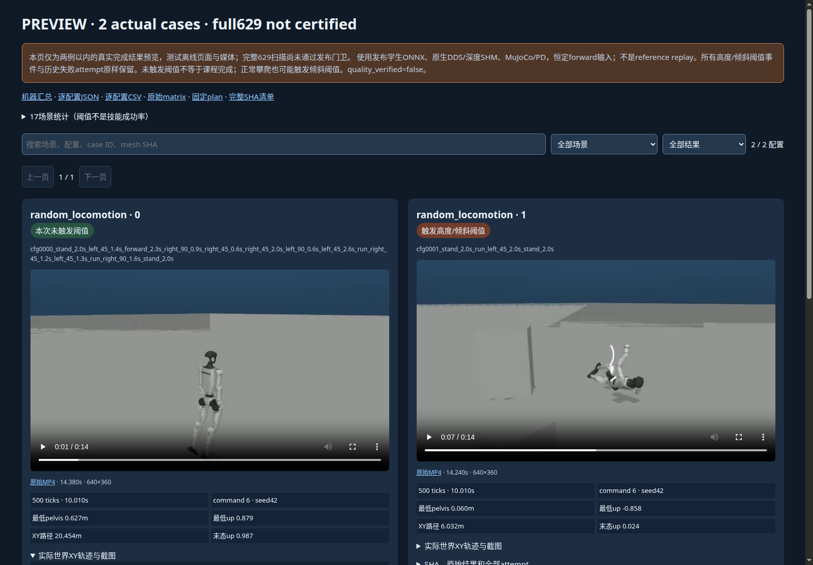
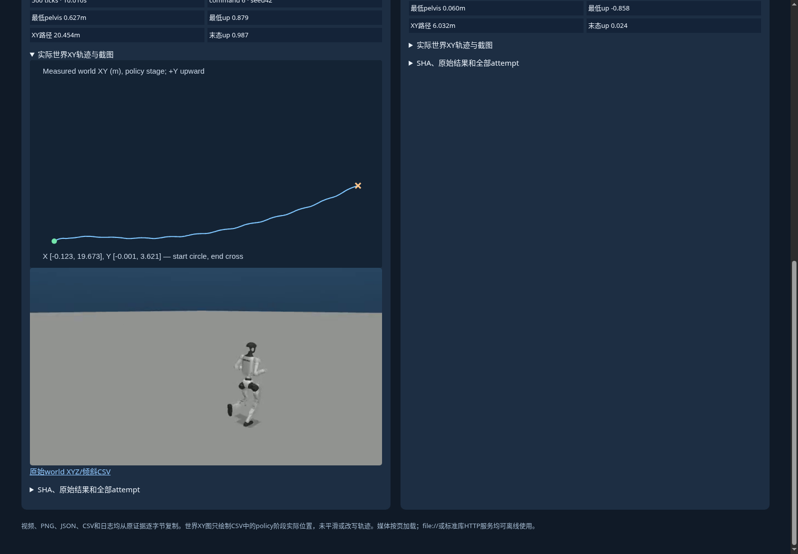

# 完整场景结果页的发布工具验收

新增 [publish_full_scene_matrix.py](../../../scripts/research/publish_full_scene_matrix.py) 和 [verify_full_scene_gallery.py](../../../scripts/research/verify_full_scene_gallery.py) 已通过24项CPU回归，以及两例真实完成结果的独立Chrome检查。根合并验证32项含另外8项教师配置检查，不能重复累加为56项。

本次只检查发布通路，**没有完成629项物理扫描或完整结果页发布**。实际完整发布命令返回exit2，未创建目标目录；[拒绝记录](full-scene-publisher-development/full-refusal.stderr.log)与[开发汇总](full-scene-publisher-development/report.json)保留原字节。两例PREVIEW仍在ignored输出目录；这里仅保存两例浏览器截图与报告，不把它发布为629页。

[根浏览器检查](full-scene-publisher-root-browser/results.json)逐一核验2个原始MP4的metadata和seek解码、实际播放推进、2个PNG与2个轨迹SVG，以及场景、case ID和阈值筛选。视频按页加载，最多24张卡片、4个并发媒体检查；完整629浏览器验收尚未运行。

完整发布门卫要求冻结plan、本轮真实driver终态exit0、629项完成及matrix SHA一致；逐例核验500 ticks、10秒、吊架释放、340运行依赖/1887输入及原始证据SHA。sealed历史attempt也核原SHA；unsealed失败保留当前原字节及指纹，明确不补造封存验收。所有日志、MP4、PNG、JSON、CSV逐字节复制；世界XY仅由实际policy阶段CSV绘出，不平滑。阈值事件和历史失败不会删除，`quality_verified=false`。

工具当前只发布本次固定`571dfb1e…` cohort。fresh复跑的路径、时间、image或输入变更会生成新plan identity，须重新审阅并适配发布期望值；当前拒绝新identity属于来源门卫。[cohort边界](full-scene-publisher-development/cohort-scope-review.json)。复跑物理仿真的入口不受此发布工具限制。

完整物理任务真实结束并核验后，使用[开发报告中的精确命令](full-scene-publisher-development/report.md)生成最终页面；不要在运行中改变原输入或启动第二个DDS作业。后续出现的执行异常还需独立解决，不能用本工具CPU通过替代物理运行结果。
