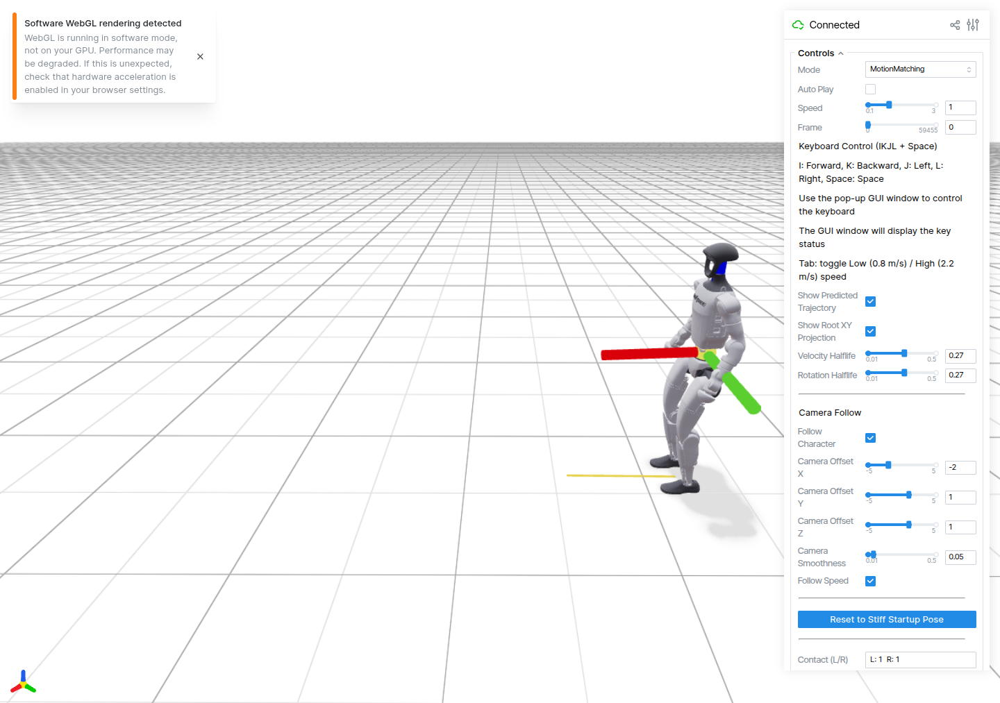

# GUI 保存工作流补充验收

本次真实浏览器/Tk 操作确认并修复两条保存流程的地形配对问题。它是参考 GUI 和 CPU 格式验收，没有物理策略、GPU训练或新的真实动作采集。

| 流程 | 原版实际结果 | 修复后实际结果 |
|---|---|---|
| Viser 文件/地形切换、速度编辑保存 | [实际保存失败证据](viewer-before-04/results.json)：NPZ存在，配对NPY/OBJ不存在 | [真实控件结果](viewer-final/results.json)：切文件、选地形variant、重随机、速度2.0保存223帧；完整复制源terrain全部变体与OBJ；15维onehot命令保留；临时源Delete清理三文件 |
| 主程序交互录制 | [实际录制失败证据](interactive-before-04/results.json)：真实I/J和Start/End已操作，motion/terrain分目录且命名不配对 | [真实控件结果](interactive-final/results.json)：新Tk窗口定向I/J按下/释放、Start/End后保存259帧@50Hz，同目录完整NPZ/空terrain NPY/ground OBJ/录制JSON |

两条保存结果都执行了真实单文件与目录 `motion_convert` CLI、`diagnose_motion` CLI、`file://` RegistryResolver 与原生 `MotionLoader(device="cpu")`；native关节位置/速度36/35维、身体32，全部通过。[Viser转换](viewer-final/conversion/result.json) · [交互转换](interactive-final/conversion/result.json) · [CPU原生加载](interactive-final/native-load.json)。没有W&B SDK导入或登录。

交互录制仍只记录qpos，**没有vel_cmd标签**。sidecar和GUI状态明确提示这一点；没有根据位移推断标签，也不声称该输出可以直接替代带显式意图标签的学生训练数据。Viser Save原版已经保留已有vel_cmd，本次新增修复是terrain配对，不是重新创造命令标签。

[相关CPU JUnit](related-final-tests.xml)覆盖IO helpers和public workflows；其中public workflows共12项通过，四项为本次新增，不将重复运行累计成新增测试。




原始参考资产逐SHA复核未改。精确[修改前源码](source-before/manifest.json)、[修改后源码](source-after/manifest.json)、[完整结果及来源限制](summary.json)独立存放，不修改旧technical audit的115源码哈希或旧raw报告。原始Tk录制失败试验时，run.py回调尚未改，motion_io已有新增但未使用的helper定义；原save_motion_npz AST前后相同，因此不声称该试验所有依赖bytes都与更早Viser baseline一致。

复现需统一GUI容器、已有Chrome和本地X11会话，并先完成low_speed_step参考生成（输入在outputs/research/motion-matching/scenarios/low_speed_step）。宿主只用标准库驱动浏览器，项目包只在Docker执行；输出目录须新建且为空，8080/8081须无相关服务。

```bash
python3 scripts/research/verify_gui_workflows.py --mode viewer --expect-paired --output outputs/research/gui-workflows/viewer-new
python3 scripts/research/verify_gui_workflows.py --mode interactive --expect-paired --output outputs/research/gui-workflows/interactive-new
```

这些操作只删除临时复制的测试文件。验收后本脚本终止自己的Viser/Tk进程；原TensorBoard6006服务保持运行。当前证据来自已运行research容器的源码挂载，新的GUI源码与原云训练镜像/正式训练源保持独立版本边界。
