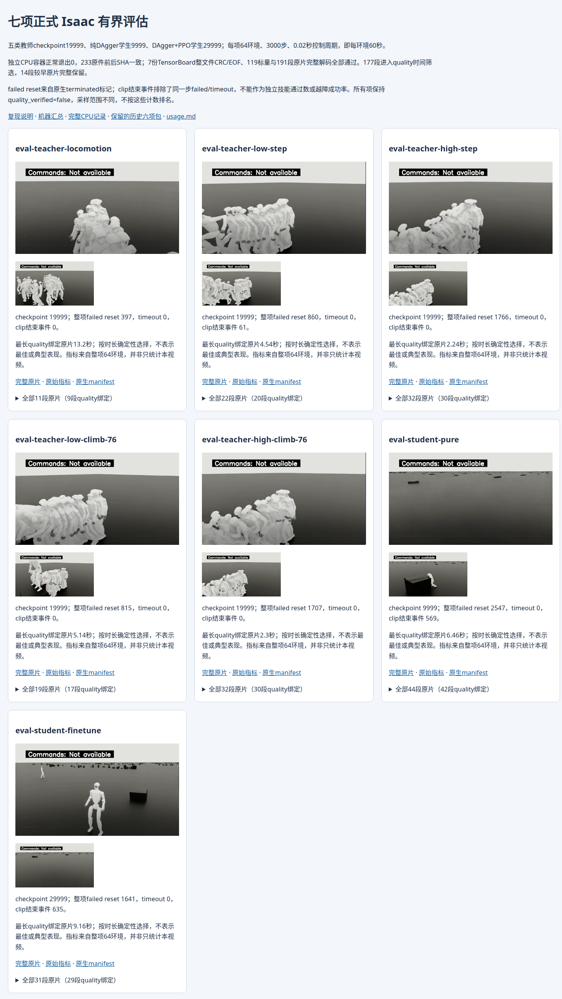
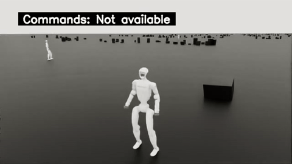

# 七项正式Isaac有界评估：五教师与两学生

2026-10-15补齐最终DAgger+PPO学生的真实评估，形成新的七项包；[历史六项包](../official-evaluations-six/index.md)保持原字节。混合学生训练manifest记录30,000轮、最终checkpoint29999、FINETUNE=1，绑定相同顺序的五个最终教师。原生评估正常退出0。

[集中播放七项原视频](playback.html) · [机器汇总](summary.json) · [原始输入合同](control/input-contract.json) · [完整CPU报告](cpu-01/results/report.json) · [CPU宿主/容器回执](cpu-01/host/execution.json)

| 评估 | checkpoint | failed reset | timeout | clip结束事件 | 原片 / quality绑定 |
| --- | ---: | ---: | ---: | ---: | ---: |
| eval-teacher-locomotion | 19999 | 397 | 0 | 0 | 11 / 9 |
| eval-teacher-low-step | 19999 | 860 | 0 | 61 | 22 / 20 |
| eval-teacher-high-step | 19999 | 1766 | 0 | 0 | 32 / 30 |
| eval-teacher-low-climb-76 | 19999 | 815 | 0 | 0 | 19 / 17 |
| eval-teacher-high-climb-76 | 19999 | 1707 | 0 | 0 | 32 / 30 |
| eval-student-pure | 9999 | 2547 | 0 | 569 | 44 / 42 |
| eval-student-finetune | 29999 | 1641 | 0 | 635 | 31 / 29 |

每项64环境×3000控制步，0.02秒周期：每环境60秒、每项3840环境秒。四项tracking指标每项192,000样本，完整mean/p95/max及expert分组保留在原quality.json。failed reset统计原生terminated，不能把所有事件称为跌倒；clip结束事件排除同一步failed/timeout，不是独立源动作覆盖、技能通过数或课程成功率。两学生observed_clip_ids=0..4与available_clip_count=1来自不同原生索引语义，不能据此推断296源覆盖。

新增混合学生有31段原片，末编号episode33；编号2、4未列在原生manifest，不能将末编号写成33段。远端目录实际MP4集合与31条manifest精确一致；其中29段quality绑定，另外2段较早原片保留。[只读SSH回传回执](transfer/host-receipt.json)与[逐文件远端前后SHA](transfer/remote-receipt.json)证明37份新增输入未变。另196份输入从历史六项包逐SHA复制。[本地复制记录](transfer/local-six-copy-receipt.json)保留来源合同身份。

新独立CPU容器`92957ad69d220714a5dce2069ec74d621a3c634a1a2e701f1b733667cecf308c`使用既有固定镜像、runc、无网络、无GPU、2CPU/12GiB，宿主attach wait和容器自然退出均为0。233份原件共41,253,916 B；全部7份TensorBoard完整CRC/EOF、119标量、191段MP4共21,021解码帧通过。ffprobe计帧与ffmpeg完整解码帧数逐片相等；来源、合同与执行代码前后SHA均相同。177段quality绑定，14段初始化较早原片也完整保留。

播放页每项确定性展示最长quality绑定片段及中点PNG；选择规则是时长，不能解释为最佳、典型或成功片段。完整191段原片均可逐项下载。

## 独立CPU重放

从已按[note.md](../../../note.md)准备统一镜像的仓库根目录执行。宿主只使用Python标准库与Docker；输出目录必须全新。它重新核对既有证据，不重新训练或运行Isaac。

```bash
python3 -B usage_assets/reports/official-evaluations-seven/reproduce/run_owned_cpu.py \
  --input usage_assets/reports/official-evaluations-seven \
  --contract-sha256 d52a2f8a46ef8778b4db0b2585f779cd62d3a17e5ba094a55a7e37bc58b53dfa \
  --validator-sha256 dfbf4064995051f2f4724dd939071f5d5702a52e32b21c5dfa9473864aa51fec \
  --output outputs/research/official-evaluations-seven-replay-FRESH
```

验收代码基于历史六项工具扩展，精确[validator差异](reproduce/validate.py.adaptation.diff)与[执行器差异](reproduce/run_owned_cpu.py.adaptation.diff)保留：实际总数233/191/177/7及混合学生30000/29999/FINETUNE1身份；数据、CRC、指标、视频和真实退出门卫继续执行。

可选浏览器复查使用已安装Chrome，检查七个展示原片的metadata、中点seek、真实播放推进和七张图片；输出目录全新，不安装任何包：

```bash
python3 -B usage_assets/reports/official-evaluations-seven/browser-reproduce/verify_gallery.py \
  --package usage_assets/reports/official-evaluations-seven \
  --output outputs/research/official-evaluations-seven-browser-FRESH
```

本包保持`quality_verified=false`、`convergence_verified=false`、`full=false`。CPU一致性和完整视频只验证本包证据，不验收完整16阶段、888逐源覆盖、最终学生58例/各629配置或真机结果。PT正文未打包；重新运行Isaac仍需原始最终PT、动作/地形资产和相同镜像，并明确设置64环境/3000步。

实际浏览器验收已完成：七原片metadata、中点seek和真实播放推进、七张PNG均通过，Chrome自然退出0，所选14份输入及浏览器代码前后SHA未变。[实际浏览器记录](browser/report.json)。

[](playback.html)

## 混合学生的实际动态预览



GIF取最长quality绑定原片的1.16–9.16秒，以8 FPS、480×270、原速显示；部分时刻机器人离开近景，没有按成功表现筛选。完整试验的1641次failed reset、635次clip结束事件属于全部64环境，不能分配给这一段或解释为成功率。[完整原片](artifacts/official-full/official/eval-student-finetune/PHP-research/20261014_215839-student-finetune-wholebodytrackingmanager/renderings_training/episode_7_1792015196.mp4)、[源SHA/抽帧与指标](student-finetune-preview.json)、[无GPU CPU回执](student-finetune-preview-cpu.json)均保留。
