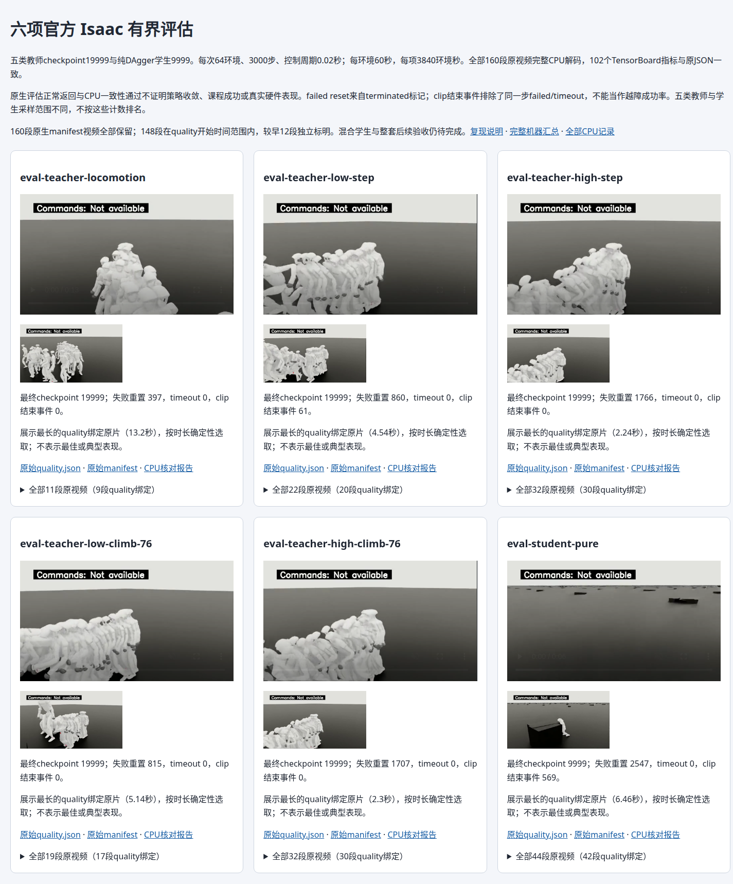
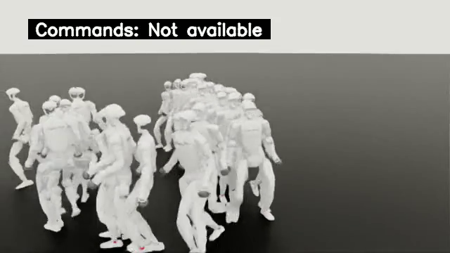
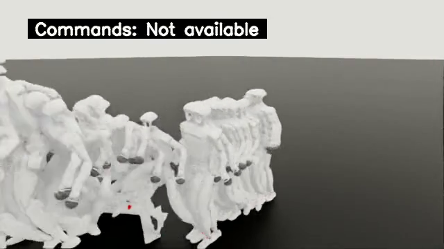
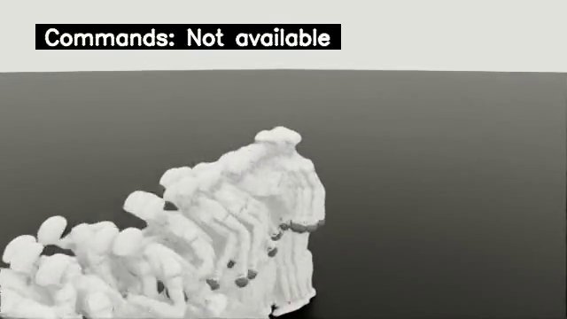
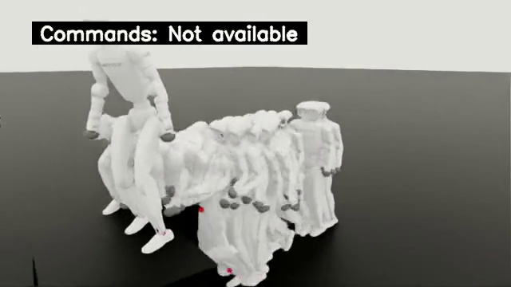
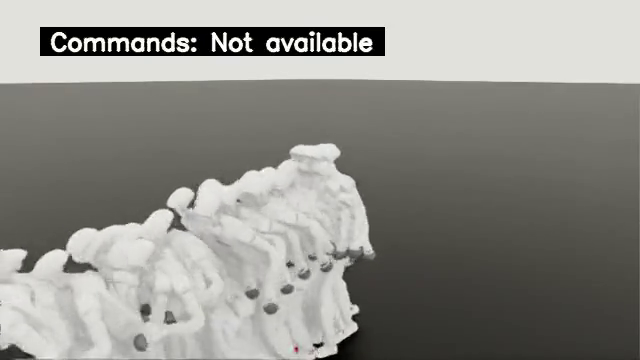

# 六项官方 Isaac 有界评估与离线证据

五类教师最终checkpoint19999与纯DAgger学生9999的六项原生评估均正常返回0。每项64环境、3000控制步、0.02秒周期，即每环境60秒、每项3840环境秒。原始文件、配置、TensorBoard和视频都随包保存。

[播放六项原始视频与中点图片](playback.html) · [机器汇总](summary.json) · [原始输入合同](control/input-contract.json) · [CPU完整报告](cpu-02/results/report.json)

| 评估 | iter | failed resets | timeout | clip结束事件 | 原生视频／quality绑定 |
| --- | ---: | ---: | ---: | ---: | ---: |
| eval-teacher-locomotion | 19999 | 397 | 0 | 0 | 11／9 |
| eval-teacher-low-step | 19999 | 860 | 0 | 61 | 22／20 |
| eval-teacher-high-step | 19999 | 1766 | 0 | 0 | 32／30 |
| eval-teacher-low-climb-76 | 19999 | 815 | 0 | 0 | 19／17 |
| eval-teacher-high-climb-76 | 19999 | 1707 | 0 | 0 | 32／30 |
| eval-student-pure | 9999 | 2547 | 0 | 569 | 44／42 |

`failed_resets`统计原生terminated重置，不将所有事件称为跌倒。`clip_completions_excluding_failed_timeout_steps`统计没有同一步failed/timeout的片段结束事件；它不是独立源片段覆盖、技能通过数或越障成功率。四项tracking指标每项192,000个样本，完整mean/p95/max及单位、每环境和expert分组数据保留在原quality.json。纯学生的observed_clip_ids为0..4、available_clip_count为1，两者来自不同原生索引语义，不能据此证明296源覆盖。

[独立逐原件审查](independent-review/report.json)另外核对了328个实际子进程返回码、18,018个解码帧、108条完整TFRecord记录与102个标量，并保留首次失败。

CPU容器使用已存在的统一镜像`sha256:2be18521015b2a84ef7a4442af9a94ef041a19feb9ce385ae15424b1dc158d8f`，runc、无网络、无GPU设备、2CPU/12GiB；一次自然退出0。196份原件共37,955,540B及合同、源码前后SHA均未变；六项各17个TensorBoard指标与JSON在float32容差1e-6内一致，六份事件整文件CRC32C/帧结构/EOF检查全部通过。160段原视频均由ffprobe计帧与ffmpeg全片解码，返回0、正帧数且两者相等。

原生manifest列出160段视频，quality.videos绑定148段。每项初始化时的两段较早视频未进入稍后开始的quality时间筛选，合计12段；全部原片与描述仍保留，未伪装成quality绑定样本。六张中点图片确定性取各项最长quality绑定原片，不代表最佳或典型表现。

首次CPU尝试在第三方导入、日志解析和解码前因过严环境检查自然退出1：[原失败记录](failed-cpu-01/host/execution.json)、[原stderr](failed-cpu-01/host/attached.stderr.raw)。宿主的只读/proc显卡元数据可见并不授予GPU设备访问。v3只修正该条件，继续检查设备/env和宿主Docker配置，保留nvidia_proc实际观测；没有放宽数据、指标或视频检查。最初v1的索引语义/日志完整性源码问题也在执行前纠正并保留[审查](sources/rejected-v1/review.json)。

六项展示页也已在现有Chrome实际检查：[浏览器原记录](browser/report.json)。六段原视频均核对metadata、解码中点seek和真实播放时间推进，六张PNG正常解码；14份输入与两份代码前后SHA未变，Chrome自然退出0。此检查不安装浏览器或Python包，也不重跑策略。

[](playback.html)

## 离线重放

在已按仓库note.md准备统一Docker镜像的机器上，从仓库根目录运行以下命令；宿主只需现有Python标准库和Docker，不安装任何包。输出目录必须全新。它重新检查本包196份原件、配置、CRC、102个标量、160段视频与六张图片，不重新训练或产生新Isaac rollout。

```bash
python3 -B usage_assets/reports/official-evaluations-six/reproduce/run_owned_cpu.py \
  --input usage_assets/reports/official-evaluations-six \
  --contract-sha256 4ca7fb20e21328235b1dd40def4852ceccc81cdd414782523adefd52cc05fb72 \
  --validator-sha256 86ad6bb0f41f60951b4a784285851525eb0efb2bf398da38cbe1ef8f71688ac4 \
  --output outputs/research/official-evaluations-six-replay-FRESH
```

公开包的上述入口已在新CPU容器实际重放并自然退出0：[独立重放回执](public-replay-receipt.json)。196份输入与源码未变，全部102个标量和160段视频的元数据/帧数与原验收相等，六份完整性JSON、标量JSON和中点PNG逐字节一致。新容器和实际子进程日志见[重放记录](public-replay/host/execution.json)，没有重跑Isaac训练或rollout。

本包不包含六个PT的权重正文；原生manifest记录其最终SHA和教师顺序。重新运行Isaac评估还需要匹配的原始最终PT、动作/地形资产及镜像。以原报告中的checkpoint与registry_order设置`CHECKPOINT`和`REGISTRY`，并明确指定64环境、3000步、headless、日志目录与视频参数，完整说明见仓库[note.md](../../../note.md)。native默认1环境/250步，不能省略64/3000。随机rollout不承诺逐字节相同或相同性能。

此包保持`quality_verified=false`、`full=false`、`convergence_verified=false`、`official_schedule_complete=false`。混合学生30,000轮与其评估/导出、全16阶段、888逐源尝试、最终两学生58例及各629原参考指令、云端SDK正式切换仍未在本包验收；真实G1/D435i未操作或标定。

### eval-teacher-locomotion

[原视频](artifacts/official-full/official/eval-teacher-locomotion/PHP-research/20261012_231547-teacher-locomotion-wholebodytrackingmanager/renderings_training/episode_12_1791847119.mp4) · [原始指标](artifacts/official-full/official/eval-teacher-locomotion/quality.json)



### eval-teacher-low-step

[原视频](artifacts/official-full/official/eval-teacher-low-step/PHP-research/20261012_231918-teacher-low-step-wholebodytrackingmanager/renderings_training/episode_7_1791847194.mp4) · [原始指标](artifacts/official-full/official/eval-teacher-low-step/quality.json)



### eval-teacher-high-step

[原视频](artifacts/official-full/official/eval-teacher-high-step/PHP-research/20261012_232313-teacher-high-step-wholebodytrackingmanager/renderings_training/episode_30_1791847579.mp4) · [原始指标](artifacts/official-full/official/eval-teacher-high-step/quality.json)



### eval-teacher-low-climb-76

[原视频](artifacts/official-full/official/eval-teacher-low-climb-76/PHP-research/20261012_232700-teacher-low-climb-76-wholebodytrackingmanager/renderings_training/episode_21_1791847880.mp4) · [原始指标](artifacts/official-full/official/eval-teacher-low-climb-76/quality.json)



### eval-teacher-high-climb-76

[原视频](artifacts/official-full/official/eval-teacher-high-climb-76/PHP-research/20261012_233135-teacher-high-climb-76-wholebodytrackingmanager/renderings_training/episode_29_1791848085.mp4) · [原始指标](artifacts/official-full/official/eval-teacher-high-climb-76/quality.json)



### eval-student-pure

[原视频](artifacts/official-full/official/eval-student-pure/PHP-research/20261013_093506-student-pure-wholebodytrackingmanager/renderings_training/episode_42_1791884401.mp4) · [原始指标](artifacts/official-full/official/eval-student-pure/quality.json)


可选浏览器检查（使用已存在的Chrome/Chromium，输出目录须全新）：

```bash
python3 -B usage_assets/reports/official-evaluations-six/browser-reproduce/verify_gallery.py \
  --package usage_assets/reports/official-evaluations-six \
  --output outputs/research/official-evaluations-six-browser-FRESH
```
