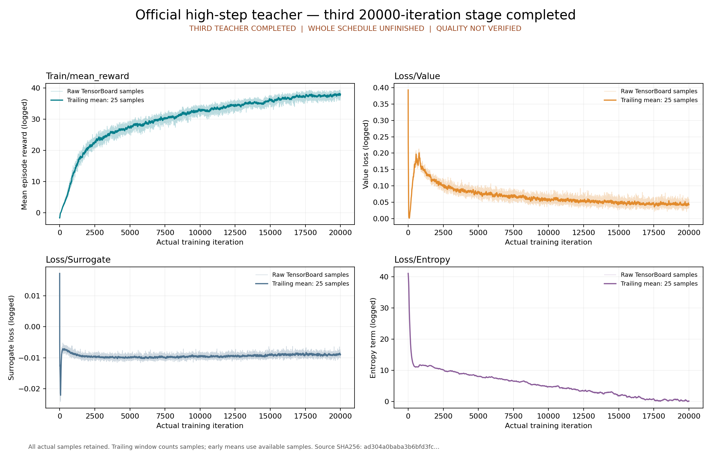

# high-step 公开恢复入口的实际复跑

本页封存[原高台阶验收包](../official-high-step-final/index.md)出版后的实际执行证据。原149件文件保持原字节；其中尚未执行 replay 的说明是出版时快照。本次真实调用公开 `replay.py run`，恢复原件后在新隔离容器中完成五阶段。

```bash
python3 -B usage_assets/reports/official-high-step-final/replay.py run \
  --onnx outputs/research/official-full/teacher-high-step-final-01/artifacts/model_19999.onnx \
  --output outputs/research/official-full/teacher-high-step-final-public-replay-01
```

实际容器执行时段为 `2026-10-11T17:37:52.565220833Z` 至 `2026-10-11T17:38:10.363356638Z`。宿主 attach wait、checkpoint、scalars、ONNX、bind、plots及容器退出均为0。[宿主回执](host/execution.json)、[五阶段回执](validation/phases.json)、[终态inspect](host/inspect-after.json)及[根代理复核](root-verification.json)保留实际记录。容器 `f5892fc9212cd940ff3d591c8933183d18b8d4ed72b2eb289afc3717ab3e0644` 使用同一固定 image2be、runc、无网络、GPU hidden、2 CPU/12 GiB、三个只读输入挂载及独立可写输出，自然停止、无OOM；cgroup memory peak为1,885,900,800 bytes（约1.756 GiB）。

[恢复回执](restoration.json)证明五个产物共536,130,378 bytes与原件一致；72,561,360-byte TensorBoard事件完整恢复为 SHA `dcd98916219f4bf4696e864dfdfc0c9837433ce50327cd44697111d159367f82`。11个宿主输入、16个阶段输入与原验收精确相同。checkpoint的68个有限Tensor、449/575/29维度、Adam20→400000，四条曲线共80,000个有限样本、12项ORT检查与T=1,696,832参考表均保留。checkpoint/scalars科学字段及ONNX全报告与原验收一致；实际时间戳、bind新报告SHA和绘图来源SHA按本次执行保留。[独立只读审查](independent-review.json)另核原件/报告/真实退出，不第三次重跑科学阶段。



本包保存这次实际回执与报告，恢复后的大文件不重复进入Git。原模型、事件归档、固定源码和入口位于原包；442,848,025-byte ONNX按原包外部下载合同取得并核SHA。[路径映射](path-map.json)绑定副本来源，[完整清单](evidence-manifest.json)封存所有文件，原JSON绝对路径不改写。

本次证明公开恢复入口可实际执行这些CPU检查。质量、收敛、PT/ONNX动作数值parity及整个官方日程仍未验证；剩余两教师、两学生、官方物理评估、888逐源与自训学生58例继续等待原任务完成，真机G1/D435i尚未验收。
