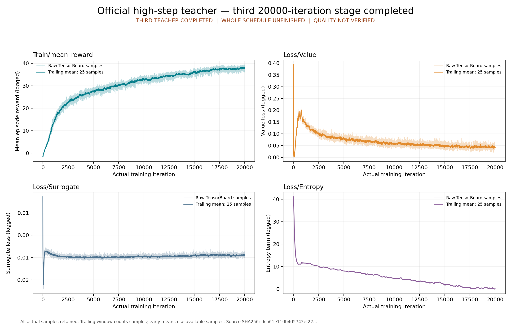

# 第三个完整官方教师：high-step

本包只归档官方第三个教师 high-step 的真实原生终态、下载原件和独立 CPU 验收。原生 manifest 记录 20,000 次迭代、最终 checkpoint iteration 19999、返回码 0；完成时间为 2026-10-11 17:10:20 UTC。原 driver 已自然继续下一个教师。

CPU 结果必须以 [五阶段原始回执](cpu-01/validation/phases.json)、[实际容器退出](cpu-01/host/execution.json)及[独立后验复核](cpu-01/independent-postexecution-review.json)为准。出版器在这些真实报告绑定、复核且全五阶段正常退出 0 前拒绝创建本包；准备阶段不等于本包已生成或重放已执行。

来自本次原始 TensorBoard event。检查点、标量、ONNX、输入绑定及绘图沿用同一五阶段 CPU 实现，不启动仿真或训练。数值检查不能证明技能成功、物理稳定性、PT/ONNX 数值一致或收敛；其余两个教师、两个学生及后续覆盖验收仍须分别取得真实结果，整个官方日程尚未完成。

实际隔离 CPU 五阶段在 **2026-10-11 17:27:31–17:27:48 UTC** 全部退出 0，宿主 attach wait 与容器也退出 0。容器自然停止、无 OOM；实际 cgroup memory peak 为 1,730,846,720 bytes（约 1.612 GiB）。[根代理后验](cpu-01/root-postexecution-verification.json)与独立后验绑定全部原件和原始回执，未重复运行科学检查。

[checkpoint 报告](cpu-01/validation/checkpoint.json)确认 `iter/iteration=19999`，68 个 Tensor 有限，actor449→29、critic575→1，两个 normalizer 均为 `None`。4096 环境、seed42、64 地形变体、obstacle_seed42、24 steps/env、4 minibatches、5 epochs 来自实际保存配置。同 run 的 iter0 与最终 PT 全配置相同；actor9个、critic8个权重 Tensor 有变化，保存的 AdamW step 从20增至400000。iter0 已做第一轮优化，不能当作未训练随机初值。

[完整 TensorBoard 标量](cpu-01/validation/scalars.json)的四个 tag 各有20,000个有限样本，step严格为0–19999，共80,000点；图保留原始数据及25样本 trailing mean，不用平滑值替代原始记录。[SVG](cpu-01/validation/plots/learning-curves.svg)及[绘图回执](cpu-01/validation/plots/plot-report.json)保留来源 SHA。

| Tag | step19999 实际值 |
|---|---:|
| Train/mean_reward | 38.5565299987793 |
| Loss/Value | 0.05058148875832558 |
| Loss/Surrogate | -0.008427823893725872 |
| Loss/Entropy | 0.11766765266656876 |

[ONNX 报告](cpu-01/validation/onnx.json)的12项真实 CPU ORT检查为两种合成观测×六个时间索引，验证有限确定性动作和内嵌参考查表，未覆盖全部外部参考帧的物理技能。输入为 `obs[1,449]`、`time_step[1,1]`，动作 `[1,29]`；参考表 `T=1,696,832`，四个常量布局 `[T,29]`、`[T,29]`、`[T,3]`、`[T,4]`。T是表总帧数，不能当作独立动作数量或课程成功数。[绑定报告](cpu-01/validation/bind.json)确认 PT/ONNX 全配置相等；原 YAML 只允许 `actor.output_dim` 的 `robot_action_dim→29` 原生解析，其余完整配置精确比较。配置相等不等于动作数值 parity。`quality_verified`、`convergence_verified`、`pt_onnx_numerical_parity_verified` 和 `official_schedule_complete` 均为 false。

- [原始终态观察](terminal-observation/stdout.raw)及[阶段转换复核](terminal-observation/root-terminal-transition-verification.json)保留原路径和字节。
- [实际下载回执](transfer/receipt.json)、[原云 manifest](transfer/teacher-high-step.json)、[下载 SHA 复核](transfer/root-transfer-verification.json)绑定五个真实原件。
- [生成 CPU 合同](cpu-01/contract.json)、[源码适配记录](cpu-01/preparation.json)、source/source-original/diffs 以及全部日志/验证报告保留原件；没有虚构 preparation-manifest.json。
- 最终 PT 是 [model_19999.pt](artifacts/model_19999.pt)，同次训练基线是 [model_00000.pt](cpu-01/input/model_00000.pt)。两个 PT 发布到 Git 时必须显式 `git add -f`，并对新的 `git archive` 逐文件与 evidence-manifest 核验，不能只检查工作区文件。
- [外部 ONNX 合同](external-onnx.json)记录实际 442848025 字节及 SHA；该模型不进入 Git。按其中 rsync argv 下载到新路径，replay 会在 Docker 操作前核验完整 SHA。
- [event 无损归档](tensorboard/event-archive.json)记录原 event 的 SHA/字节数、mtime=0 gzip、连续分块偏移和实际完整还原核验；所有发布文件不超过 25,000,000 字节。
- [路径映射](path-map.json)保留原始 JSON 的绝对路径，不改写历史证据；[完整清单](evidence-manifest.json)覆盖本包所有文件。

重放只使用宿主标准库及已有统一镜像 `sha256:2be18521015b2a84ef7a4442af9a94ef041a19feb9ce385ae15424b1dc158d8f`，runc、无网、GPU 隐藏、2 CPU/12 GiB，`/code`、`/control`、`/artifacts` 只读，`/validation` 是全新可写目录。源训练及已完成证据不受重放影响。

```bash
python3 -B usage_assets/reports/official-high-step-final/replay.py verify
python3 -B usage_assets/reports/official-high-step-final/replay.py restore --output /absolute/new-restore --onnx /absolute/model_19999.onnx
python3 -B usage_assets/reports/official-high-step-final/replay.py run --output /absolute/new-cpu-replay --onnx /absolute/model_19999.onnx
```

上述命令是可复核入口，不表示 preparation 阶段已运行出版器或 replay；后续实际重放必须另存真实退出和报告。
