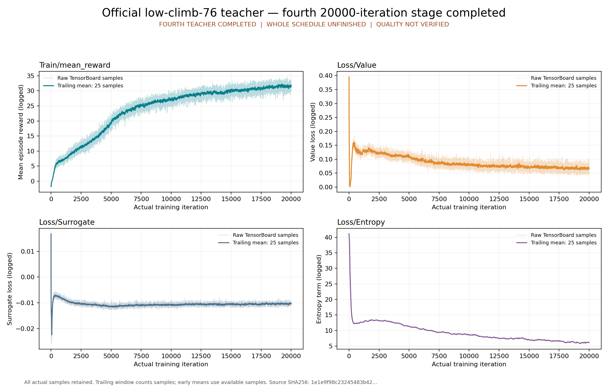

# low-climb-76 公开恢复入口的实际复跑

本页保存[原低攀爬验收包](../official-low-climb-76-final/index.md)出版后的真实执行记录。原包106个manifest依赖及清单保持原字节，其中“尚未执行出版/replay”是封存时快照。本次公开`replay.py run`从归档还原五份原件，在新隔离容器中实际通过checkpoint/scalars/onnx/bind/plots五阶段，宿主attach wait与容器退出均为0。

复跑前按[外部ONNX合同](../official-low-climb-76-final/external-onnx.json)取得并核验同一文件，使用全新output：

```bash
python3 -B usage_assets/reports/official-low-climb-76-final/replay.py verify
python3 -B usage_assets/reports/official-low-climb-76-final/replay.py run \
  --onnx outputs/research/official-full/teacher-low-climb-76-final-01/artifacts/model_19999.onnx \
  --output "$PWD/outputs/research/official-full/teacher-low-climb-76-final-public-replay-new"
```

[Root实查](root-verification.json)、[独立后验](independent-review.json)、[真实执行](host/execution.json)和[五阶段记录](validation/phases.json)绑定本次实际容器及正常终态。固定统一image2be、runc、无网、GPU隐藏、2CPU/12GiB，三个只读输入与独立可写输出；容器自然停止、无OOM。没有为审查再跑科学阶段。

[恢复记录](restoration.json)和Root逐字节校验确认五份原件共640,979,040B一致。72,561,360B的原TensorBoard事件由无损gzip恢复；最终ONNX547,696,678B按外部SHA取得。11个宿主输入和16个阶段输入前后及当前一致。checkpoint/scalars仅本次报告时间戳变化，全部科学字段及80,000个原始标量完全相同；ONNX整个报告字节相同。bind保留本次实际报告SHA，绘图保留本次输入SHA与渲染时间；12项ORT、参考表T=2,100,096及449/575/29维度通过。



[映射](path-map.json)和[完整清单](evidence-manifest.json)封存原JSON/日志，绝对路径不重写。恢复的大产物不重复进Git，原PT/基线PT、事件归档、科学源码和入口位于原验收包。`root_verify_replay.py`只封存本次Root审查源码，其原绝对路径和执行时机见报告，用户重复验收应使用原包的`replay.py`。旧teacher-only PID仅观察为absent，无法由此推断退出原因或OS返回码。

本次证明公开恢复入口可执行这些CPU检查；没有证明策略收敛、技能质量、PT/ONNX动作数值parity或全部官方日程完成。两学生、云端888及正式学生的完整场景验收仍未完成，真机G1/D435i尚未验证。
