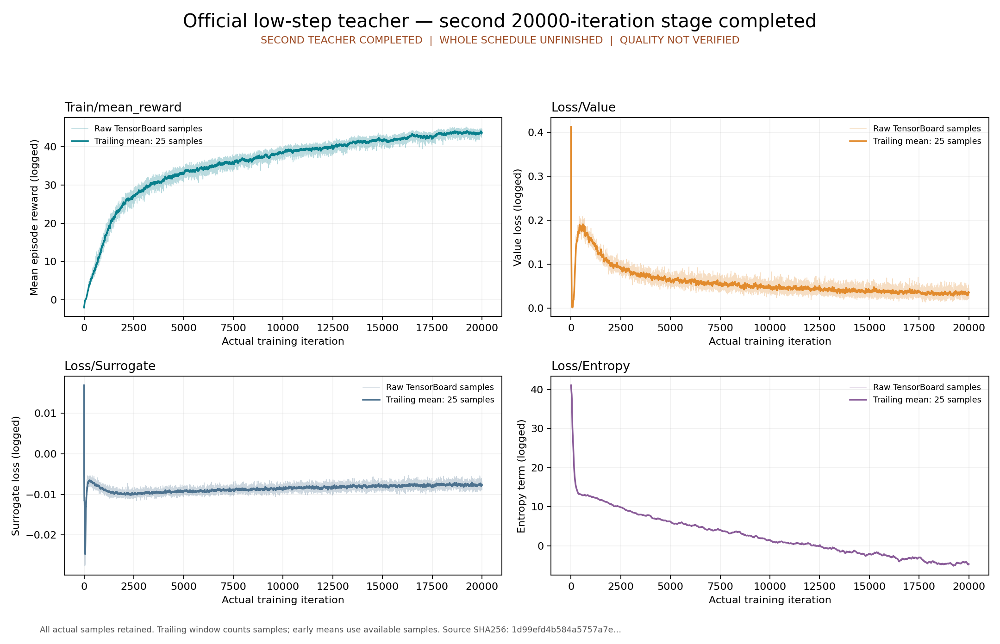

# low-step 公开恢复入口的实际复跑

本页是[原封存验收包](../official-low-step-final/index.md)发布后的独立执行证据。原包的100件文件及清单保持不变；其中“尚未执行出版后的 replay”是发布时快照。本次实际调用该包的 `replay.py run`，不是仅检查脚本或提供命令。

```bash
python3 -B usage_assets/reports/official-low-step-final/replay.py run \
  --onnx outputs/research/official-full/teacher-low-step-final-01/artifacts/model_19999.onnx \
  --output outputs/research/official-full/teacher-low-step-final-public-replay-01
```

实际 CPU 五阶段在2026-10-11 08:27:51–08:28:06 UTC执行，宿主等待、checkpoint、scalars、ONNX、bind、plots及容器退出均为0。[宿主回执](host/execution.json)、[阶段回执](validation/phases.json)、[完整终态 inspect](host/inspect-after.json)保留原字节。新容器 `eae557f772b6ed43fb328b5b539cb97a18f60f681f1772a58e7a45a7b381fad7` 使用固定 image2be、runc、无网络、隐藏GPU、三个只读输入挂载及一个独立可写输出挂载，自然退出并停止，无OOM；cgroup memory peak为1,396,834,304 bytes。

[恢复回执](restoration.json)和[根代理复核](root-verification.json)证明五件恢复产物及16项阶段输入与原验收完全相同。完整TensorBoard事件恢复为72,561,360 bytes，SHA `85ed6bec3d6737dc8705c6191bd9e11da5908eb35e803345d2cc590f7b436203`。四个tag的80,000条标量、checkpoint科学内容、ONNX全报告及绑定的科学字段均与原验收相同；新阶段的真实时间戳及其报告指纹保留变化。68个tensor有限、Adam20→400000、12项ORT检查及参考表T=1,643,264均保留。[独立只读复核](independent-review.json)另核输入SHA、真实退出码与隔离设置，没有第三次重跑。



本包只复制此次实际回执和报告，恢复后的大文件未重复进入Git；模型、事件归档、固定源码和原恢复入口仍位于原封存包，最终ONNX需按其说明另取并校验SHA。[path-map.json](path-map.json)绑定副本来源，[evidence-manifest.json](evidence-manifest.json)封存本页全部文件。原JSON中的绝对路径保留，方便与执行时原件核对。

本次证明公开入口可实际恢复和执行这些CPU检查。`quality_verified`、`convergence_verified`、`pt_onnx_numerical_parity_verified`和`official_schedule_complete`仍为false；尚未完成其余教师、学生、官方物理评估及真机验收。
