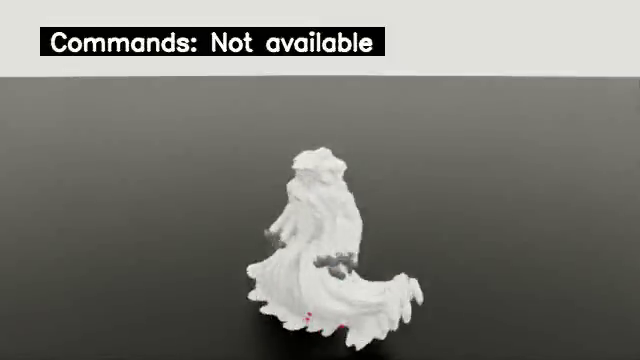

# 云端 pilot 回传至本地 16 GiB Isaac 的真实评估

**执行与回传通路通过，策略质量未验证。** 先前本地显卡被其他项目占用时没有启动任务；该作业结束后，重新确认无其他 compute process，在本地最终统一 Docker 镜像执行本次评估。没有停止或修改其他项目。

源 checkpoint 为云端 4096 环境、64 variants、20 轮 locomotion pilot 的 `model_00019.pt`，SHA-256 `10650ab1c20223b3b9500739b948b5f12724e6cab8a7e6e7970ff99cc9583a4d`。实际恢复到本地 64 环境、1 variant、seed/obstacle_seed 42，原生 Isaac 闭环运行 250 个控制步，退出码 0，完整命令耗时 36.861 秒。[启动命令及镜像](launch.json)、[实际保存配置](actual-eval-config.yaml)、[质量报告](quality.json)、[原始日志](driver.log)。

| 实测项 | 结果 |
| --- | ---: |
| 本地显卡 | RTX 4070 Ti SUPER，16376 MiB |
| 本轮总显存采样峰值（含桌面） | 5797 MiB |
| 评估 compute process 显存采样峰值 | 4826 MiB |
| 采样数 | 35，约每秒一次，可能漏掉短峰值 |
| 每环境／总仿真时间 | 5 秒／320 env-seconds |
| 四项跟踪误差样本 | 各 16000，均有限 |
| 失败 reset／timeout | 3971／0 |
| 本次质量报告关联的 MP4 | 64，均来自 record_env_id=0 的多次短回合 |
| 最长原片 | 0.08 秒，4 帧，50 FPS，640×360 |

3971 是 64 个可重置环境累计终止回合，不是永久跌倒或机器人数量；原生 `BadTracking` 条件也不能仅用骨盆高度解释。模型只训练了 20 轮，本次不是 20000 轮教师的质量验收。

CPU 后验检查真实保存的配置、重建 NPZ/OBJ 与 SHA：合并 NPZ 有 100 个源动作边界，但顶层 loader 仍只有 ID 0；该字段不能表示源动作覆盖。64 个关联视频逐 SHA 检查，17 个 TensorBoard 标量与质量 JSON 核对一致。见 [逐项验证](artifact-verification.json)、[验证脚本](inspect-artifacts.py)、[GPU 原始采样](gpu-samples.json)。

[最长原始录像](../../isaac/official-pilot-local-quality/longest-original.mp4)已完整解码全部 4 帧，截图直接取零起始编号第 2 帧，未改速或拼接。[ffprobe](video-ffprobe.json)与[原始 TensorBoard events](../../tensorboard/official-pilot-local-quality/)。

与云端同一个 pilot 的 [64 环境评估](../official-pilot-quality/summary.md)相比，源 PT 和失败回合总数相同；误差统计有细小数值差异，没有声称跨 GPU 逐位等价。此结果证明现有 16 GiB 本地卡能运行这次缩小后的加载/推理/渲染设置；4096 环境训练曾实测超过 20 GiB，仍由云端承担。正式完整训练继续使用独立 `/outputs/official-full` 输出，尚未完成。

[精选证据清单](evidence-manifest.json)记录 bytes/SHA。完整未筛选输出位于本地 `outputs/research/official-pilot-local-eval/`。
