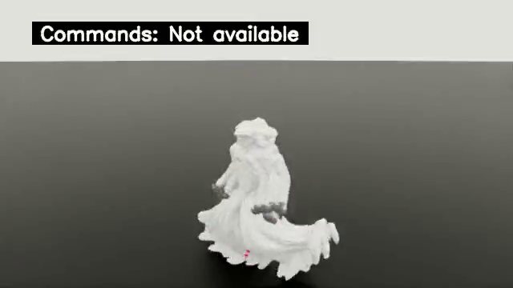

# 官方规模 pilot checkpoint 的云端缩小评估

**接口兼容通过，策略质量未验证（`quality_verified=false`）。** 云端真实 Isaac 评估退出码为 0；源 PT 来自 4096 环境、地形生成参数 `num_variants=64` 的 **20 次迭代容量 pilot**（保存索引 19），并非完成 20000 次迭代的官方教师。实际评估为 64 环境、地形生成参数 `num_variants=1`、seed 42、250 个控制步。它证明该 PT 能恢复配置、生成缩小后的地形、运行物理闭环并产出指标与录像；**不是本地 16GB 显卡评估成功的证明**。

源 PT SHA256：`10650ab1c20223b3b9500739b948b5f12724e6cab8a7e6e7970ff99cc9583a4d`（本地已有相同 PT，重新计算 SHA 一致）。[源 PT 配置检查](checkpoint-config-preflight.json)记录 4096 环境／`num_variants=64`；[本次实际保存配置](actual-eval-config.yaml)和[生成产物检查](runtime-inspection.json)确认 64 环境／`num_variants=1`／obstacle_seed 42，以及真实 NPZ、OBJ 的 SHA。[部署来源](provenance.json)区分镜像内代码与挂载源码。

| 本次实测 | 结果 |
|---|---:|
| 控制步 × 环境数 | 250 × 64 |
| 控制时间步长 | 0.02 s |
| 每环境仿真时间／累计环境时间 | 5 s／320 env·s |
| 指标采集段 wall time／完整 driver wall time | 25.209 s／49.861 s |
| 累计 terminated episodes／timeout episodes | **3971／0** |
| 每环境 terminated episodes | 61–63 |
| 结束回合长度 | 3 步 × 28；4 步 × 3933；5 步 × 10 |
| 每项误差样本数 | **16000，四项均 finite** |
| 记录动作／根状态数值 | 均 finite |
| `quality_verified` | **false** |

3971 是 **64 个可重复重置环境累计的终止回合数**，不是 3971 个机器人，也不是永久跌倒次数。`len(ended_episode_lengths_steps)`、逐环境 failed 之和、TensorBoard 的 `Evaluation/failed_resets` 均等于 3971。Probe 在原生 termination 检查后、reset 前每个控制步读取一次布尔 `terminated`；同一环境同一步的多个终止条件经 OR 合并，计数不会按条件重复相加。[完整原始质量报告](quality.json)、[原始驱动日志](driver.log)、[逐文件校验](artifact-verification.json)保留失败结果。

该配置的非 timeout 终止项为原生 `BadTracking`。其手腕／脚踝条件按任一指定 body 的误差判断，而报告的 `error_body_pos` 是所有 tracked bodies 的平均；姿态终止条件比较投影重力 Z，而报告的 `error_ref_rot` 是四元数角误差。因此不能直接拿下表的平均／最大值替代每个终止谓词，也不能从这些汇总值确定 3971 次分别触发了哪个子条件。当前记录未采集逐谓词计数。最小根高度为 0.5248 m，报告不把这些 tracking resets 改称永久倒地。

| 原生误差 | 单位 | mean | p95 | max | finite samples |
|---|---|---:|---:|---:|---:|
| ref position | m | 0.08219 | 0.17319 | 0.27321 | 16000 |
| ref rotation | rad | 0.19935 | 0.40104 | 0.78290 | 16000 |
| mean body position | m | 0.11000 | 0.23840 | 0.32624 | 16000 |
| joint position L2 | rad | 1.18158 | 2.06458 | 2.60169 | 16000 |

样本来源是原生 pre-reset 采集点每步的 64 个环境，250 × 64 = 16000；本次 CPU 核验检查保存的样本计数、finite 标记与 TensorBoard 汇总一致，没有声称重新回放计算了所有原始误差数组。[解码及 TensorBoard 核验](decode-tensorboard-verification.json)检查 17 个标量标签，均在 step 250，与 JSON 相符且时间位于本次 driver 区间。[TensorBoard 原始事件](../../tensorboard/official-pilot-quality/)可由项目现有离线 TensorBoard 入口展示。

**最长原始录像仅 0.08 s，4 帧，640×360，50 fps。** 原生录像仅记录 `record_env_id=0`；64 个 MP4 是该环境的多次短回合录像，不是为每个并行环境各录一段，也不是完整 5 s 的连续 rollout。全部 64 个原始 MP4 留在 ignored `outputs/research/cloud/results/official-training/official/eval-teacher-locomotion/`，均逐 SHA 验证；下方只发布列表中第一个最长片段，未拉长、拼接或改变速度。[原始 MP4](../../isaac/official-pilot-quality/longest-original.mp4)已用 ffmpeg 完整解码 4 帧；截图直接解码其第 2 帧（零起始编号）。

**motion ID 的边界：** `observed_clip_ids=[0]`、`available_clip_count=1` 是单个合并 NPZ 的顶层 `MotionLoader` 索引。CPU 检查本次真实生成 NPZ，得到 **100 个原始动作边界**，首个边界帧为 919；所以 count 1 不能解释为“只加载了一个原始动作”，也不能解释为“覆盖了 100 条动作”。此 loader 的 eval 重置 phase 为 0，本次每个结束回合仅 3–5 步，反复从库起始重置；没有记录原始 source clip ID／参考时间轨迹，因此未证明全库片段覆盖。此前 [16 环境本地 quality 报告](../isaac-local-quality.json)的 ID 0／count 1 也是相同语义。[两次报告的语义核对](coverage-interpretation.json)保留该边界。

代码依据：[Probe pre-reset 计数与指标采集](../../../scripts/research/eval_quality.py#L76)、[原生 step 的 termination→log→reset 顺序](../../../thirdparty/holosoma/src/holosoma/holosoma/envs/base_task/base_task.py#L484)、[终止 flags 按条件 OR](../../../thirdparty/holosoma/src/holosoma/holosoma/managers/termination/manager.py#L82)、[BadTracking 谓词](../../../thirdparty/holosoma/src/holosoma/holosoma/managers/termination/terms/wbt.py#L64)、[合并动作边界读取](../../../thirdparty/holosoma/src/holosoma/holosoma/managers/command/terms/wbt.py#L144)、[单 NPZ loader 的 num_motions=1](../../../thirdparty/holosoma/src/holosoma/holosoma/managers/command/terms/wbt.py#L240)、[eval phase=0](../../../thirdparty/holosoma/src/holosoma/holosoma/managers/command/terms/wbt.py#L805)。源码 SHA 收录于 [provenance.json](provenance.json)。

本次仅收集 CPU／网络证据，无新增 GPU 任务，无运行时代码修改。完整官方训练使用独立 `official-full` 输出，后续收敛、长回合稳定性、原始 motion 覆盖及跨场景能力须使用其真实训练结果另行验收。
