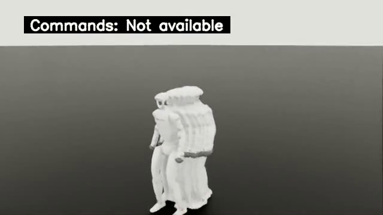

# 正式训练第500轮 checkpoint 回传本地 Isaac 评估

**实际执行与证据核验通过，训练质量尚未验证。** 此次评估加载正在云端完整日程中产生的 locomotion `model_00500.pt`（iteration500 / 计划20000），不是完整训练终点，也没有把失败回合拼接为成功。源 checkpoint SHA-256 `d38d7c626fab4750e40eacfc05bc8178a56141055a569f9abca9f71c7584e87a`。[回传校验](milestone-0500-transfer.json)与[iter0→500真实权重更新](milestone-0500-weight-update.json)均通过；权重变化不等于收敛。

源训练使用4096环境、64 variants；本地在最终统一Docker镜像 `sha256:88254ac0b90a3056375145601d741aa3e08726e18412d201a3c7e7915a23996f` 内恢复为64环境、1 variant、seed/obstacle_seed42，运行250控制步。完整命令退出0，耗时28.405秒；quality capture内部窗口耗时12.244秒。[启动命令](launch.json)、[实际保存配置](actual-eval-config.yaml)、[质量JSON](quality.json)、[原始日志](driver.log)。发布阶段只执行CPU后验检查，没有新增GPU或云端任务。

| 本次实测项 | 结果 |
| --- | ---: |
| 每环境／总仿真时间 | 5秒／320 env-seconds |
| 失败reset／timeout | 75／0 |
| 失败reset / 1000 env-seconds | 234.375 |
| 四项误差样本 | 各16000，均有限 |
| Action／root state | 均有限 |
| 本轮总显存采样峰值（含桌面） | 5905MiB |
| 评估compute process显存采样峰值 | 4839MiB |
| GPU原始采样数 | 27，约每秒一次，可能漏短峰值 |
| quality报告关联视频 | 3段，0.02／3.22／1.78秒 |
| 输出目录所有MP4 | 5段，全部完整解码；另外2段属于启动/采集前短片 |

75次reset是64个可重置环境的累计终止回合，不是75台机器人或75次永久跌倒。所有环境在本窗口内都记录到首次原生失败。这里沿用原生BadTracking；位置判据为full3D L2，姿态判据为projected-gravity-z差，不能只凭骨盆高度解释失败。

| 跟踪误差 | mean | p95 | max | 单位 |
| --- | ---: | ---: | ---: | --- |
| `motion/error_ref_pos` | 0.100629 | 0.310863 | 0.548272 | m |
| `motion/error_ref_rot` | 0.090557 | 0.169659 | 0.477226 | rad |
| `motion/error_body_pos` | 0.039762 | 0.101164 | 0.274229 | m |
| `motion/error_joint_pos` | 0.655738 | 1.458878 | 2.626065 | rad (joint-vector L2) |

真实保存的eval config、重建NPZ/OBJ和视频均逐SHA核对。NPZ含100个源动作边界，但顶层loader仍仅ID0，报告没有逐步源reference索引，所以**未测量原始源动作覆盖率**；边界完成事件为0。原生eval max episode length为100000秒，本次250step有界退出不由训练10秒timeout触发。[CPU逐项验证](artifact-verification.json)、[可重跑检查脚本](inspect-artifacts.py)。

17个离线TensorBoard `Evaluation/*` scalar使用真实EventAccumulator读取，step250，数值与quality JSON一致；原始events保留在[TensorBoard目录](../../tensorboard/official-progress-0500-local/)。没有启用W&B在线记录。

[最长原始录像](../../isaac/official-progress-0500-local/longest-original.mp4)为640×360、50FPS、161帧、3.22秒，已逐帧完整解码，未改速或拼接。截图直接取零起始frame80（1.6秒），只展示原片的一帧，不代表持续成功。[最长片ffprobe](video-ffprobe.json)、[全部5段完整解码/SHA报告](video-verification.json)。

[精选证据清单](evidence-manifest.json)保存bytes/SHA；完整未筛选输出位于 `outputs/research/official-progress-0500-local/`。云端正式训练继续使用独立 `/outputs/official-full`，此次中间检查不宣称五教师/两学生完整日程已结束或策略已收敛。
