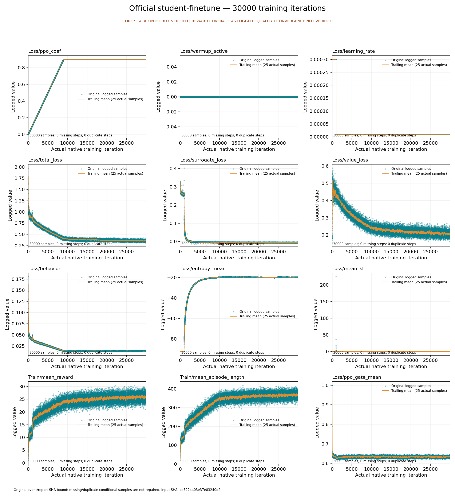

# 正式混合学生曲线：从公开包完整重放

2026-10-15，实际从[已封存的原曲线包](../official-student-finetune-training-curves/index.md)恢复原事件、配置、合同及四份CPU代码，再用全新的无网络、无GPU Docker重新提取和绘图。恢复、宿主执行器、提取、绘图与容器自然退出码全部为0。

**58个tag的1,740,000条标量、全部coverage、原生训练终态和事件元数据逐项相等**。每个tag完整覆盖iteration 0–29,999，无缺失、重复或非有限值；原事件的1,740,001条TFRecord通过CRC32C及精确EOF核验。新报告保留新的真实时间戳与来源SHA。



[实际重放回执](replay.json) · [CPU执行与退出](cpu/host/execution.json) · [两阶段原始收据](cpu/validation/phases.json) · [绘图参数和来源](cpu/validation/plots/plot-report.json) · [完整新标量和SVG恢复映射](compressed-artifacts.json) · [SHA清单](evidence-manifest.json)

新标量JSON为416,852,025字节，新SVG为53,810,999字节，均以mtime=0 gzip完整保存，连续块各不超过25MB，并实际流式解压核对原bytes与whole SHA。[验证与恢复入口](verify_artifacts.py)复用包内原SHA固定的archive helper，可校验所有出版文件，并用`--output`向全新目录恢复这两个原件；须显式传入已核验的`--manifest-sha256`。原JSON内部路径、时间戳和原包均保持原字节。

从仓库根目录可完整复现；输出目录必须尚未存在：

```bash
python3 -S -B scripts/research/student_training_curves/replay.py \
  --package usage_assets/reports/official-student-finetune-training-curves \
  --manifest-sha256 7140d3b6514dcdafcdadede3020f11400979fb2d3e6a853439961fc169ef295f \
  --output "$PWD/outputs/research/finetune-curves-replay-new"
```

镜像为`sha256:2be18521015b2a84ef7a4442af9a94ef041a19feb9ce385ae15424b1dc158d8f`，实际使用runc、2 CPU、12GiB，三个只读输入挂载及一个全新可写输出。该结果验证原始记录与CPU重绘的可复现性；模型质量、收敛、物理技能、七模型PT验收、PT/ONNX数值一致与完整官方日程仍由各自实际验收决定。
