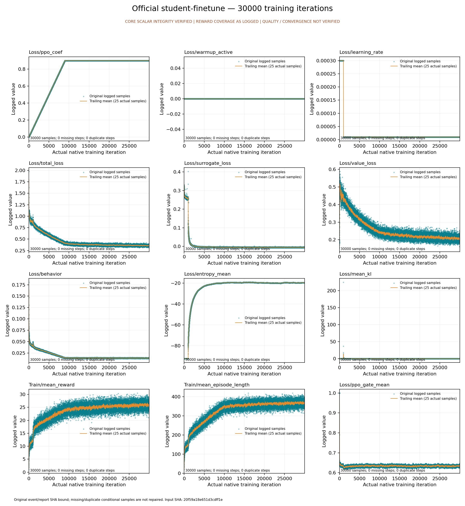

# 正式学生原始训练曲线

finetune：实际 extract/plot CPU验收与完整原始事件归档。本包不证明模型质量、收敛、物理技能、全部日程或PT/ONNX parity。

[原始SVG超过25MB：完整分块及无损恢复路径](restore-map.json) · [范围和真实coverage](summary.json) · [原字节恢复映射](restore-map.json) · [SHA清单](evidence-manifest.json) · [校验与恢复源码](student_curves_archive.py)

用已审源码 student_curves_archive.py 的 verify/restore 子命令，显式传本manifest SHA；restore只向全新目录恢复原bytes及mode，不改JSON内部原绝对路径，不运行科学任务。
