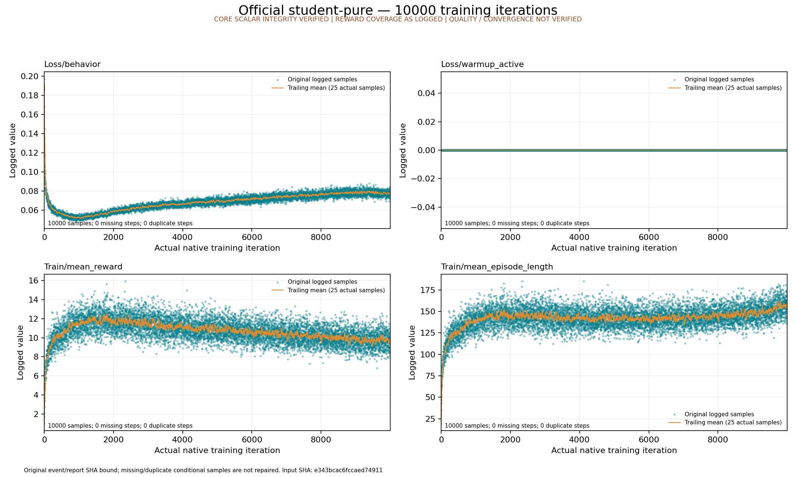

# 正式纯学生曲线：从公开包完整重放

2026-10-13，[原曲线包](../official-student-pure-training-curves/index.md)通过完整校验后，实际恢复46份原件，按原合同和原容器挂载映射重新组织输入及四份代码，再启动全新的CPU Docker执行提取与绘图。restore、宿主执行器、两个阶段及新容器自然退出均为0。

新结果与原结果的 **43个tag、430,000条完整标量、tag coverage、原生终态身份及全部事件记录元数据逐项相等**。原JSON未改写，完整原事件和原YAML字节/权限一致；新报告保留实际新时间戳，不冒充旧报告的相同SHA。没有运行训练、模型推理或物理rollout。



[真实重放回执](replay.json) · [新CPU执行](cpu/host/execution.json) · [两阶段实际退出](cpu/validation/phases.json) · [新绘图来源](cpu/validation/plots/plot-report.json) · [Root后验](root-review.json) · [独立后验](independent-review.json) · [完整新标量压缩与whole SHA](scalar-archive.json) · [SHA清单](evidence-manifest.json)

以下命令从仓库根目录执行，使用已有统一Docker镜像，不安装宿主包、不连接服务器或在线服务；输出必须为全新目录：

```bash
python3 -S -B scripts/research/student_training_curves/replay.py \
  --package usage_assets/reports/official-student-pure-training-curves \
  --manifest-sha256 ea1aee664e260ffbcd8303f1db24db7e45d0530a92533d070e9dfa55a436463b \
  --output "$PWD/outputs/research/student-curves-replay-new"
```

[准确重放源码](replay.py)固定原archive helper及四份CPU代码SHA。镜像为 `sha256:2be18521015b2a84ef7a4442af9a94ef041a19feb9ce385ae15424b1dc158d8f`；实际容器为runc、无网、GPU隐藏、2 CPU/12 GiB，三只读输入及一个全新可写输出。原始输入从上游曲线包恢复，本页不重复保存其102 MB标量或30 MB事件的原始副本；新的102,766,974 B标量按mtime=0 gzip完整保存，并实际流式解压核对whole SHA。

这证明原始记录和CPU重绘可复现。质量、收敛、七模型PT验收、PT/ONNX数值一致、完整官方日程及混合学生最终结果仍未成立。
