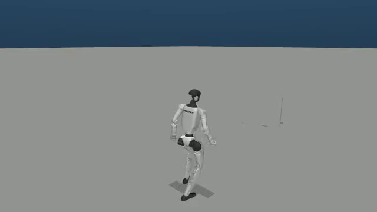

# 原生策略逐帧参考指令 pilot

本页保留一次已完成的真实 MuJoCo + 发布学生 ONNX 物理闭环。输入为 `high_speed_speed_vault` 的一个341帧片段；只将原始 `vel_cmd` 的 **341×15 全矩阵** 按50Hz送入策略，经过原生 DDS / 深度共享内存闭环。没有用参考关节轨迹驱动物理仿真，也没有证明 speed vault 成功。

[播放原始视频](playback.html) · [原始 PNG](reference-native-pilot-01/outputs/rollout/video/episode_0_1791645855.png) · [CPU 实测后验](reference-native-pilot-checks-01/verification.json) · [原生结果](reference-native-pilot-01/outputs/rollout/result.json)

指令序列是 `0 → 6 → 7 → 6 → 0`，对应帧区间 `[0,50)、[50,100)、[100,115)、[115,217)、[217,341)`。CPU 后验已逐帧比较真实策略输入、完整15维标签和原生录制 NPZ；原始 MP4 的 `ffmpeg -xerror` 全片解码退出0。实际推理锚点是物理步2160，gantry释放事件是2159；两者明确区分，每个策略帧间隔10个物理步，完整341帧均有记录。初始位置只对齐参考根部 XY/yaw，保留部署高度和启动关节姿态；gantry 在策略运行期间已移除。

**执行检查通过，技能质量未验证。** 仿真记录最低 `base_up_z=0.1381618381`，低于0.35的采样累计0.18秒，触发启发式跌倒阈值；最低骨盆高度0.62715m。`fall_detected=true`、`quality_verified=false`、`obstacle_course_completion_verified=false` 原样保留。最后恢复较直立姿态不能消除此前阈值事件。该结果只覆盖这一完整配置，不代表所有场景或629配置已做逐帧指令验收。

[宿主启动与退出原件](reference-native-pilot-01/host/launch-receipt.json) 记录 native parent 实际 wait=0、两个 worker 退出0、最终私有进程组为空、两个 `command_writer` 的真实宿主线程/出生映射，以及 own CID 已停止。容器中常驻 `sleep infinity` 被停止后的143与两个原生 worker 的0分别保留。5184个冻结文件及模型输入在运行前后 SHA 一致。

CPU 历史原件均保留：

- [CPU01 receipt](reference-commands-cpu-01/receipt.json)、[stdout](reference-commands-cpu-01/stdout.raw)、[JUnit](reference-commands-cpu-01/results.xml)：131通过，2个旧 launcher 断言失败，实际退出1。
- [CPU04 receipt](reference-commands-cpu-04/receipt.json)、[stdout](reference-commands-cpu-04/stdout.raw)、[JUnit](reference-commands-cpu-04/results.xml)：最终147通过、0失败，实际退出0；不与旧轮累计。
- [最终源码副本](cpu-final-sources/)：CPU04 receipt 绑定的6份文件是3份生产源码和3份修改测试，另保留本轮实际执行的既有 worker 测试当前副本；后者没有冒称 receipt 已记录其运行前后 SHA。

[原始 controller](controller/reference-pilot-controller-01.py)、[真实检查脚本](reference-native-pilot-checks-01/check.py)、两次运行使用的 overlay、observer 流、输入 NPZ/OBJ、原始录像/录制 NPZ/日志及 stdout/stderr 均保持原字节。[复制映射](copy-provenance.json) 给出原路径与本目录路径；历史报告中的绝对路径没有改写。原始冻结源树、ONNX 与 Docker 镜像属于[外部复现输入](external-reproduction-inputs.json)，本包不复制该大树、不声称独立包含全部运行环境。原始5184冻结校验依据的 manifest SHA 为 `599e09e78fdabd4a7a7792a7cd66e2dcddf25f5e1e6aaf56582b2d1cf7e77169`，须结合指定原 preparation 与 Git / overlay 版本恢复。

本次出版仅做标准库复制、SHA/路径/规模核对与凭据模式扫描；没有再次启动原生进程、GPU、Docker、SSH 或重新解码视频。[证据清单](evidence-manifest.json) 绑定本目录全部文件，清单自身除外。
