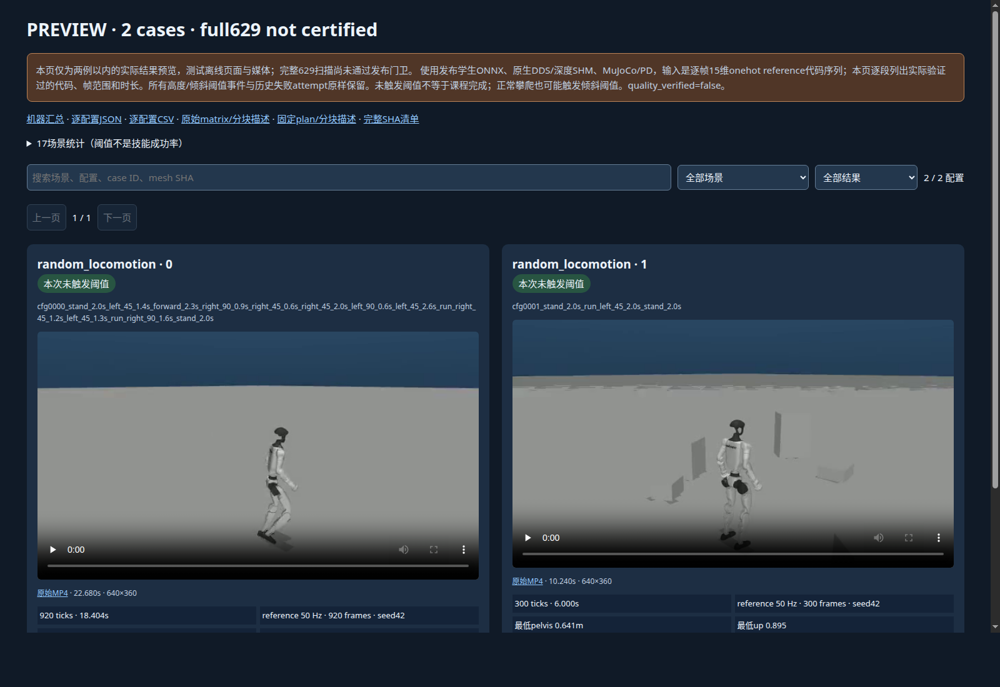

# 逐帧批次：两例真实 CPU 后验

这是完整 reference629 批次中两例已完成配置的后验验证，**不是完整629终态或技能成功验收**。原生回放未重跑，读取现有封存结果；独立 runc CPU 容器隐藏GPU、network none，原始源码、overlay、输入和输出均只读。

[播放原始视频与逐段指令](playback.html) · [摘要](summary.json) · [CPU原始报告](cpu/validation.json) · [真实执行回执](cpu/host/execution.json) · [独立父进程真实 wait](cpu/parent/process-exit.json) · [原路径映射](path-map.json)。

| 配置 | 原始指令帧 | 控制时长 | 全片解码 | 高度/倾斜阈值 |
| --- | ---: | ---: | --- | --- |
| random_locomotion 0000 | 920 | 18.4 s | ffmpeg -xerror，exit0 | False |
| random_locomotion 0001 | 300 | 6.0 s | ffmpeg -xerror，exit0 | False |

合计1220帧、4个原生worker正常退出且进程组为空、2个完整MP4解码。策略真正消费了每帧15维指令，并逐帧核对原生录制NPZ、控制时钟和policy启用状态；仅对齐初始根XY/yaw，没有用参考qpos驱动物理。CPU validator和独立宿主父进程实际wait均为0；CPU sleep容器停止码143独立保留，不能替代科学worker退出码。

[实际执行的validator副本](source/validate_scene_matrix.py)、[宿主执行器](source/reference629-cpu-runner-01.py)及[独立父监督](source/host_owned_launch.py)原样保留。实际完整计划、377项源码依赖与发布模型属于外部运行依赖：参见[可无损恢复的计划](../reference629-plan/index.md)、[真实native启动证据](../reference629-native-start/index.md)和[note.md](../../../note.md)。本包保存两例全部native封存输出及原reference NPZ；路径映射不改写原始JSON。

本次CPU报告的 `status=preview_validated`、`preview=true`、`completion_verified=false`。publisher完整发布入口必须拒绝这个局部报告。

[155项CPU单元检查](cpu-tests/stdout.raw)与[实际退出回执](cpu-tests/receipt.json)已通过，覆盖可变时长、完整范围与局部预览隔离、失败/重试拒绝、封存文件变化及视频解码错误。单元测试使用明确标注的合成fixture，不能作为物理运行证据；上面的两段原生录像才是本次实际解码输入。

最终包含publisher的[211项组合CPU检查](publisher-tests/stdout.raw)也已退出0，包含上述155项，不应相加。[真实publisher预览](publisher-preview/actual-exit.json)退出0；[完整发布拒绝实证](publisher-preview/rejected-full/actual-exit.json)保留真实退出2：native宿主父进程尚未结束，局部CPU报告不能冒充全批通过。

浏览器实际退出0，正确显示两张卡片、920/300帧、原片与逐段指令。[DOM后验](publisher-preview/browser/dom-validation.json)以HTML parser核对真实渲染标签。首次朴素字符串计数误把JS模板当成第三张卡片，导致检查父进程退出1；[首次原回执](publisher-preview/browser/receipt.json)原样保留，修正DOM检查后通过，没有修改页面或重跑浏览器。

实际preview renderer读取了较晚的运行中matrix；CPU报告仍保留自己较早的whole SHA。两者的完整plan及所选两例封存产物必须相同，preview允许其余配置进度变化；full路径必须whole matrix SHA相等。[publisher摘要](publisher-preview/page-summary.json)同时记录两个SHA。本包只保存生产页面的真实截图、结果表及回执；可直接播放的两段原片仍见本文开头链接。

`restore-chunks`还已对原计划103,152,864字节和publisher矩阵119,188,835字节执行[实际无损恢复](publisher-preview/restored-chunks/actual-exit.json)，两个whole SHA均一致。publisher当时的[运行中matrix快照](publisher-preview/matrix-snapshot.json.gz)另以gzip无损保存，[恢复元数据](publisher-preview/matrix-snapshot-restoration.json)记录whole字节数/SHA；可用Python标准库gzip解压到全新路径后核验。它不是CPU报告先前的matrix版本，也不是完整native629终态。
