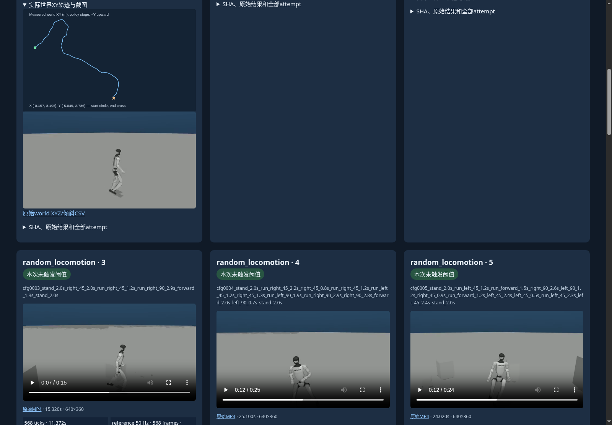

# 参考指令629项：完整画廊浏览器验收

实际离线Chrome验收退出0，覆盖629个视频的metadata与中点seek、1258张缩略图/世界XY图、27页、场景与321/308/629结果筛选、case ID搜索和实际播放推进。14566个发布文件逐SHA核对通过；没有重跑策略或仿真。

[完整画廊](../reference629-full/playback.html) · [机器结果](results.json) · [真实父进程退出](parent/process-exit.json) · [字节来源](receipt.json) · [本包SHA清单](evidence-manifest.json)

321项触发高度/倾斜阈值、308项未触发；阈值统计不等于技能成功率。quality_verified=false，obstacle_course_completion_verified=false。
