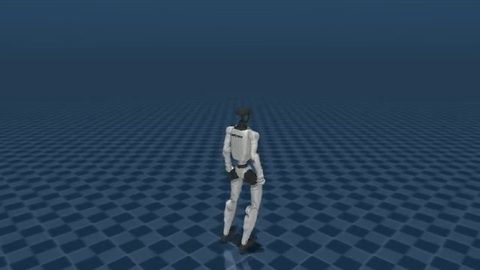
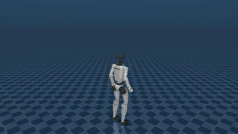
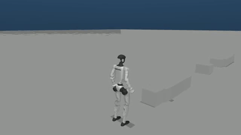
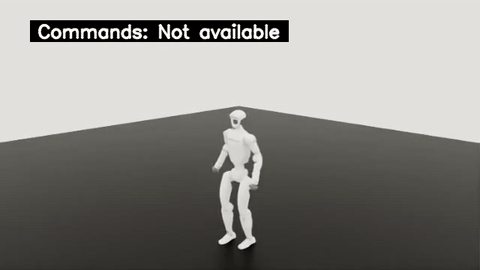
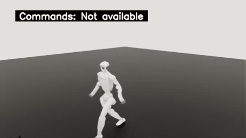
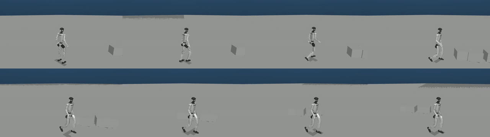

# 2026-10-15 逐步复现与续做记录

从仓库 `63afe74b` 的 [note.md](../../../note.md) 与 [usage.md](../../../usage.md) 开始核对。所有时间按北京时间说明，原 JSON 保留 UTC。此页随本次实际执行更新；执行完成、首次参考片段完成、越障成功分别统计。

## 已确认的进展

| 检查 | 本次实际结果 | 原始证据 |
| --- | --- | --- |
| 七组公开资产 | 682 文件、862,921,430 B，全部 SHA 正确 | [本次原始报告](local-checks/summary.json) |
| 训练数据清单 | 296 对、181,236 帧、50 FPS | [本次原始报告](local-checks/summary.json) |
| 正式训练日程 | 16 个 manifest 均 passed/returncode 0；五教师各 20,000、纯学生 10,000、混合学生 30,000 轮 | [实际只读云端观察](cloud/official16-and-original-rejection.json)、[SSH 实际退出](cloud/observation-execution.json) |
| 混合学生最终训练曲线 | 58 tag × 30,000 步，1,740,000 条有限标量，完整事件 CRC/EOF；已绘图和无损归档 | [完整曲线包](../official-student-finetune-training-curves/index.md) |
| 七项官方有界评估 | 233 原件、191 原视频、119 标量，独立 CPU 校验/完整解码通过 | [七项评估包](../official-evaluations-seven/index.md) |
| 最终学生回传与 CPU 准备 | 32/32 文件回传；纯/混合学生共 60 项 ORT 通过，默认关节姿态误差均为 0；原 prepare 父进程及两只 CPU 容器均退出 0 | [原件与四个 ONNX 无损恢复包](student-transfer-cpu-actual-02/README.md) |
| 首次学生原生 58 批次 | 14:05:42 开始，完成 41 例后在第四阶段前被 GPU 空闲门卫拒绝；真实 parent/控制退出 1 | [真实启动](native58-actual-start-01/root-review.json)、[失败与 41 原片原件](native58-preserved-failed41-01/README.md) |
| 新独立批次 CPU 准备 | 原 prepare 再次实际退出 0，60 ORT／默认姿态／5241 冻结文件核验通过；42 原件模拟 Git 权限恢复通过 | [新 CPU 原件与主审](native58-resource-wait-cpu-prepare-02/README.md)、[真实恢复](native58-resource-wait-cpu-gitmode-restore-02/execution.json) |
| 新独立完整 58 批次 | 15:41:23 完整结束，58 例、116 worker/宿主映射；独立 CPU 后验、1611 原件恢复及全部视频的浏览器拖动/播放通过 | [全部58原片与逐例结果](../final-student-native58-resource-wait-04/playback.html)、[发布、恢复和浏览器实际收据](native58-resource-wait-publication-receipts-05/README.md) |
| 正式两学生各629配置 | 两套 CPU 计划、60 ORT及独立合同审查通过，16:09:47启动1258次物理测试；终态尚未产生 | [CPU合同与独立验收](formal629-cpu-contract-actual-02/README.md)、[85/206源码与CPU控制包](../final-student-reference629-resource-wait-preparation/README.md) |
| 完成片段的实际可视化 | locomotion 最终教师的一次平地首次尝试，490 源帧、488 策略步、0 failed/timeout，到达原生边界；三原片完整解码、HTTP 实播/拖动与 31 原件恢复通过 | [原视频和轨迹包](source888-first-boundary-preview/README.md)、[主审恢复与观察](root-publication-reviews-01/source888-first-boundary-preview/review.json) |
| 低台阶完成片段 | 最终 low-step 教师，505 源帧、503 连续策略步，0 failed/timeout，到达原生边界；三原片共 506 视频帧完整解码，GIF/HTTP/浏览器及 31 原件恢复通过 | [原视频与轨迹](source888-first-lowstep-boundary-preview/README.md)、[主审恢复与观察](lowstep-publication-root-review-01/review.json) |
| 新视频预览 | 8 个真实仿真 GIF，另链接 17 种参考运动；25 段原视频实际浏览器播放/seek 通过 | [集中播放页](../../reproduction-20261015/media/playback.html)、[来源与真实指标](../../reproduction-20261015/media/manifest.json) |

混合学生训练在 10 月 15 日 05:55:58 完成，最终 PT 的 SHA-256 为 `276f9e7f44a674ba42f651867b9aab242cf0fb28b1ee1b4acc2cb9f09472549f`；其独立导出阶段于 06:04:38 完成。16 阶段成功记录不等于七个最终 PT 的完整 CPU 后验或物理技能成功。

本次还在空输出目录重新执行完整动作匹配：17/17场景、629/629配置、28/28独立traversal技能通过，seed42、jobs4，实际父进程退出0；[新矩阵](local-checks/motion-rerun/generated/matrix.json)和[原执行收据](local-checks/motion-rerun/execution.json)保留全部字段和输入/输出SHA。全部629配置的motion NPZ每个字段及terrain NPY都与保留结果逐数组完全相等；[独立数值对照](local-checks/motion-rerun/array-comparison.json)没有修改历史golden。17类参考视频已由新数组用CPU OSMesa真实重录并完整解码发布：共4,194个视频帧，渲染及发布父进程均返回0。[本次新参考播放页](../../reproduction-20261015/reference-rerun/playback.html)与[来源/采样SHA](../../reproduction-20261015/reference-rerun/manifest.json)保存完整17组MP4/GIF/PNG。只读Mesa cache无法创建的提示原样保留；缓存关闭后全部视频实际生成。

混合学生原曲线包的[独立公开重放与完整无损恢复](../official-student-finetune-training-curves-replay/index.md)也已完成：58个tag的全部1,740,000行及coverage、原生终态和事件元数据逐项相等。最大出版文件25MB，原117MB事件、417MB标量JSON和53MB SVG均完整保存。

## 浏览器视频播放的实际修复

默认 `http.server` 的三次真实HTTP检查显示：文件虽返回200并可加载，部分MP4没有可seek区间，不能可靠拖动。新增[标准库Range媒体服务器](../../../scripts/research/serve_evidence.py)，29项真实HTTP测试通过。使用现有Chrome复查新入口后，49段视频（25项集中媒体、7项正式Isaac、17项本次重录参考）的metadata、中点seek和实际播放均通过；18张GIF及2张训练曲线PNG正常HTTP解码，184次请求含83次206，浏览器自然退出0。[完整HTTP收据与三次原失败](http-playback-summary.json)。

```bash
python3 scripts/research/serve_evidence.py
# http://127.0.0.1:8088/usage_assets/reproduction-20261015/media/playback.html
```

## 修复并继续的事项

原逐源 monitor 在 06:07:17 拒绝启动，因为 Docker 返回小写 `no such object`，旧代码只识别大写 `No such`。这次修复精确匹配目标容器的不存在诊断，socket、权限及其他名称错误仍拒绝。修复与恢复控制的 171 项 CPU 检查通过。补齐Range服务器后，通过同一三环境完整CPU入口再次复跑：根目录/训练863通过、键盘23通过、motion217通过及12项原历史raw-hash失败。完整命令因这12项保留退出1，[最终集成原件](local-checks/final-integrated-cpu/results.json)记录实际三个解释器、退出码与JUnit，不与先前834/29计数相加。

[恢复入口](../../../scripts/research/recover_posttrain_monitor.py)仅替换原 `02bc` host monitor 的容器检查，并持原两把锁重新核对 selection、原源码和最终模型。真实 dry-run 返回 0；后台 supervisor 启动PID为3400720。原拒绝状态、selection和lock已按原字节归档，CPU/GPU科学runner保持原冻结字节。CPU后验随后实际通过，见下方收据；888次首次尝试和最终状态仍待真实终态。

本地旧交接程序在今天凌晨被停止，当时没有 fetch、prepare 或 native run。本次通过原 SHA 固定 parent 启动了全新执行目录，parent PID362656、wrapper PID362657；[启动时原始记录](student-delivery-start/source-copy-map.json)保留首次 waiting 状态。云端 CPU-ready 后实际成功回传 32 个文件；随后等待器因 `Host boot differs from actual recovery` 退出 1，没有执行 native run。旧 boot/PID 与退出记录保留，不能把重启后消失的容器写成当前正常退出。

接着直接调用未修改的原 prepare，真实父进程退出 0，两只无 GPU、无网络 CPU 容器也均退出 0；两个最终学生共 60 项 ORT 通过，29 关节默认姿态最大误差均为 0。主审逐项核验全部 5241 个冻结文件及同一回传模型。[回传、失败等待器、CPU 原件及四个 ONNX 恢复入口](student-transfer-cpu-actual-02/README.md)均已公开；包核验兼容 Git 克隆后的权限。 初版v1原件保留为历史版本，其完整普通权限检查不兼容Git克隆；实际使用链接的v2和独立Git权限恢复收据。首次原生批次在完成 41 例后被资源门卫拦住，失败与新独立批次分别记录；后续新完整58及独立CPU后验已通过，见下方真实终态。

13:56:57，北京时间，云端CPU-ready实际生成：七个最终PT及三套296源计划通过，CPU原容器于13:56:58自然退出0，无OOM/错误。固定GPU原生容器于13:58:11启动；[实际原件与主审](cloud/cpu-ready-gpu-start-actual-01/root-review.json)保存CPU-ready SHA、原CID和新GPU启动身份。这仍是CPU验收与GPU启动记录，尚未证明888次原生尝试完成。

新的跨 boot 只读门卫实际返回 waiting（退出 2）：原互斥锁、当前 boot、Unix socket、Docker daemon 和操作账号均核对通过，本地 GPU 正被其他任务使用。北京时间 13:40:12 的真实新 parent 启动记录为 e238 parent PID729992 → 新控制 wrapper PID729993；此时未创建原 native receipt，也未开始任何原生例次。[新宿主控制源码、24 项普通 CPU 检查及实际只读原件](../native58-crossboot-control-preparation/README.md)已独立封存；模拟 Git 权限后，全部 101 个原件的字节、SHA、完整权限和文件集合均[实际恢复通过](native58-crossboot-source-git-restore-01/execution.json)。源码准备和 waiting 不作为原生结果；原科学源码、模型、计划及历史失败记录保持原字节。

北京时间 14:05:42，GPU 空闲窗口实际出现，同一 wrapper 在原互斥锁内通过完整门卫并启动原 native58。五个历史 CID 均以当前 Unix API 的真实 typed404 与历史停止事实分别记录；原 root143 和八个历史观察缺口仍保留。[启动快照](native58-actual-start-01/root-review.json)含原控制/启动 JSON 和 fresh Docker inspect，当时已经进入纯学生场景阶段。

14:20:22，首次批次在完成纯学生 12 方向＋17 场景及混合学生 12 方向后失败，共 41 例、82 个正常 worker/宿主映射及 41 原片完整 CPU 解码；最后 17 场景尚未启动。错误为 `Selected GPU has existing compute; never stop other work`，原门卫没有保存拦截瞬间的 PID 查询，不能确定是外部任务或上一阶段的短暂残留。原 parent、wrapper 与外层监督退出 1 保留；三个承载 sleep 的 GPU 容器经原 cleanup 停止为 143，科学 driver/observer/CPU finalizer 的 0 单独记录。[完整失败原件及 41 视频](native58-preserved-failed41-01/README.md)已封存，909 个原件模拟 Git 权限后[实际恢复通过](native58-failed41-gitmode-restore-01/execution.json)。

随后在全新路径由未修改的原 prepare 完成[新批次 CPU 准备](native58-resource-wait-cpu-prepare-02/README.md)，仍使用同一回传的四模型，60 ORT、姿态误差 0 和 5241 冻结文件通过。新宿主控制将对精确的 busy 状态等待并保存真实查询；物理时序、worker timeout、原 12 小时总 wall bound 以及原科学源码不变。旧批次不续写，不把 41 例改记为完整 58。

新控制的实际只读门卫曾在尚未启动仿真时退出 1：对已停止容器重复 inspect，末次完整比较拒绝。该版本按原顺序比较 Mounts 列表，存在顺序变化造成误拒的缺口；旧入口没有独立保存失败瞬间的 API 响应，因此不补造其原始差异。[控制02与真实 gate1](native58-resource-wait-control02-preserved-01/README.md)保持原字节，全部158原件[模拟 Git 权限恢复通过](native58-resource-wait-control02-gitmode-restore-01/execution.json)。修订只规范完整 Mounts 行顺序，任何挂载内容或其他容器字段差异仍应拒绝，并增加逐次只读诊断原件。新的科学批次不会复用首次失败的 41 例。

15:20:07，修订后的实际只读 gate 退出 0，当前 boot、互斥锁、账号、socket/daemon、GPU 空闲和旧失败批次释放通过。15:20:31，原 e238 parent PID1096507 → 控制 wrapper PID1096508 启动新的完整 58 例。原科学代码、同四模型和新 CPU 计划保持原字节；每次 GPU 空闲检查只对精确 busy 状态有限等待，实际等待计入原 12 小时总 wall 上限。[控制04与实际原件](../native58-resource-wait-control-preparation-04/README.md)已封存，全部401个源码/CPU控制/实际门卫/不可变启动原件[模拟 Git 权限恢复通过](native58-resource-wait-control04-gitmode-restore-01/execution.json)。运行中 stdout、未来退出和完整 58 终态不属于该启动快照。 五次主审恢复任务的原e238底层stdout/stderr与出生/退出JSON另存[完整原日志补充](root-restore-rawlog-supplement-01/README.md)，不改旧旁包、不增加执行次数。

15:41:23，新独立批次完整结束：58 例、116 个正常 worker/宿主映射及 58 原片完整解码通过，原 parent、控制 wrapper 与外层实际退出 0，全部冻结源码保持原字节。随后[独立只读 CPU 后验](native58-resource-wait-independent-review-04/README.md)又完整解码全部 58 原片，共 38,285 视频帧；原四模型、60 ORT、默认姿态、映射、九次资源检查及 API/查询原件全部通过。严格 CPU 容器只有整仓一个 RO 挂载，无 GPU、无网络；验收和父进程均退出 0。该后验包的 170 原件[模拟 Git 权限恢复](native58-resource-wait-independent-review-gitmode-restore-04/execution.json)也通过。

[完整58原片画廊](../final-student-native58-resource-wait-04/playback.html)已出版，1611原件恢复后的文件集合、字节、SHA及完整权限均一致。实际Chrome逐段加载、拖动及播放58个视频，验证58个独立Range视频路径和116张图；浏览器自然退出0后才删除profile，HTTP服务正常结束，发布输入未变。[实际发布/恢复/浏览器旁包](native58-resource-wait-publication-receipts-05/README.md)另含23个可无损恢复原件。纯学生29例中24例触发高度/倾斜阈值，混合学生29例中7例触发；其余5/22例仅未触发该阈值，不作为技能或课程成功数。

[发布包主审与另一独立复核](native58-publication-root-review-05/README.md)也通过，核对全部发布seal、1611+23个已恢复原件、五份真实父等待和浏览器原件。主审初版对整数计数字段误用len而真实退出1，源码与TypeError原日志保留；新版本只修正该断言和新输出路径，真实退出0，科学和媒体原件没有变化。

两学生各629配置的[CPU准备和合同](formal629-cpu-contract-actual-02/README.md)随后也已实际退出0：每模型17场景、629配置、342,651参考帧和30 ORT，默认姿态误差为0；两只CPU容器均自然退出0。主审与独立只读验收核对全部5317个冻结文件、双629计划和真实CPU收据通过。独立审查初版把可选inference字段误作必有字段，真实失败1及原源码保留；修订仅按原probe契约检查字段，没有重跑或改动科学结果。16:09:47，原e238 parent PID1358837 → 原adapter PID1358838实际启动1258次物理测试；运行中，不提前记为完整结果。

该CPU合同包的85个原件（含两套完整629计划）已[模拟Git权限实际恢复](formal629-cpu-contract-final-git-restore-02/README.md)，精确文件集合、字节、SHA与完整权限一致；原e238父进程及外层真实等待0，完整出生/退出JSON和stdout/stderr原日志均保存。

当前正式629使用的[85文件准备与206文件发布源码](../final-student-reference629-resource-wait-preparation/README.md)也已独立封存；其861个原件在Git普通权限归一化后[实际完整恢复](../final-student-reference629-resource-wait-source-restore/README.md)，文件集合、字节、SHA及目标完整权限一致。该包保留18+10+16项普通CPU协议与真实帮助/状态收据，只证明源码和控制协议，不宣称未来1258例完成。

后续两学生各 629 配置的新[宿主版本源码与恢复入口](../final-student-reference629-crossboot-preparation/README.md)也已封存；新准备的 48 文件和发布工具的 106 文件均经过独立审查，模拟 Git 权限后全部 268 个原件[实际恢复通过](../final-student-reference629-crossboot-source-restore/execution.json)。原仿真与科学验收逻辑不变；源码准备不表示未来 1258 例或合同验收已经完成。

## 结果解释

没有经过核验的障碍课程成功率。公开 ONNX 的全 629 逐帧批次中，321 例触发高度/倾斜阈值，308 例未触发；后者包含绕行障碍的实际画面。新播放页同时展示未触发、倾斜后继续、跌倒、正式学生 Isaac 和运动学参考，不把“正常退出”或“未跌倒”改写成“成功越障”。

本次新58批次的[三段最终学生预览](../../reproduction-20261015/native58-resource-wait-media-05/playback.html)按真实画面命名：纯学生前进后跌倒，混合学生持续行走，以及梁端附近跳起落地后继续跑动。主审还查看了低台阶及两种攀爬的原片接触图，存在绕行或停在障碍前的行为；低梁片段不认定为正面跨整梁或整条路线通过。三GIF均为64帧、480×270、8 FPS，完整CPU解码和实际HTTP/Chrome检查通过，[来源和原始媒体收据](../../reproduction-20261015/native58-resource-wait-media-05/README.md)保持可复核。

[](../final-student-native58-resource-wait-04/playback.html)

[](../final-student-native58-resource-wait-04/playback.html)

[](../final-student-native58-resource-wait-04/playback.html)

本次已实际查看一个完整平地源片段：正式 locomotion 教师先站立，随后前进和转向，最后停稳；488 个连续策略步到达原生片段边界。原视频无障碍，不扩大为越障成功；完整队列比例待 888 例终态后统计。下图是最长原片 1.76–9.76 秒的 8 FPS 预览，点击可查看全部三段原片和证据。

[](source888-first-boundary-preview/playback.html)

最终 low-step 教师也有一个已完整执行的源片段：505 源帧中 503 个连续策略步到达边界，failed/timeout 均为 0。主审实际查看全程、3–7 秒的 16 帧图和派生 GIF：可见抬腿经过黑色台阶、继续行走后停稳；跟随视角与遮挡限制接触判断，不宣称完整课程成功。[原轨迹、三原片和媒体检查](source888-first-lowstep-boundary-preview/README.md)、[主审恢复](lowstep-publication-root-review-01/review.json)与[最终 Git 权限恢复](source888-first-lowstep-boundary-final-git-restore/execution.json)分别保留。以下 GIF 取最长原片的 2.06–10.06 秒。

[](source888-first-lowstep-boundary-preview/playback.html)

主审也实际查看了低台阶、高攀爬和平地转向三段预览的八帧图：两段障碍视频均从障碍旁经过，平地片段可见持续跑动及转向。[逐段观察与实际 CPU 收据](local-checks/root-visual-inspection-02/visual-review.json)保留来源 SHA；首次接触图脚本误写文件名的失败也原样保留。下面是低台阶预览的抽样画面，从左到右、从上到下阅读；完整原片仍在播放页。



动作匹配测试本次为 217 passed、12 failed。12 项仍是缺失历史环境/原始数组的 raw-hash 比较；未刷新 golden、跳过测试或掩盖退出码。实体 G1/D435i 的采集、标定与真机验收仍无对应硬件证据。
