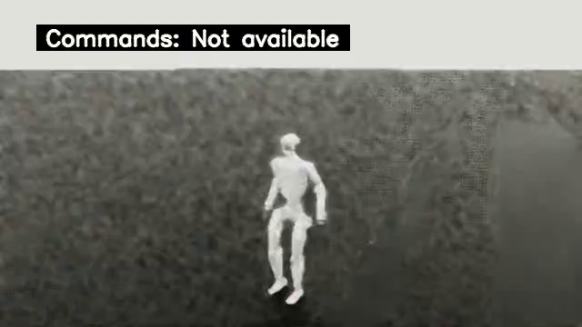

# 统一容器环境验收记录

本记录对应首次完成实际功能验收的镜像 `sha256:4a0aa12db11137e88db530fe871229d5bfe146e14db254f326f64c69b947cab2`，大小 23,871,450,353 字节。之后增加的完整依赖约束已通过 resolver 验证，尚待最终统一重建；不能把本记录中的 image ID 当成最终重建的 ID。基础镜像固定为 NVIDIA Isaac Lab 2.3.0 的 amd64 digest，见 [镜像记录](runtime-image-initial.json)。

## 实际版本与路径

| 运行入口 | Python | 数值与推理组件 | 已验收内容 |
| --- | --- | --- | --- |
| `train-python` | NVIDIA 3.11.13 | Torch 2.7.0+cu128、CUDA 12.8、NumPy 1.26.4、MuJoCo 3.8.1 | CUDA、Holosoma、WBT、Unitree SDK、实际 Isaac 教师训练与 checkpoint 评估 |
| `motion-python` | 3.12.3 独立 venv | NumPy 2.2.6、SciPy 1.15.3、MuJoCo 3.8.1、Tk 8.6 | 动作包/Tk 导入、`pip check`；功能与数值回归结果由动作匹配报告说明 |
| `inference-python` | 3.12.3 独立 venv | NumPy 2.3.5、Pinocchio 4.1.0、ONNXRuntime 1.31.0 | 原生 DepthDistillationPolicy 与 Unitree SDK 导入、CPU ONNX provider、`pip check` |

Isaac Lab 产品 release 是 2.3.0，而 `isaaclab` Python distribution metadata 是 0.47.1。Isaac Sim 的实际构建字符串为 `5.1.0-rc.19+release.26219.9c81211b.gl`。这些都是上游镜像内的实际值，[doctor 原始报告](runtime-initial.json) 同时保留了它们。基础镜像还继承了 `version=2.1.1` 与表示 Ubuntu 的 `org.opencontainers.image.version=24.04` labels；判断 Isaac 组件版本应使用其产品 VERSION 文件及实际运行报告，不能仅看这些通用 labels。

仓库 `/workspace/php_parkour`、产物 `/outputs`、资产 `/data/assets`、缓存 `/data/cache` 在本地与云端一致。三个入口位于同一个 Docker 镜像；motion/inference 隔离 NumPy 2 与训练依赖，未在宿主或服务器安装项目 Python 包。仿真与推理通过同一容器的私有 `/dev/shm` 通信。本地使用 NVIDIA CDI `nvidia.com/gpu=0`，云端使用经空闲检查的 GPU UUID；容器内统一编号 `cuda:0`。

## 构建及配置问题与修复

| 实际问题 | 修复 | 验证 |
| --- | --- | --- |
| 官方 Isaac Python 3.11 没有 `_tkinter` 扩展 | 在同一镜像内安装容器系统 Python/Tk，为 motion 和 inference 建独立 venv | Tk 8.6 导入通过；GUI 功能另有有界验收 |
| `evdev` 和 `netifaces` 构建报 `Python.h: No such file or directory` | Docker apt 层增加 `python3-dev` | 后续构建成功，SDK/pynput 及相关模块正常导入 |
| 初始已有 Dockerfile 专用 ignore，但根目录没有 `.dockerignore`；两种构建入口的排除规则需要统一 | 补充根 ignore，与专用 ignore 保持一致，并扩展凭据/密钥过滤；重启构建使用独立日志 | 专用 ignore 原本已经排除 Git 元数据和产物；最终无挂载镜像源码边界检查通过，见 [独立检查](runtime-image-boundary.json) |
| 中止的后台构建仍向共用日志追加退出栈 | 每次构建使用 UTC 时间/PID 独立日志，`build.log` 仅作为最新尝试的软链接 | 首次成功日志为 `build-20261010T021735Z-3994990.log` |
| motion 子进程调用裸 `python` 时可能继承 train 的 PATH | 运行 wrapper 将对应 runtime 的 bin 置于 PATH 首位 | 原生 setup/launch wrapper 测试 11 项通过 |
| `XDG_CACHE_HOME=/data/cache` 导致 pip 绕过 BuildKit 的缓存挂载 | Dockerfile 显式指定 `PIP_CACHE_DIR=/root/.cache/pip` | 修复已写入待重建配置；首次镜像的 pip check 日志仍含旧缓存权限警告 |
| inference 的 ONNXRuntime 等传递依赖未锁定，未来重建可能漂移 | 从已验收镜像 freeze 锁定 motion/inference 全量，训练仅锁相对固定 base 的新增/变更，同时固定构建后端 | motion 82 项、inference 66 项从空环境解析后与约束逐项相等；训练 117 项增量 dry-run 无运行依赖变更 |

依赖约束为 [Docker 目录](../../docker/) 中的 `constraints.motion.txt`、`constraints.inference.txt`、`constraints.train-added.txt` 和 `constraints.build.txt`。验证结果见 [锁定报告](runtime-lock-validation.json)；完整原始 freeze 见 [train](runtime-freeze-train.txt)、[motion](runtime-freeze-motion.txt)、[inference](runtime-freeze-inference.txt)。固定基础镜像负责训练底座，增量约束不试图替换整个 NVIDIA Python 栈。

## pip metadata 的实际限制

motion 和 inference 的 `pip check` 均通过。训练环境仍有三条已知上游元数据问题：`nvidia-srl-usd` 与 `nvidia-srl-usd-to-urdf` 要求名为 `usd-core` 的 distribution，而 Isaac 的 `omni.usd.libs` 扩展已经包含 pxr/USD，并由 Kit 启动流程加载；`dex-retargeting` 要求 `lxml>=5.2.2`，但 NVIDIA SRL 要求 `lxml<5`。当前镜像保留符合 SRL 的 lxml 4.9.4。单独执行尚未启动 Kit 的 `train-python -c 'from pxr import Usd'` 不会自动加载 USD 扩展，不能把它当作 Isaac USD 运行时缺失的判断依据。

未经扩展的官方 base 原有六条检查问题，本镜像补入 quadprog、docstring-parser、PyJWT，并调整 lxml 后剩上述三条。没有伪造 metadata，也没有为了通过检查另外覆盖 Isaac 的 USD 库。实际训练/评估成功与 `pip check` 的状态分别报告，见 [原始检查输出](runtime-pip-check.txt)。训练 Python 偶有内置 Requests 与已安装 chardet 的兼容性警告；首次本地训练、加载与录像均未因此失败。

## 本地实际 Isaac smoke

在 16 GiB RTX 4070 Ti SUPER 上运行原生教师管线，显式使用 16 environments、2 iterations、4 mini-batches、seed 42，并从本地官方 locomotion registry 加载数据。

```bash
docker exec php-parkour-research bash scripts/research/train_pipeline.sh \
  teachers --profile smoke --skills locomotion --num-envs 16 --output /outputs/local-isaac
docker exec php-parkour-research bash scripts/research/train_pipeline.sh \
  eval-teachers --profile smoke --skills locomotion --output /outputs/local-isaac --eval-steps 100
```

训练返回 0，累计 768 timesteps，耗时 23.376 秒，保存 `model_00001.pt`，SHA-256 为 `c013d58ca8f88164eed3b0b6ee3b90ec43e8b935b7e50a6afe654773e1fb23ac`。随后评估真实加载该 checkpoint 并返回 0；首次 RTX 初始化后完成 100 步评估与原生录像，总耗时 178.809 秒。分别见 [训练 manifest](runtime-local-teacher-smoke.json)、[评估 manifest](runtime-local-eval-smoke.json)。

原生渲染输出 6 段 640×360、50 FPS 的 H.264 MP4；策略仅训练两轮，频繁提前终止，最长一段 0.70 秒。录像仅证明实际加载、物理步进和渲染路径执行，不证明技能收敛。[视频元数据与哈希](runtime-local-video.json) 保留全部六段记录；[示例视频](../videos/runtime-isaac-smoke.mp4) 与下图取自同一次评估。



## 镜像与传输校验

镜像源码边界在无宿主仓库挂载的独立容器中检查，排除 Git、环境文件和密钥路径，并确认下载产物未包含在源码层。云端传输核对完整归档 SHA-256，加载后核对 Docker `Config` 和 `RootFS` 层 digest 的组合指纹。该内容指纹允许 Docker 不同 image store 的 manifest ID 表现不同，而仍验证实际配置和层内容相同。

独立 cloud review 测试覆盖远端归档损坏、错误加载层、已有容器保留、传输后重新选择 GPU UUID、私有 IPC、敏感文件过滤，以及 IMAGE tag 在 inspect 后被并发构建替换的情况。export 使用初始不可变 ID 对应的 transfer tag，远端只给内容验证通过的加载 ID 重 tag；部署也使用经验证的 remote ID。[原生 wrapper 与 cloud 测试](runtime-tests.txt) 分别为 11 和 9 项通过。

最终重建后需要重新生成镜像 ID/内容指纹、doctor、pip check 和源码边界报告，并确认两端加载同一新镜像。现有功能测试使用本记录开头明确标识的首次镜像及挂载源码，依赖锁的 resolver 验证不能替代最终新镜像构建验证。

后续同一镜像在云端完成的 22 项 smoke、4096 环境的 20 轮性能 pilot，以及离线 TensorBoard 原始曲线，另见 [云端训练验收记录](training-cloud-summary.md)。
