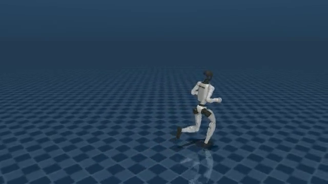

# SDK0.1.8 canonical镜像：原12命令真实闭环复验

真实执行并独立后验通过：12项各8秒仿真时间、400个策略tick；24个worker exact exit0且身份连续的进程组为空；24份精确host command_writer线程birth/NSPID映射；12段原始MP4全部完整解码。宿主受控运行248.185秒，native driver 247.346秒。GPU容器已正常停止，独立复核使用无GPU的runc/network-none CPU容器并已停止。

固定镜像 `sha256:2be18521015b2a84ef7a4442af9a94ef041a19feb9ce385ae15424b1dc158d8f`，源码commit `6cb2ae2492ef7bf66da7c5a72da87d6f60f0636f`，released模型与旧12命令相同。0–11顺序、原命令label、seed42、平地独立重置、8秒、settle3秒、startup180秒、ORT1全部保持；每例actual run.json 的wall_timeout均为373秒，没有120秒override。新增faulthandler及schema3/worker-schema2退出取证；默认record_policy/course_guide均False。

[独立逐项后验报告](independent/report.json)与[实际host收据](raw/host/launch-receipt.json)绑定真实driver0、原始输入、全部3332冻结文件SHA、有限JSON/CSV、SDK两环境0.1.8的实际.so SHA及进程组/线程/录像。源本体未安装任何包。

下表路径长度与转角来自原生轨迹：持续转弯会绕圈，净位移不能代替路径长度。12项存活启发式均为True；这不是越障能力、动作质量或SDK修复因果的证明。

| command | mode | 原命令label | 路径长度m | 转角deg | 原始录像 |
|---|---|---|---:|---:|---|
| 00 | LOW | stand | 0.046 | -0.11 | [原视频](../../sim2sim/sdk018-directions/command-00/video/episode_0_1791624459.mp4) |
| 01 | LOW | forward | 6.751 | +0.54 | [原视频](../../sim2sim/sdk018-directions/command-01/video/episode_0_1791624480.mp4) |
| 02 | LOW | left_45 | 6.088 | +332.48 | [原视频](../../sim2sim/sdk018-directions/command-02/video/episode_0_1791624500.mp4) |
| 03 | LOW | left_90 | 6.723 | +693.95 | [原视频](../../sim2sim/sdk018-directions/command-03/video/episode_0_1791624521.mp4) |
| 04 | LOW | right_45 | 6.197 | -352.58 | [原视频](../../sim2sim/sdk018-directions/command-04/video/episode_0_1791624541.mp4) |
| 05 | LOW | right_90 | 6.155 | -696.46 | [原视频](../../sim2sim/sdk018-directions/command-05/video/episode_0_1791624562.mp4) |
| 06 | HIGH | forward | 16.173 | +22.96 | [原视频](../../sim2sim/sdk018-directions/command-06/video/episode_0_1791624582.mp4) |
| 07 | HIGH | left_45 | 15.556 | +314.79 | [原视频](../../sim2sim/sdk018-directions/command-07/video/episode_0_1791624603.mp4) |
| 08 | HIGH | left_90 | 13.723 | +665.46 | [原视频](../../sim2sim/sdk018-directions/command-08/video/episode_0_1791624623.mp4) |
| 09 | HIGH | right_45 | 16.276 | -254.64 | [原视频](../../sim2sim/sdk018-directions/command-09/video/episode_0_1791624644.mp4) |
| 10 | HIGH | right_90 | 13.071 | -641.68 | [原视频](../../sim2sim/sdk018-directions/command-10/video/episode_0_1791624664.mp4) |
| 11 | LOW | back | 5.290 | -22.91 | [原视频](../../sim2sim/sdk018-directions/command-11/video/episode_0_1791624685.mp4) |

全部原JSON/CSV/log、CPU入口/参数门卫、宿主观察、收据、baseline配置、冻结source manifest与控制器均归档。只排除完整3297源码树、两ONNX大模型、runtime cache和Python字节码；其指纹/固定canonical来源保留。原生12个simulator.log有trailing whitespace，保留原字节并单独记录，不做文本归一化。此目录不替代旧12命令证据。
