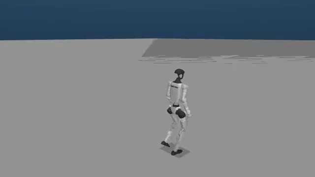
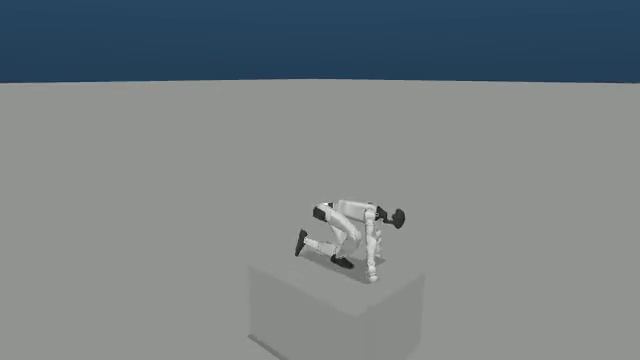

# SDK 0.1.8：五个历史失败配置的隔离原生试跑

本轮实际执行 **3 类场景中的 5 个历史失败配置，每例一次**：原生 MuJoCo 相机/PD、DDS、深度共享内存和 released student ONNX 组成闭环。五例各完成 **500 个策略周期、10 秒仿真时间**，累计 2,500 个周期；5 个父进程及 10 个 worker 均返回 0，10 个 worker 进程组最终均已验证为空，5 段原始 MP4 完整解码通过。

隔离任务总墙钟耗时 **109.479 秒**，容器内 driver 耗时 **108.846 秒**。它使用固定候选镜像 `sha256:caf61487b69ce478980b3bf9df38a7f1fcaaae4b109d971dfbea10b09bf441aa`，训练侧 Kit Python 和 inference 环境的实际 SDK 均为 **0.1.8**；两份原生扩展 SHA 已核对。源码和输入只读、独立 PID/IPC、`--network none`、`--init`、8 GiB SHM，绑定唯一的本地 GPU UUID。

策略输入仍是原先声明的恒定向前命令：低速配置为 1，高速配置为 6。没有参考动作回放或额外越障引导。

| 原始配置身份 | 单例墙钟秒 | 策略周期 | 原生跌倒启发式 | 原视频 |
| --- | ---: | ---: | --- | --- |
| `low_speed_step:0041:right_45_walk1.5s_step0s` | 21.609 | 500 | 未触发阈值 | [MP4](../../sim2sim/sdk018-native-pilot/low_speed_step-0041-744bdf020e7b/episode_0_1791621722.mp4) |
| `low_speed_climb_58:0022:left_90_walk2.0s_plat0s` | 21.771 | 500 | 未触发阈值 | [MP4](../../sim2sim/sdk018-native-pilot/low_speed_climb_58-0022-865815b831c2/episode_0_1791621745.mp4) |
| `low_speed_climb_58:0031:right_45_walk2.0s_plat1.2s` | 21.404 | 500 | 未触发阈值 | [MP4](../../sim2sim/sdk018-native-pilot/low_speed_climb_58-0031-8ce5f91111d1/episode_0_1791621766.mp4) |
| `high_speed_climb_58:0000:run_forward_0.6s_step0.1s` | 21.576 | 500 | 检测到跌倒 | [MP4](../../sim2sim/sdk018-native-pilot/high_speed_climb_58-0000-ab1b00bb0e5b/episode_0_1791621788.mp4) |
| `high_speed_climb_58:0023:run_left_90_1.5s_step1.0s` | 21.605 | 500 | 未触发阈值 | [MP4](../../sim2sim/sdk018-native-pilot/high_speed_climb_58-0023-a4aad2a02ca6/episode_0_1791621809.mp4) |

**执行与退出通过不代表技能成功。** `high_speed_climb_58:0000:run_forward_0.6s_step0.1s` 的 `survival_passed=false`，最低骨盆高度约 0.064 m，最终直立余弦约 0.086；它跌倒后仍按要求记录并正常退出。其它四例只是在这 10 秒内未触发同一启发式阈值，不构成越障完成证据。所有报告仍保留 `quality_verified=false`、`obstacle_course_completion_verified=false`。

以下两张图片是原生录像在中点提取的真实帧，原 PNG 字节保留：

低速台阶配置：

高速攀爬配置 0000：原始指标已记录跌倒，截图本身不代替完整时序指标。

可以在 [独立复核报告](independent-review/report.json) 中逐例查看最终 worker 收据、原生 PID/出生时钟到宿主 `command_writer` TID 的完整 `NSpid`/`NStgid` 映射、视频大小与 SHA、有限轨迹以及跌倒指标。[宿主启动与终态收据](host/launch-receipt.json)、[完整观察器 JSONL](host/observer/snapshots.jsonl)、[原生计划](inputs/native-plan.json)、各例的 `run.json`/日志/CSV/JSON 与所有执行 helper 都按原字节归档。父源码冻结版本为 `sim2sim.py d9f95883…` 和 `sim2sim_scene_matrix.py 5e90c163…`。

原生启动前还做了真实无 GPU 的 CPU 容器预检：[完整 argv 与退出收据](host/cpu-preflight/launch.json)；两个环境导入了 150 / 49 个实际仓库模块，全部归入冻结依赖 SHA。安装元数据中的 `holosoma.bridge`/`unitree` 入口实际解析为 `holosoma.bridge.unitree.unitree_sdk2py_bridge:UnitreeSdk2Bridge`，五份原生仿真配置解析通过。预检不实例化机器人、桥接、策略或仿真，Unitree factory 调用次数为零。

复跑必须创建新输出目录；历史计划和已有输出不能覆盖。归档中的 host 准备器仍保留 `prepare` / `run` 分离、单例 90 秒启动 / 120 秒运行上限、850 秒总 driver 上限、只清理本次新建容器的门卫。完整依赖/机器人资产和 released ONNX pair 不重复复制，所有输入路径、大小与 SHA 在计划中保留；15 份该五例的生成输入与原矩阵已随本归档保存。原始准备失败记录另见 [准备阶段报告](../sdk018-native-setup/summary.md)。

这五例一次性的正常退出不能证明此前 SIGSEGV 的唯一原因，也不能统计排除间歇性竞态，更不替代新的 629 配置全覆盖。上游析构修复与本例取证边界见 [SDK 生命周期调查](../unitree-lifecycle-independent/report.md)。发布清单 [evidence-manifest.json](evidence-manifest.json) 使用仓库根目录相对路径，包含全部原视频；[publication.json](publication.json) 明确列出未重复复制的内容。
